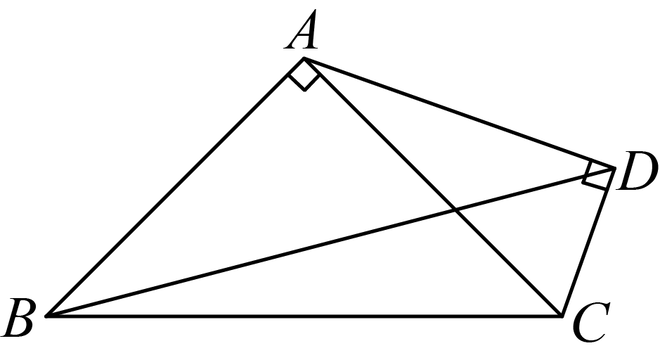

# Mathematics - 题目 61

**ID**: 392cff29d6c64ebb9facbf76d51a4a06
**年级**: Grade 8
**难度**: Medium
**题型**: Fill-in-the-blank

## 题目
在四边形 $ABCD$ 中，连接对角线 $AC$ ， $BD$ ，已知 $AB=AC$ ， $\angle BAC=\angle ADC=90{^{\circ }}$ ，若 $BD=10$ ， $AD=6$ ，则 $AB$ 的长是．​​​​​​​‌

## 解答

1. 解：如图，过B作 $BE\bot AD$ ，交 $DA$ 延长线于点E，则 $\angle E=\angle ADC=90{}\degree $ ，
2. 
3. ∵ $\angle BAC=90{}\degree $ ，
4. ∴ $\angle BAE=\angle ACD=90{}\degree -\angle CAD$ ，
5. 在 ${\rm{R}}{\rm{t}}△ABE$ 和 ${\rm{R}}{\rm{t}}\mathrm{△}CAD$ 中，
6. $\begin{cases}\angle E=\angle ADC\\\angle BAE=\angle ACD\\AB=AC\end{cases}$ ，
7. ∴ $\vartriangle ABE≌\vartriangle CAD\left ({{\rm{A}}{\rm{A}}{\rm{S}}}\right )$ ，
8. ∴ $BE=AD=6，AE=CD$ ，
9. ∵ $BD=10$ ，
10. ∴在 ${\rm{R}}{\rm{t}}BDE$ 中， $DE=\sqrt {BD{^{2}}-BE{^{2}}}=8$ ，
11. ∴ $AE=DE-AD=2$ ，
12. 在Rt△ABE中， $AB=\sqrt {AE{^{2}}+BE{^{2}}}=2\sqrt {10}$ .

## 知识点

**中文**:
  - 全等三角形的判定与性质
  - 勾股定理

**English**:
  - Determination and Properties
  - Pythagorean Theorem

---
