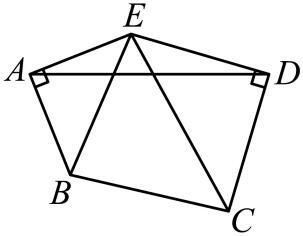

# Mathematics - 题目 2854

**ID**: 4e3fba48d49a4357848b36367695a763
**年级**: Grade 8
**难度**: Medium
**题型**: Fill-in-the-blank

## 题目
如图，在等腰 ${\rm{R}}{\rm{t}}\mathrm{△}EAB$ 和等腰 ${\rm{R}}{\rm{t}}\vartriangle EDC$ 中， $\angle EAB=\angle EDC=90{}^\circ $ ， $AB=AE$ ， $DC=DE$ ， $AE<ED$ ．若 $AD=3$ ，则五边形 $ABCDE$ 的面积是．​​​​​​​‌

## 解答

1. 解：如图所示，
2. 
3. ∵ $△EAB,△EDC$ 是等腰直角三角形， $AB=AE$ ， $DC=DE$ ， $AE<ED$ ，
4. ∴ 设 $AB=AE=a$ ， $DE=DC=b$ ，
5. ∵ $\angle EAB=\angle EDC=90{}^\circ $ ，
6. ∴将 $\mathrm{△}AED$ 绕点 $A$ 顺时针旋转 $90{}^\circ $ ， $AE$ 与 $AB$ 重合，点 $D$ 的对应点为 $F$ ，将 $\vartriangle ADE$ 绕点 $D$ 逆时针旋转 $90{}^\circ $ ， $DE$ 与 $DC$ 重合，点 $A$ 的对应点为点 $G$ ，连接 $FG$ ，
7. ∴ $AD=AF=DG=3$ ， $AD\bot AF$ ， $AD\bot DG$ ，
8. ∴四边形 $ADGF$ 是正方形，且 $BF=ED=b$ ， $CG=EA=a$ ，
9. ∴四边形 $ABCD$ 的面积等于四边形 $GCBF$ 的面积，
10. ∴ $S{{}_{△AED}}+S{{}_{四边形ABCD}}=S{{}_{△ABF}}+S{{}_{四边形ABCD}}=S{{}_{△DCG}}+S{{}_{四边形GCBF}}$ ，
11. $S{{}_{△ABF}}+S{{}_{四边形ABCD}}+S{{}_{△DCG}}+S{{}_{四边形GCBF}}=S{{}_{正方形AFGD}}$ ，
12. ∴ $S{{}_{△AED}}+S{{}_{四边形ABCD}}=S{{}_{五边形ABCDE}}=\frac {1}{2}S{{}_{正方形AFGD}}=\frac {1}{2}\times 3\times 3=\frac {9}{2}$ ，
13. 故此题答案为： $\frac {9}{2}$ ．

## 知识点

**中文**:
  - 旋转的性质
  - 正方形的判定与性质综合
  - 等腰直角三角形的性质

**English**:
  - Properties of Rotation
  - Determination and Properties of Squares
  - Properties of Isosceles Right Triangles

---
