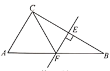

# Mathematics - 题目 3992

**ID**: 63d265ebcab141f6b277e7b757627fe5
**年级**: Grade 8
**难度**: Medium
**题型**: Fill-in-the-blank

## 题目
如图，在 $\vartriangle ABC$ 中， $BC$ 的垂直平分线分别交 $BC$ 、 $AB$ 于点E、F．若 $\mathrm{△}AFC$ 是等边三角形，则 $\angle B=$°．​​​​​​​‌

## 解答

1. 解：∵EF垂直平分BC，
2. ∴BF=CF，
3. ∴∠B=∠BCF，
4. ∵△ACF为等边三角形，
5. ∴∠AFC=60°，
6. ∴∠B=∠BCF=30°.
7. 故答案为：30.

## 知识点

**中文**:
  - 三角形的外角性质
  - 等边三角形的性质
  - 线段垂直平分线的性质

**English**:
  - Exterior Angle Properties
  - Properties of Equilateral Triangles
  - Properties of Perpendicular Bisectors

---
