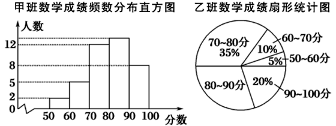

# Mathematics - 题目 3101

**ID**: 6bb2292d42af4bf69aa14a0e540297ca
**年级**: Grade 8
**难度**: Medium
**题型**: Fill-in-the-blank

## 题目
光明中学八年级甲、乙、丙三个班中，每班的学生人数都为40名，某次数学考试的成绩统计如图：(每组分数含最小值，不含最大值)丙班数学成绩频数统计表分数50～6060～7070～8080～9090～100人数1415119根据上图及统计表提供的信息，则80～90分这一组人数最多的班是​​​​​​​‌

## 解答

1. 根据频数分布直方图可知，
2. 甲班80～90分这一组人数大于12人，根据扇形统计图可知，
3. 乙班80～90分这一组人数为40×（1-35%-10%-5%-20%）=12人，
4. 根据频数统计表可知，丙班80～90分这一组人数最多为11人，
5. 所以80～90分这一组人数最多的班是甲班；
6. 故答案为甲

## 知识点

**中文**:
  - 频数分布表

**English**:
  - Frequency Distribution Tables

---
