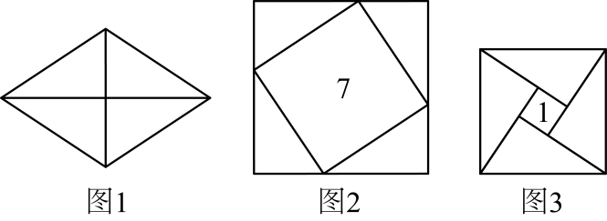

# Mathematics - 题目 2026

**ID**: 79f1bb94cba44dbc92f7c8638d2ec69b
**年级**: Grade 8
**难度**: Medium
**题型**: Fill-in-the-blank

## 题目
把图1中的菱形沿对角线分成四个全等的直角三角形，将这四个直角三角形分别拼成如图2，图3所示的正方形，如果图2和图3每个图形中间的正方形面积分别为7和1，则图1中菱形的面积为．​​​​​​​‌

## 解答

1. 解：设菱形较长对角线长为 $2a$ ，较短对角线长为 $2b$ ，
2. 由图2得 $a{^{2}}+b{^{2}}=7$
3. 由图3得 $a-b=1$ ，即 ${\left({a-b}\right)^{2}}=1$
4. $\therefore a{^{2}}+b{^{2}}-2ab=1$
5. $\therefore 2ab=a{^{2}}+b{^{2}}-1=6$
6. 所以菱形的面积为： $\frac {1}{2}\times 2a\times 2b=2ab=6$

## 知识点

**中文**:
  - 完全平方公式
  - 菱形的判定与性质综合

**English**:
  - Perfect Square Formula
  - Determination and Properties of Rhombuses

---
