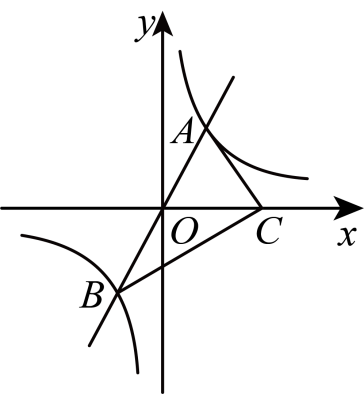

# Mathematics - 题目 600

**ID**: 806e456e827b47bcacaf11ec4d23148c
**年级**: Grade 8
**难度**: Medium
**题型**: Fill-in-the-blank

## 题目
如图，在平面直角坐标系中，反比例函数 $y=\frac {k}{x}\left ({k>0}\right )$ 的图象与一次函数 $y=mx\left ({m>0}\right )$ 的图象交于 $AB$ 两点，点 $C$ 在 $x$ 轴上，若 $AO=AC$ ， $S{{}_{\mathrm{△}ABC}}=10$ ，则 $k$ 的值是．​​​​​​​‌

## 解答

1. 解：如图，过点A作 $AD\bot x$ 于点D，
2. 
3. ∵ $AC=AO$ ，
4. ∴ $CD=DO$ ，
5. ∵函数 $y=mx\left ({m>0}\right )$ 与反比例函数 $y=\frac {k}{x}\left ({k>0}\right )$ 交于A、B两点，
6. ∴A、B关于原点对称，
7. ∴ $OA=OB$ ，
8. ∵ $S{{}_{\mathrm{△}ABC}}=10$ ，
9. ∴ $S{{}_{\vartriangle AOC}}=\frac {1}{2}S{{}_{\vartriangle ABC}}=5$ ，
10. ∴ $S{{}_{\vartriangle AOD}}=\frac {1}{2}S{{}_{\vartriangle AOC}}=\frac {1}{2}\left |{k}\right |=\frac {5}{2}$ ，
11. 又∵ $k>0$ ，
12. ∴ $k=5$ .

## 知识点

**中文**:
  - 反比例函数系数k的几何意义及应用
  - 正比例函数图象和性质
  - 反比例函数综合

**English**:
  - Geometric Meaning and Application of Coefficient k
  - Graphs and Properties of Direct Proportion Functions
  - Comprehensive Inverse Proportionality Problems

---
