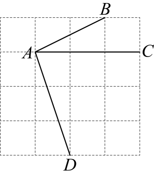

# Mathematics - 题目 3919

**ID**: 84570a0d9dcc472c8485d951e370d6e9
**年级**: Grade 8
**难度**: Medium
**题型**: Fill-in-the-blank

## 题目
如图，点A，B，C，D均在正方形网格格点上，则 $\angle DAC-\angle BAC=$${}\degree $ ．​​​​​​​‌

## 解答

1. 解：如图，作点 $B$ 关于线段 $AC$ 的对称点 $B^{′}$ ，连接 $AB{^{\prime }},DB{^{\prime }}$ ，
2. 
3. 由对称可得 $\angle B^{′}AC=\angle BAC$ ，
4. 即 $\angle DAC-\angle BAC=\angle DAC-\angle B^{′}AC=\angle B^{′}AD$ ，
5. 设小正方形的边长为 1 ，
6. 由勾股定理，得 $AB^{′}{{^{2}}}=DB^{′}{{^{2}}}=1{^{2}}+2{^{2}}=5,AD{^{2}}=1{^{2}}+3{^{2}}=10$ ，
7. $\therefore AB^{′}{{^{2}}}+DB^{′}{{^{2}}}=AD{^{2}}$ ，
8. $\therefore \vartriangle AB^{′}D$ 是等腰直角三角形，
9. ∴ $\angle B^{′}AD=45{}\degree $ ，即 $\angle DAC-\angle BAC=45{}\degree $ ．

## 知识点

**中文**:
  - 勾股定理的逆定理
  - 轴对称的性质

**English**:
  - Converse of Pythagorean Theorem
  - Properties of Axial Symmetry

---
