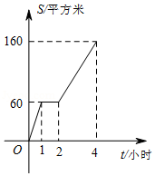

# Mathematics - 题目 3908

**ID**: 960cce1e1ac14501b8be6c4cbb57a6fa
**年级**: Grade 8
**难度**: Medium
**题型**: Fill-in-the-blank

## 题目
园林队在某公司进行绿化，中间休息了一段时间，已知绿化面积S（平方米）与工作时间t（小时）的关系的图象如图所示，则休息后园林队每小时绿化面积为平方米．​​​​​​​‌

## 解答

1. 解：根据图像得：休息后园林队2小时绿化面积为160-60=100平方米，休息后园林队每小时绿化面积为100÷2=50（平方米）．
2. 故答案为50

## 知识点

**中文**:
  - 从函数的图象获取信息
  - 其他问题
  - 函数图象识别

**English**:
  - Extracting Information from Graphs
  - Other Problems
  - Recognizing Function Graphs

---
