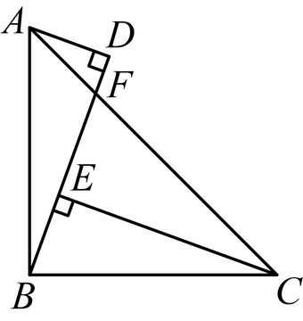

# Mathematics - 题目 1537

**ID**: 9efb3f2b7fca4ee9b044ca9c1071935f
**年级**: Grade 8
**难度**: Medium
**题型**: Fill-in-the-blank

## 题目
如图， $\vartriangle ABC$ 为等腰直角三角形， $AD\bot BD,CE\bot BD$ 于点 $E,AC$ 与 $BD$ 交于点 $F$ ，若 $\angle BAD=70{}\degree $ ，则 $\angle AFB=$${}\degree $ ；​​​​​​​‌若 $BE=2,CE=7$ ，则 $DE=$．

## 解答

1. 解：∵ $\vartriangle ABC$ 为等腰直角三角形，
2. ∴ $\angle ABC=90{}\degree ,AB=BC,\angle ACB=45{}\degree$ ，
3. ∵ $AD\bot BD,CE\bot BD$ ，
4. ∴ $\angle ADB=\angle CEB=90{}\degree$ ，
5. ∴ $\angle ABD=\angle BCE=90{}\degree -\angle CBE$ ，
6. ∴ $\vartriangle ABD≌\vartriangle BCE$ ，
7. ∴ $\angle BAD=\angle CBE=70{}\degree$ ， $BD=CE=7$ ，
8. ∴ $\angle AFB=\angle DBC+\angle BCD=115{}\degree$ ， $DE=BD-BE=5$ .

## 知识点

**中文**:
  - 三角形的外角性质
  - 等腰三角形的性质
  - 全等三角形的判定与性质

**English**:
  - Exterior Angle Properties
  - Properties of Isosceles Triangles
  - Determination and Properties

---
