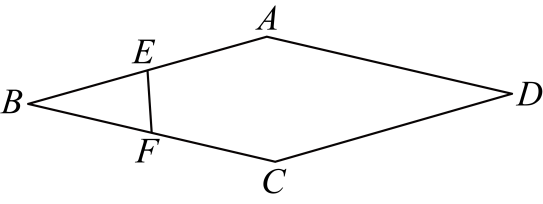

# Mathematics - 题目 1423

**ID**: b5be79743a974ba5979bac3d8a316c83
**年级**: Grade 8
**难度**: Medium
**题型**: Fill-in-the-blank

## 题目
如图，在 $▱ABCD$ 中，点E是AB的中点，点F是BC的中点．若 $△BEF$ 的面积为4，则 $▱ABCD$ 的面积为．​​​​​​​‌

## 解答

1. 连接 $AC$ ， $AF$ ，
2. 
3. $\because $ 点 $E$ 是 $AB$ 的中点，
4. $\therefore $  $S{{}_{\vartriangle BEF}}=S{{}_{\vartriangle AEF}}=\frac {1}{2}S{{}_{\vartriangle ABF}}$ ，
5. $\because $ 点 $F$ 是 $BC$ 的中点，
6. $\therefore $  $S{{}_{\mathrm{△}ABF}}=\frac {1}{2}S{{}_{\mathrm{△}ABC}}$ ，
7. $\therefore $  $S{{}_{\vartriangle BEF}}=\frac {1}{4}S{{}_{\vartriangle ABC}}$ ，
8. 已知 $S{{}_{\mathrm{△}BEF}}=4$ ，那么 $S{{}_{\vartriangle ABC}}=4\times 4=16$ ，
9. 因为四边形 $ABCD$ 是平行四边形，根据平行四边形的性质，平行四边形的对角线将平行四边形分成两个面积相等的三角形，
10. 即 $S{{}_{\mathrm{△}ABC}}=S{{}_{\mathrm{△}ADC}}$ ，
11. 所以平行四边形 $ABCD$ 的面积 $S=2S{{}_{\vartriangle ABC}}$ ，
12. 由 $S{{}_{ΔABC}}=16$ ，可得 $S=2\times 16=32$ ，
13. 综上，平行四边形 $ABCD$ 的面积为32．

## 知识点

**中文**:
  - 平行四边形的性质

**English**:
  - Properties of Parallelograms

---
