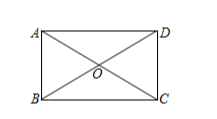

# Mathematics - 题目 295

**ID**: beec021eef014a73a0e8edbc96cf3432
**年级**: Grade 8
**难度**: Medium
**题型**: Fill-in-the-blank

## 题目
如图，矩形 $ABCD$ 的对角线 $AC$ ， $BD$ 相交于点 $O$ ， $AB=2$ ， $\angle BOC=120{^{\circ }}$ ，则 $AC$ 的长是．​​​​​​​‌

## 解答

1. 解：∵∠BOC＝120°，
2. ∴∠AOB＝180°﹣120°＝60°，
3. ∵四边形ABCD是矩形，
4. ∴∠ABC＝90°，AC＝BD，OA＝OC＝ $\frac {1}{2}$AC，OB＝OD＝ $\frac {1}{2}$BD，
5. ∴OA＝OB，
6. ∵∠AOB＝60°，
7. ∴△AOB是等边三角形，
8. ∵AB＝2，
9. ∴OA＝OB＝AB＝2，
10. ∴AC＝2AO＝4
11. 故答案为：4．

## 知识点

**中文**:
  - 矩形的性质
  - 等边三角形的判定与性质

**English**:
  - Properties of Rectangles
  - Determination and Properties

---
