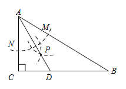

# Mathematics - 题目 1856

**ID**: fbc4f234b44d4976b94a75e9a33ae097
**年级**: Grade 8
**难度**: Medium
**题型**: Fill-in-the-blank

## 题目
如图，在△ABC中，∠C＝90°，∠B＝30°，以A为圆心，任意长为半径画弧分别交AB、AC于点M和N，再分别以M、N为圆心，大于 $\frac {1}{2}$MN的长为半径画弧，两弧交于点P，连接AP并延长交BC于点D，若CD＝1，则BD的长是．​​​​​​​‌

## 解答

1. 解：由题意知：AD是∠BAC的平分线，
2. 过点D作DE⊥AB于点E，如图，则DE=DC=1，
3. 在△BDE中，∵∠BED=90°，∠B=30°，
4. ∴BD=2DE=2，
5. 故此题答案为：2．
6. 

## 知识点

**中文**:
  - 含30度角的直角三角形
  - 角平分线的性质
  - 尺规作图——作角平分线

**English**:
  - Right Triangle with 30° Angle
  - Properties of Angle Bisectors
  - Construction: Angle Bisector

---
