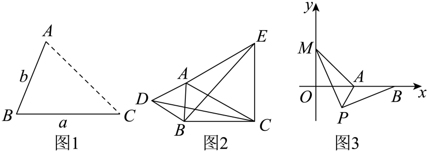

# Mathematics - 题目 771

**ID**: 05ba5e705be84c0f9c04ff5bcdbcb80f
**年级**: Grade 8
**难度**: Medium-Hard
**题型**: Calculation

## 题目
（1）发现：如图1，点A为线段BC外一动点，且BC=a，AB=b，填空：当点A位于_时，线段AC的长取得最大值，且最大值为_（用含a，b的式子表示）（2）应用：点A为线段BC外一动点，且BC=4，AB=1，如图2所示，分别以AB，AC为边，作等边三角形ABD和等边三角形ACE，连接CD，BE．①求证：BE=CD②直接写出线段BE长的最大值．（3）拓展：如图3，在平面直角坐标系中，点A的坐标为（2，0），点B的坐标为（5，0），点P为线段AB外一动点，且PA=3，PM=PB，∠BPM=90°，请直接写出线段AM长的最大值​​​​​​​‌

## 解答

1. 解：（1）∵点A为线段BC外一动点，且BC=a，AB=b，
2. ∴当点A位于CB的延长线上时，线段AC的长取得最大值，且最大值为BC+AB=a+b，
3. 故答案为：CB的延长线上，a+b；
4. （2）①证明：∵ ${\rm △\mathit{ABD}}$ 与 ${\rm △\mathit{ACE}}$ 是等边三角形，
5. ∴AD=AB，AC=AE，∠BAD=∠CAE=60°，
6. ∴ ${\rm ∠\mathit{BAD}+∠\mathit{BAC}=∠\mathit{CAE}+∠\mathit{BAC}}$ ，
7. 即 ${\rm ∠\mathit{CAD}=∠\mathit{EAB}}$ ，
8. 在 ${\rm △\mathit{CAD}}$ 与 ${\rm △\mathit{EAB}}$ 中， $\begin{cases}AD=AB\\\angle CAD=\angle EAB\\AC=AE\end{cases}$ ，
9. ∴ ${\rm △\mathit{CAD}}$ ≌ ${\rm △\mathit{EAB}}$ ，
10. ∴CD=BE；
11. ②∵线段BE长的最大值=线段CD的最大值，
12. 由（1）知，当线段CD的长取得最大值时，点D在CB的延长线上，
13. ∴最大值为BD+BC=AB+BC=5；
14. （3）如图3−1中，连接BM，
15. 
16. ∵将 ${\rm △\mathit{APM}}$ 绕着点P顺时针旋转90°得到 ${\rm △\mathit{PBN}}$ ，连接AN，则 ${\rm △\mathit{APN}}$ 是等腰直角三角形，
17. ∴PN=PA=3，BN=AM，
18. ∵A的坐标为（2，0），点B的坐标为（5，0），
19. ∴OA=2，OB=5，
20. ∴AB=3，
21. ∴线段AM长的最大值=线段BN长的最大值，
22. ∴当N在线段BA的延长线时，线段BN取得最大值，（如图3−2中）
23. 
24. 最大值 ${\rm =\mathit{AB}+\mathit{AN}}$ ，
25. ∵ ${\rm \mathit{AN}=}\sqrt {2}{\rm \mathit{AP}=}$  $3\sqrt {2}$ ，
26. ∴最大值为 $3\sqrt {2}{\rm +3}$ ．

## 知识点

**中文**:
  - 三角形的综合
  - 全等三角形的综合问题

**English**:
  - Comprehensive Triangle Problems
  - Comprehensive Problems

---
