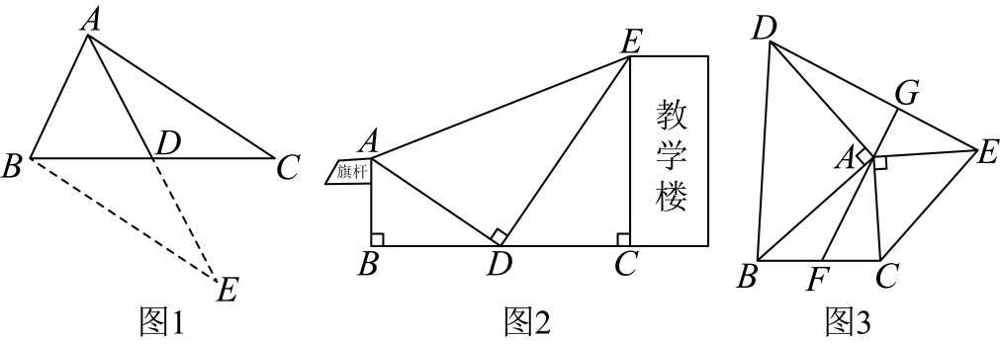

# Mathematics - 题目 1899

**ID**: 082f270b56ca45e18e853758972bc061
**年级**: Grade 8
**难度**: Medium-Hard
**题型**: Calculation

## 题目
【阅读理解】中线是三角形中的重要线段之一．在利用中线解决几何问题时，当条件中出现“中点”、“中线” 等条件时，可以考虑做辅助线，即把中线延长一倍，通过构造全等三角形，把分散的已知条件和所要求  的结论集中到同一个三角形中，从而运用全等三角形的有关知识来解决问题，这种作辅助线的方法称为“倍长中线法”【初步感知】（1）如图1，在 $\vartriangle ABC$ 中 ， $AB=6$ ， $AC=10{\rm ，\mathit{D}}$ 是  $BC$ 的中点，求 $BC$ 边上的中线 $AD$ 的取值范围．小明在组内经过合作交流，得到了如下的解决方法：延长 $AD$ 到 点E，使  $DE=AD$ ，连 接 $BE$ ．可以判定 $\vartriangle ADC≌\vartriangle EDB$ ， 从而得到 $AC=EB=10$ ．这样就能把线段 $AB$ ， $AC$ ， $2AD$  集中在 $\vartriangle ABE$ 中，利用三角形三边的关系，即可求出中线 $AD$ 的取值范围是(请直接写出答案)【实践应用】（2）为了测量学校旗杆 $AB$ 和教学楼 $CE$ 顶端之间的距离，学习小组设计了如图2所示的测量方案，他们首先取地面 $BC$ 的中点D，用测角仪测得此时 $\angle ADE=90{}\degree $ ，测得旗杆高度 $AB=10.​​​​​​​‌8{\rm{m}}$ ，  教学楼高度 $CE=20.2{\rm{m}}$ ，求  $AE$ 的长 ．【拓展探究】( 3 ) 如图 3 ，  $\mathrm{△}ABD$ 和  $△ACE$  均为等腰直角三角形，连接 $DE$ ， $BC$ ，点F是  $BC$ 的中点，连接 $FA$ 并延长，与 $DE$  相交于点G．试探究：  $DE$  和  $AF$ 的数量关系和位置关系并说明理由．

## 解答

1. 解：（1）如图，延长 $AD$ 到点 $E$ ，使 $DE=AD$ ，
2. 
3. ∵ $D$ 是 $BC$ 的中点，
4. $\therefore BD=CD$ ，
5. $\because \angle ADC=\angle EDB$ ，
6. $\therefore \vartriangle ADC≌\vartriangle EDB\left ({{\rm{S}}{\rm{A}}{\rm{S}}}\right )$ ，
7. $\therefore BE=AC=10$ ，
8. 在 $\vartriangle ABE$ 中， $10-6<AE<10+6$ ，
9. $\therefore 4<2AD<16$ ，
10. $\therefore 2<AD<8$ ；
11. （2）如图，延长 $AD,EC$ 交于点 $F$ ，
12. 
13. ∵ $BC$ 的中点为D，
14. ∴ $BD=CD$ ，
15. ∵由题意可得， $\angle B=\angle DCE=90{}\degree =\angle DCF$ ，
16. 而 $\angle ADB=\angle CDF$ ，
17. ∴ $\vartriangle ADB≌\vartriangle FDC$ ，
18. ∴ $AD=DF$ ， $AB=CF=10.8{\rm{m}}$ ，
19. ∵ $CE=20.2{\rm{m}}$ ， $\angle ADE=90{}\degree $ ，
20. ∴ $EF=20.2+10.8=31{\rm{m}}$ ， $DE$ 是 $AF$ 的垂直平分线，
21. ∴ $AE=EF=31{\rm{m}}$ ；
22. （3） $AF\bot DE$ ， $DE=2AF$ ，理由如下：
23. 如图，延长 $AF$ ，使 $AF=FH$ ，连接 $CH$ ，
24. 
25. ∵ $F$ 为 $BC$ 的中点，
26. ∴ $BF=FC$ ，
27. ∵ $\angle AFB=\angle CFH$ ，
28. ∴ $\vartriangle AFB≌\vartriangle HFC\left ({{\rm{S}}{\rm{A}}{\rm{S}}}\right )$ ，
29. ∴ $AB=HC$ ， $\angle H=\angle BAF$ ，
30. ∴ $AB/\mskip-4mu/CH$ ，
31. ∴ $\angle BAC+\angle ACH=180{}\degree $ ，
32. ∵ $AD\mathrm{⊥}AB$ ， $AE\bot AC$ ，
33. ∴ $\angle DAB=\angle CAE=90{}\degree $ ，
34. ∴ $∠DAE+∠BAC=360{}\degree -90{}\degree -90{}\degree =180{}\degree $ ，
35. ∴ $\angle DAE=\angle ACH$ ，
36. ∵ $AD=AB$ ， $AE=AC$ ，
37. ∴ $\vartriangle DAE≌\vartriangle HCA\left ({{\rm{S}}{\rm{A}}{\rm{S}}}\right )$ ，
38. ∴ $DE=AH$ ， $\angle H=\angle ADE$ ，
39. ∵ $AH=2AF$ ，
40. ∴ $DE=2AF$ ．
41. ∵ $\angle DAG+\angle BAF=180{}\degree -90{}\degree =90{}\degree $ ，
42. ∴ $\angle DAG+\angle ADE=90{}\degree $ ，
43. ∴ $\angle AGD=90{}\degree $ ，
44. ∴ $AF\bot DE$ ．

## 知识点

**中文**:
  - 三角形的中线
  - 全等三角形的判定与性质
  - 线段垂直平分线的性质

**English**:
  - Medians
  - Determination and Properties
  - Properties of Perpendicular Bisectors

---
