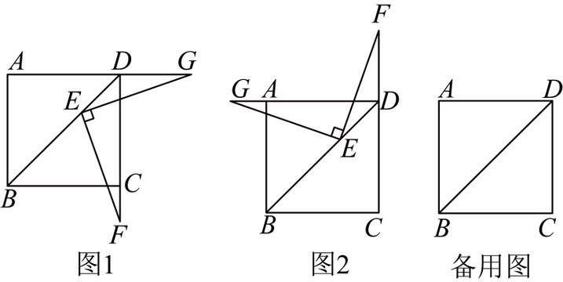

# Mathematics - 题目 1202

**ID**: 0982bc8dddc34bf78da30c260a57909d
**年级**: Grade 8
**难度**: Medium-Hard
**题型**: Calculation

## 题目
正方形 $ABCD$ 中， $BD$ 为对角线，点 $E$ 为射线 $DB$ 上一点，点 $F$ 为直线 $CD$ 上一点，连接 $EF$ ，过点 $E$ 作 $EG\bot EF$ 交直线 $AD$ 于点 $G$ ．（1）如图1，当点 $E$ 在线段 $BD$ 上，点 $F$ 在线段 $DC$ 延长线上时， $EG$ 与 $EF$ 的数量关系为；​​​​​​​‌（2）如图2，当点 $E$ 在线段 $BD$ 上，点 $F$ 在线段 $CD$ 延长线上时，请判断 $DE$ ， $DF$ ， $DG$ 之间的数量关系，并说明理由；（3）当 $DF=1$ ， $\angle DEF=15{}\degree $ 时，请直接写出 $\mathrm{△}DEG$ 的面积．

## 解答

1. （1）解：如图，过 $E$ 作 $EH\bot AD$ 于点 $H$ ，过点 $E$ 作 $EI\bot CD$ 于点 $I$ ，
2. 
3. ∴ $\angle EHD=\angle EID=\angle EIF=90{}\degree $ ，
4. ∵四边形 $ABCD$ 是正方形，
5. ∴ $\angle ADC=90{}\degree $ ， $BD$ 平分 $\angle ADC$ ，
6. ∴ $\angle EHD=\angle EID=\angle ADC=90{}\degree $ ， $EH=EI$ ，
7. ∴四边形 $EHDI$ 是矩形，
8. ∴ $\angle HEI=90{}\degree $ ，
9. ∵ $EG\bot EF$ ，
10. ∴ $\angle FEG=\angle HEI=90{}\degree $ ，
11. ∴ $\angle HEG+\angle GEI=\angle IEF+\angle GEI=90{}\degree $ ，
12. ∴ $\angle HEG=\angle IEF$ ，
13. 在 $△HEG$ 和 $\mathrm{△}IEF$ 中，
14. $\begin{cases}\angle HEG=\angle IEF\\EH=EI\\\angle EHG=\angle EIF\end{cases}$ ，
15. ∴ $\mathrm{△}HEG≌\mathrm{△}IEF\left ({{\rm{A}}{\rm{S}}{\rm{A}}}\right )$ .
16. （2）解： $DG=DF+\sqrt {2}DE$ ，理由如下，
17. 如图，过点 $E$ 作 $EM\bot AD$ 于点 $M$ ，过点 $E$ 作 $EN\bot CD$ 于点 $N$ ，
18. 
19. ∴ $\angle EMD=\angle END=\angle ENF=90{}\degree $ ，
20. ∵四边形 $ABCD$ 是正方形，
21. ∴ $\angle ADC=90{}\degree $ ， $BD$ 平分 $\angle ADC$ ，
22. ∴ $\angle EMD=\angle END=\angle ADC=90{}\degree $ ， $EM=EN$ ，
23. ∴四边形 $EMDN$ 是矩形，
24. ∴ $\angle MEN=90{}\degree $ ，
25. ∵ $EG\bot EF$ ，
26. ∴ $\angle FEG=\angle MEN=90{}\degree $ ，
27. ∴ $\angle MEG+\angle MEF=\angle NEF+\angle MEF=90{}\degree $ ，
28. ∴ $\angle MEG=\angle NEF$ ，
29. 在 $\mathrm{△}MEG$ 和 $\mathrm{△}NEF$ 中，
30. $\begin{cases}\angle MEG=\angle NEF\\EM=EN\\\angle EMG=\angle ENF\end{cases}$ ，
31. ∴ $\mathrm{△}MEG≌\mathrm{△}NEF\left ({{\rm{A}}{\rm{S}}{\rm{A}}}\right )$ ，
32. ∴ $GM=FN$ ，
33. ∵四边形 $EMDN$ 是矩形， $EM=EN$ ，
34. ∴四边形 $EMDN$ 是正方形，
35. ∴ $ME=MD=DN=EN$ ，
36. ∴ $DE=\sqrt {2}DN$ ，即 $DN=\frac {\sqrt {2}}{2}DE$ ，
37. ∴ $DN=MD=\frac {\sqrt {2}}{2}DE$ ，
38. ∵ $DG=GM+MD$ ，
39. ∴ $DG=FN+MD=DF+DN+MD=DF+\frac {\sqrt {2}}{2}DE+\frac {\sqrt {2}}{2}DE=DF+\sqrt {2}DE$ ，
40. 即 $DG=DF+\sqrt {2}DE$ ；
41. （3）解： $①$ 如图，当 $F$ 在 $CD$ 延长线上时，
42. 
43. 由（ $2$ ）得四边形 $EMDN$ 是正方形，
44. ∴ $ME=MD=DN=EN$ ， $\angle DEN=45{}\degree $ ，
45. ∵ $\angle DEF=15{}\degree $ ，
46. ∴ $\angle FEN=60{}\degree $ ，
47. ∴ $\angle EFN=30{}\degree $ ，
48. ∴ $EN=\frac {1}{2}EF$ ，
49. 设 $ME=MD=DN=EN=x$ ，则 $EF=2x$ ， $FN=1+x$ ，
50. 由勾股定理得 $EN{^{2}}+FN{^{2}}=EF{^{2}}$ ，
51. ∴ $x{^{2}}+{\left({1+x}\right)^{2}}={\left({2x}\right)^{2}}$ ，
52. 解得 $x=\frac {1+\sqrt {3}}{2}$ 或 $x=\frac {1-\sqrt {3}}{2}$ （舍去），
53. ∴ $ME=MD=DN=EN=\frac {1+\sqrt {3}}{2}$ ，
54. ∴ $DE=\sqrt {2}DN=\frac {\sqrt {2}+\sqrt {6}}{2}$ ，
55. 由（ $2$ ）得 $DG=DF+\sqrt {2}DE$ ，
56. ∴ $DG=1+\sqrt {2}\times \frac {\sqrt {2}+\sqrt {6}}{2}=2+\sqrt {3}$ ，
57. ∴ $\mathrm{△}DEG$ 的面积为 $\frac {1}{2}DG\cdot ME=\frac {1}{2}\left ({2+\sqrt {3}}\right )\times \frac {1+\sqrt {3}}{2}=\frac {3\sqrt {3}+5}{4}$ ；
58. $②$ 如图，当 $F$ 在 $CD$ 上时，
59. 
60. 由（ $2$ ）得四边形 $EMDN$ 是正方形，
61. ∴ $ME=MD=DN=EN$ ， $\angle DEN=45{}\degree $ ，
62. ∵ $\angle DEF=15{}\degree $ ，
63. ∴ $\angle FEN=60{}\degree $ ，
64. ∴ $\angle EFN=30{}\degree $ ，
65. ∴ $FN=\frac {1}{2}EF$ ，
66. 设 $ME=MD=DN=EN=x$ ，则 $FN=x-1$ ，
67. ∴ $EF=2x-2$ ，
68. 由勾股定理得 $EN{^{2}}+FN{^{2}}=EF{^{2}}$ ，
69. ∴ $x{^{2}}+{\left({x-1}\right)^{2}}={\left({2x-2}\right)^{2}}$ ，
70. 解得 $x=\frac {3+\sqrt {3}}{2}$ 或 $x=\frac {3-\sqrt {3}}{2}$ （舍去），
71. ∴ $ME=MD=DN=EN=\frac {3+\sqrt {3}}{2}$ ， $FN=\frac {1+\sqrt {3}}{2}$ ，
72. 同（ $2$ ）得 $DG=FN+DN$ ，
73. ∴ $DG=\frac {1+\sqrt {3}}{2}+\frac {3+\sqrt {3}}{2}=2+\sqrt {3}$ ，
74. ∴ $\mathrm{△}DEG$ 的面积为 $\frac {1}{2}DG\cdot ME=\frac {1}{2}\left ({2+\sqrt {3}}\right )\times \frac {3+\sqrt {3}}{2}=\frac {5\sqrt {3}+9}{4}$ ，
75. 综上可知， $\mathrm{△}DEG$ 的面积为 $\frac {3\sqrt {3}+5}{4}$ 或 $\frac {5\sqrt {3}+9}{4}$ ．

## 知识点

**中文**:
  - 公式法解一元二次方程
  - 勾股定理
  - 矩形的判定与性质综合
  - 正方形的判定与性质综合

**English**:
  - Solving by Quadratic Formula
  - Pythagorean Theorem
  - Determination and Properties of Rectangles
  - Determination and Properties of Squares

---
