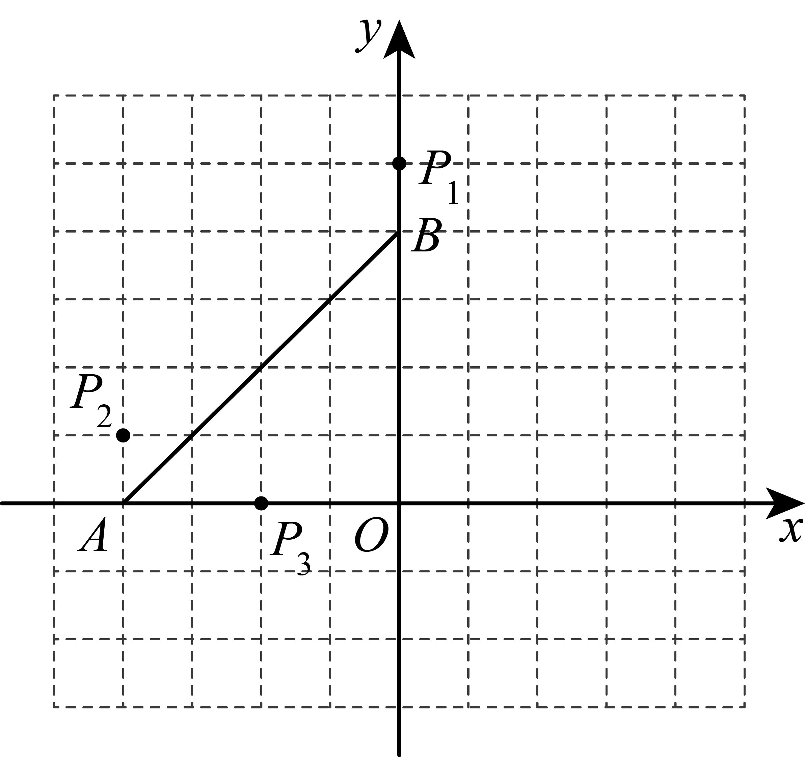

# Mathematics - 题目 271

**ID**: 0e029416a552483bb82949561ab9229e
**年级**: Grade 8
**难度**: Medium-Hard
**题型**: Calculation

## 题目
在平面直角坐标系 $xOy$ 中，对于点 $P$ 和图形 $N$ ，给出如下定义：如果图形 $N$ 上存在点 $Q$ ，使得 $PQ=1$ ，那么称点 $P$ 为图形 $N$ 的“拉手点”．已知点 $A\left ({-4,0}\right )$ ， $B\left ({0,4}\right )$ ．(1)在点 $P{{}_{1}}\left ({0,5}\right )$ ， $P{{}_{2}}\left ({-4,1}\right )$ ， $P{{}_{3}}\left ({-2,0}\right )$ 中，线段 $AB$ 的“拉手点”是；​​​​​​​‌(2)若直线 $y=x+b$ 上存在线段 $AB$ 的“拉手点”，求 $b$ 的取值范围；(3) $O$ 是边长为 $a$ 的正方形 $CDEF$ 的对角线的交点，若正方形 $CDEF$ 上存在线段 $AB$ 的“拉手点”，直接写出 $a$ 的取值范围．

## 解答

1. （1）解：如图， $P{{}_{1}}B=1,P{{}_{2}}A=1,$
2. 
3. 所以，在点 $P{{}_{1}}\left ({0,5}\right )$ ， $P{{}_{2}}\left ({-4,1}\right )$ ， $P{{}_{3}}\left ({-2,0}\right )$ 中，线段 $AB$ 的“拉手点”是 $P{{}_{1}},P{{}_{2}}$ ,
4. 故答案为 $P{{}_{1}},P{{}_{2}}$ ；
5. （2）解：如图，当直线 $y=x+b$ 在点B上方时，延长 $AB$ 交直线 $y=-x+b$ 于点C，设直线 $y=-x+b$ 与y轴交于点 ${\rm \mathit{D}，}y=-x+b$ 与x轴交于点N，
6. 
7. ∵ $A\left ({-4,0}\right )$ ， $B\left ({0,4}\right )$ ， $\angle AOB=90{}\degree $ ，
8. ∴ $OA=4，OB=4，$
9. ∴ $\angle OBA=\angle OAB=45{}\degree ,$
10. ∴ $\angle CBD=45{}\degree ,$
11. ∵在直线 $y=-x+b$ 中， $x=0，y=b；y=0，x=b$ ，
12. ∴ $DO=ON$ ，
13. ∵ $\angle DON=90{}\degree $ ，
14. ∴ $\angle CDB=45{}\degree =\angle CBD$ ，
15. ∴ $\angle DCB=90{}\degree $ ，
16. 此时点B到直线 $y=-x+b$ 的距离是 $BC$ ，
17. ∴当 $BC=CD=1,$
18. 则 $BD=\sqrt {BC{^{2}}+CD{^{2}}}=\sqrt {1{^{2}}+1{^{2}}}=\sqrt {2}$ ,
19. 过点B作 $BH\bot DF\left ({DF：y=x+b}\right )$ ，
20. 则 $BH=CD=1$ ，直线 $y=x+b$ 与线段 $AB$ 有“拉手点”，
21. ∴ $b=OB+BD=4+\sqrt {2}$ ，
22. 当往下平移也满足条件，即 $b\leqslant 4+\sqrt {2}$ ，
23. 假设点 $D{{}_{1}}$ 满足 $DB=D{{}_{1}}B$ ，则符合直线 $y=x+b$ 上存在线段 $AB$ 的“拉手点”，
24. ∴ $DB=D{{}_{1}}B=\sqrt {2}$ ，
25. ∴ $b\geqslant 4-\sqrt {2}$ ，
26. ∴直线 $y=x+b$ 上存在线段 $AB$ 的“拉手点”，则 $b$ 的取值范围为 $4-\sqrt {2}\leqslant b\leqslant 4+\sqrt {2}$ ，
27. （3）解：当线段 $AB$ 在正方形 $CDEF$ 内部时，如图，
28. 
29. 由（2）知， $OD=4+\sqrt {2}$ ，
30. ∴ $OE=4+\sqrt {2}$ ，
31. 由勾股定理得 $DE=\sqrt {OD{^{2}}+OE{^{2}}}=\sqrt {2}OD=4\sqrt {2}+2$ ,
32. ∴ $a=4\sqrt {2}+2$ ；
33. 当线段 $AB$ 在正方形 $CDEF$ 外部时，过点E作 $EG\bot AB$ 于点G，如图，
34. ∵ $\angle GAE=45{}\degree =\angle GEA,$
35. ∴ $\vartriangle GEA$ 是等腰直角三角形，
36. 当 $GE=1$ 时， $AE=\sqrt {AG{^{2}}+GE{^{2}}}=\sqrt {2}$ ，
37. ∴ $OE=OA-AE=4-\sqrt {2},$
38. ∴ $DE=\sqrt {2}OE=4\sqrt {2}-2$ ，
39. ∴当正方形 $CDEF$ 上存在线段 $AB$ 的“拉手点”，则 $a$ 的取值范围为 $4\sqrt {2}-2\leqslant a\leqslant 4\sqrt {2}+2$ ．

## 知识点

**中文**:
  - 一次函数图象的平移
  - 一次函数的图象和性质
  - 勾股定理

**English**:
  - Translation of Linear Function Graphs
  - Graphs and Properties of Linear Functions
  - Pythagorean Theorem

---
