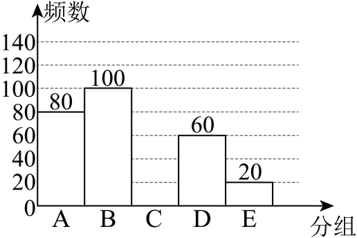

# Mathematics - 题目 3852

**ID**: 1318a2639bd344349f83788ba4dfdbe7
**年级**: Grade 8
**难度**: Medium-Hard
**题型**: Calculation

## 题目
为进一步提高义务教育质量，提升学生的信息素养，信息科技科目将纳入中考范围，为了解学生的信息科技课程学习情况，更好地促进课程学习，某校于2024年期末对全校七年级学生进行了信息科技上机测试．学校将测试成绩（满分100分），收集、整理分组，记得分为 $x$ 分，并制作了如下不完整的统计图表．根据上面信息，回答下列问题：七年级信息科技期末测试得分分出频率A组 $\left ({90\leqslant x<100}\right )$$a$B组 $\left ({80\leqslant x<90}\right )$0.​​​​​​​‌25$C$ 组 $\left ({70\leqslant x<80}\right )$$b$D组 $\left ({60\leqslant x<70}\right )$0.15E组 $\left ({x<60}\right )$0.05(1)该校七年级总人数为人； $a=$； $b=$；(2)将频数分布直方图补充完整；若将上述表格转化为扇形统计图，则 $C$ 组学生所对应扇形的圆心角的度数为．(3)若成绩在 $70\leqslant x<90$ 为良好，估计全区2400名七年级学生中有多少名学生成绩为良好．

## 解答

1. （1）解：七年级总人数为 $100\div 0.25=400$ （人），
2. $a=80\div 400=0.2$ ，
3. $b=1-0.2-0.25-0.15-0.05=0.35$ ，
4. 故答案为：400； $0.2；0.35$ ；
5. （2）解：C组人数为 $400\times 0.35=140$ （人），
6. 补图如下：
7. 
8. $C$ 组学生所对应扇形的圆心角的度数为 $360{}\degree \times 0.35=126{}\degree $ ，
9. 故答案为： $126{}\degree $ ；
10. （3）解： $2400\times \left ({0.35+0.25}\right )=1440$ ，
11. 答：估计全区2400名七年级学生中有1440名学生成绩为良好．

## 知识点

**中文**:
  - 圆心角与圆周角
  - 频数与频率
  - 频数分布直方图

**English**:
  - Central and Inscribed Angles
  - Frequency and Relative Frequency
  - Frequency Histograms

---
