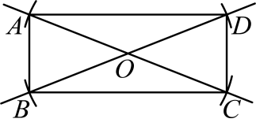
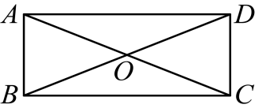

# Mathematics - 题目 3232

**ID**: 188e1aaf0f304429860ab2982fc91a23
**年级**: Grade 8
**难度**: Medium-Hard
**题型**: Calculation

## 题目
明明在学习了矩形定义及判定定理1后，继续探究其它判定定理．（1）实践与操作①任意作两条相交的直线，交点记为 $O$ ；​​​​​​​‌②以点 $O$ 为圆心，适当长为半径画弧，在两条直线上分别截取相等的四条线段 $OA$ ， $OB$ ， $OC$ ， $OD$ ；③顺次连结所得的四点得到四边形 $ABCD$ ，于是可以直接判定四边形 $ABCD$ 是平行四边形，则依据的判定定理是：．（2）猜想与证明通过和同伴交流，他们一致认为四边形 $ABCD$ 是矩形，于是猜想得到了矩形的另外一种判定方法：对角线相等的平行四边形是矩形．结合下图，请帮助明明完成命题“对角线相等的平行四边形是矩形”的证明．

## 解答

1. （1）解： $\because OA=OC,OB=OD$ ，
2. $\therefore $ 四边形 $ABCD$ 是平行四边形（对角线互相平分的四边形是平行四边形）.
3. （2）解：已知：四边形 $ABCD$ 是平行四边形， $AC=BD$ ；
4. 求证：四边形 $ABCD$ 是矩形．
5. 证明： $\because $ 四边形 $ABCD$ 是平行四边形，
6. $\therefore AB{\rm{/\mskip-4mu/}}CD$ ， $AB=CD$ ，
7. $\therefore \angle ABC+\angle BCD=180{}\degree $ ，
8. $\because AC=BD$ ， $BC=CB$ ， $AB=CD$ ，
9. $\therefore \mathrm{△}ABC≌\mathrm{△}DCB（{\rm{S}}{\rm{S}}{\rm{S}}）$ ，
10. $\therefore \angle ABC=\angle DCB=90{}\degree $ ，
11. $\because $ 四边形 $ABCD$ 是平行四边形， $\angle ABC=90{}\degree $ ，
12. $\therefore $ 四边形 $ABCD$ 是矩形．

## 知识点

**中文**:
  - 平行四边形的判定与性质
  - 矩形的判定

**English**:
  - Determination and Properties
  - Determination of Rectangles

---
