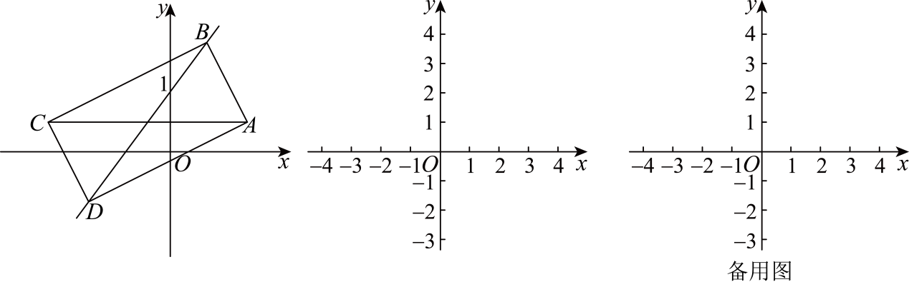

# Mathematics - 题目 1760

**ID**: 193073795ad54cbf821ca9c9c8c1c724
**年级**: Grade 8
**难度**: Medium-Hard
**题型**: Calculation

## 题目
在平面直角坐标系 $xOy$ 中，若矩形 $ABCD$ 的对角线 $AC$ 与 $x$ 轴平行，且对角线 $BD$ 在直线 $y=kx+1$ （ $k>0$ ）上，则称矩形 $ABCD$ 为“ $k-$ 矩形”．如图为“ $k-$ 矩形” $ABCD$ 的示意图．（1）已知“ $k-$ 矩形” $ABCD$ ，点 $\mathrm{A}$ ， $C$ 在直线 $y=2$ 上，点 $B$ 的坐标是 $\left ({1,3}\right )$ ， $k$ 的值是，点 $D$ 的坐标是， $AC=$；​​​​​​​‌（2）已知 $C\left ({t,-t+3}\right )$ ，其中 $t\ne 1$ ．①若矩形 $ABCD$ 为“ $2-$ 矩形”，且直线 $y=3x-1$ 平分该矩形 $ABCD$ 的面积．求 $t$ 的值；②若矩形 $ABCD$ 为“ $1-$ 矩形”，且矩形 $ABCD$ 的面积大于 $9\sqrt {2}$ ，直接写出 $t$ 的取值范围．

## 解答

1. （1）解：∵点 $B$ 的坐标是 $\left ({1,3}\right )$ ，
2. ∴ $3=k+1$ ，
3. ∴ $k=2$ ；
4. ∵“ $k-$ 矩形” $ABCD$ ，点 $\mathrm{A}$ ， $C$ 在直线 $y=2$ 上，
5. ∴ $y{{}_{A}}=y{{}_{C}}=2$ ，
6. ∴ $\frac {y{{}_{B}}+y{{}_{D}}}{2}=\frac {y{{}_{A}}+y{{}_{C}}}{2}$ ，
7. ∴ $y{{}_{D}}=1$ ，则 $y{{}_{D}}=2x{{}_{D}}+1$ ，解得： $x{{}_{D}}=0$ ，
8. ∴ $D\left ({0,1}\right )$ ，
9. ∴ $AC=BD=\sqrt {1{^{2}}+{\left({3-1}\right)^{2}}}=\sqrt {5}$ ；
10. （2）设 $AC$ 和 $BD$ 交点为 $M$ ，
11. ①∵矩形 $ABCD$ 为“ $2-$ 矩形”，
12. ∴直线 $BD$ 的解析式为 $y=2x+1$ ，
13. ∵直线 $y=3x-1$ 平分该矩形 $ABCD$ 的面积，
14. ∴直线 $y=3x-1$ 必经过矩形 $ABCD$ 的对角线的交点，
15. 联立两直线解析式得： $\begin{cases}y=2x+1\\y=3x-1\end{cases}$ ，
16. 解得： $\begin{cases}x=2\\y=5\end{cases}$ ，
17. ∴ $M\left ({2,5}\right )$ ，
18. ∵ $C$ 、 $M$ 两点连线与 $x$ 轴平行，即 $CM$ 垂直 $y$ 轴，
19. ∴ $-t+3=5$ ，
20. ∴ $t=-2$ ．
21. ②∵矩形 $ABCD$ 为“ $1-$ 矩形”，
22. ∴直线 $BD$ 的解析式为 $y=x+1$ ，
23. ∴ $BD$ 与 $x$ 轴正半轴的夹角为 $45{}\degree $ ，
24. ∵对角线 $AC$ 与 $y$ 轴垂直，且 $C\left ({t,-t+3}\right )$ ，
25. 令 $y=x+1=-t+3$ ，解得： $x=-t+2$ ，
26. ∴ $M\left ({-t+2,-t+3}\right )$ ，
27. ∴ $CM=-t+2-t=2-2t$ ， $AC=2CM$ ，
28. ∵ $AC\mathrm{/\mskip-4mu/}x$ 轴，
29. ∴ $\angle BMA=45{}\degree $ ，
30. 过点 $B$ 作 $BN\bot AC$ 于 $N$ ，
31. 
32. ∴ $BN=\frac {\sqrt {2}}{2}BM=\frac {\sqrt {2}}{2}AM=\frac {\sqrt {2}}{2}CM$ ，
33. ∴ $S{{}_{矩形ABCD}}=2\times \frac {1}{2}AC\cdot BN=\sqrt {2}CM{^{2}}$  $=\sqrt {2}{\left({2-2t}\right)^{2}}$ ，
34. ∵矩形 $ABCD$ 的面积大于 $9\sqrt {2}$ ，
35. ∴ $\sqrt {2}{\left({2-2t}\right)^{2}}>9\sqrt {2}$
36. ∴ $\left |{2-2t}\right |>3$ ，
37. 当 $2-2t\geqslant 0$ ，即 $t\leqslant 1$ 时，则 $2-2t>3$ ，
38. 解得： $t<-\frac {1}{2}$ ，
39. 当 $2-2t<0$ ，即 $t>1$ 时，则 $2-2t<-3$ ，
40. 解得： $t>\frac {5}{2}$ ，
41. ∴当 $t<-\frac {1}{2}$ 或 $t>\frac {5}{2}$ 时矩形 $ABCD$ 的面积大于 $9\sqrt {2}$ ．

## 知识点

**中文**:
  - 一次函数与二元一次方程（组）
  - 矩形的性质
  - 待定系数法求一次函数解析式

**English**:
  - Linear Functions and Systems of Linear Equations
  - Properties of Rectangles
  - Finding Expressions by Undetermined Coefficients

---
