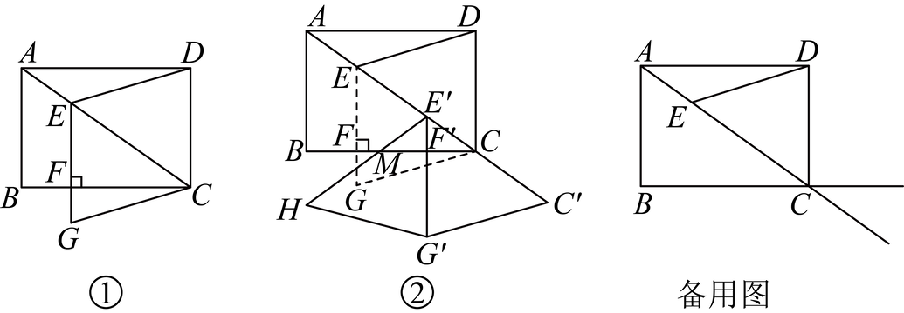

# Mathematics - 题目 1244

**ID**: 1cc137c8047a49c1914e6d9cbf8ceab7
**年级**: Grade 8
**难度**: Medium-Hard
**题型**: Calculation

## 题目
综合与实践问题情境：数学活动课上，同学们以矩形为背景．以“探究图形的性质”为主题，开展数学活动．如图①，在矩形 $ABCD$ 中（ $AB<BC$ ），E是对角线 $AC$ 上的点，且 $DE=DC$ ，过点E作 $EF⊥BC$ 于点F，过点C作 $DE$ 的平行线，与 $EF$ 的延长线交于点 $G$ ．猜想证明：（1）判断四边形 $CDEG$ 的形状，并证明；​​​​​​​‌深入探究：（2）将图①中 $\vartriangle ECG$ 沿射线 $EC$ 平移，得到 $\vartriangle E^{′}C^{′}G^{′}$ ，点E，C，G分别对应点 $E^{′}$ ， $C^{′}$ ， $G^{′}$ ；①如图②．当点 $E^{′}$ 在线段 $CE$ 上的某一位置时，将 $\vartriangle E^{′}C^{′}G^{′}$ 沿 $G^{′}E^{′}$ 所在直线翻折，得到 $\mathrm{△}E^{′}HG^{′}$ ，线段 $G^{′}E^{′}$ ， $HE^{′}$ 分别与直线BC交于点 $F^{′}$ ，点M，猜想线段 $HM$ 与 $EE^{′}$ 之间的数量关系，并说明理由；②若 $AB=6$ ， $BC=8$ ，当点 $E^{′}$ 在射线 $EC$ 上某一位置时，重复①的操作，在此过程中平面内是否存在一点N，使得以 $G^{′}{\rm ，\mathit{H}，\mathit{M}，\mathit{N}}$ 为顶点的四边形是矩形？若存在，请直接写出该矩形的面积；若不存在，请说明理由．

## 解答

1. 解：（1）四边形 $CDEG$ 是菱形，
2. 证明： $\because $ 四边形 $ABCD$ 是矩形，
3. $\therefore \angle BCD=90{}\degree $ ，
4. $\because EF\bot BC$ ，
5. $\therefore \angle EFC=90{}\degree $ ，
6. $\therefore \angle EFC+\angle BCD=180{}\degree $ ，
7. $\therefore EG\mathrm{/\mskip-4mu/}CD$ ，
8. 又 $CG/\mskip-4mu/DE$ ，
9. $\therefore $ 四边形 $CDEG$ 是平行四边形，
10. $\because DE=DC$ ，
11. $\therefore $ 四边形 $CDEG$ 是菱形；
12. （2）① $HM=E{E}^{\prime }$ ，理由如下：
13. 由平移可知， $E^{′}G^{′}/\mskip-4mu/EG$ ， $EE^{′}=CC^{′}$ ，
14. $\therefore \angle E^{′}F^{′}C=\angle EFC=90{}\degree $ ，
15. $\therefore \angle E^{′}F^{′}M=180{}\degree -\angle E^{′}F^{′}C=90{}\degree $ ，
16. $\therefore \angle E^{′}F^{′}C=\angle E^{′}F^{′}M$ ，
17. 由翻折可知， $\angle CE^{′}F^{′}=\angle ME^{′}F^{′}$ ， $E^{′}C^{′}=E^{′}H$ ，
18. 又 $\because E^{′}F^{′}=E^{′}F^{′}$ ，
19. $\therefore △C{E}^{\prime }{F}^{\prime }≌△M{E}^{\prime }{F}^{\prime }(ASA)$ ，
20. $\therefore E^{′}C=E^{′}M$ ，
21. $\therefore E^{′}C^{′}-E^{′}C=E^{′}H-E^{′}M$ ，即 $C^{′}C=HM$ ，
22. $\therefore HM=EE^{′}$ ；
23. ②在矩形 $ABCD$ 中， $CD=AB=6$ ， $AD=BC=8$ ，根据勾股定理得到 $AC=10$ ，
24. 如图，过点D作 $DP\bot AC$ 于点 $P.$
25. $\because S{{}_{\vartriangle ADC}}=\frac {1}{2}AC\cdot DP=\frac {1}{2}AD\cdot DC$ ，
26. $\therefore PD=\frac {6\times 8}{10}=\frac {24}{5}$ ，
27. 在 $Rt\vartriangle CDP$ 中，由勾股定理，得 $CP=\sqrt{C{D}^{2}-D{P}^{2}}=\sqrt{{6}^{2}-{\left(\frac{24}{5}\right)^{2}}}=\frac{18}{5}$ ，
28. $\because DE=DC$ ，
29. $\therefore CE=2CP=\frac {36}{5}$ ；
30. 如图，当点 $E^{′}$ 在线段 $EC$ 上，且 $G^{′}M\bot HE^{′}$ 时，四边形 $HMG^{′}N$ 为矩形，
31. 此时 $HM=E^{′}M$ ， $S{{}_{\vartriangle HG^{′}M}}=S{{}_{\vartriangle E^{′}G^{′}M}}$ ，
32. $\therefore S{{}_{四边形HMG^{′}N}}=2S{{}_{\vartriangle HG^{′}M}}=S{{}_{\vartriangle HG^{′}E^{′}}}=S{{}_{\vartriangle CDE}}=\frac {1}{2}CE\cdot DP=\frac {1}{2}\times \frac {36}{5}\times \frac {24}{5}=\frac {432}{25}$ ；
33. 
34. 如图，当点 $E^{′}$ 在线段 $EC$ 的延长线上，且 $G^{′}M\bot HG^{′}$ 时，四边形 $HG^{′}MN$ 为矩形，
35. 
36. 此时 $HG^{′}=C^{′}G^{′}=CG=CD$ ， $\angle HG^{′}M=\angle CDA=90{}\degree $ ， $\angle MHG^{′}=\angle C^{′}=\angle ECG=\angle DCE$ ，
37. ∴ $△H{G}^{\prime }M≌△CDA(ASA)$ ，
38. $\therefore S{{}_{△HG^{′}M}}=S{{}_{△CDA}}$ ，
39. $\therefore S{{}_{四边形HGMN}}=S{{}_{矩形ABCD}}=6\times 8=48$ ．

## 知识点

**中文**:
  - 平移的性质
  - 菱形的判定
  - 折叠问题

**English**:
  - Properties of Translation
  - Determination of Rhombuses
  - Folding Problems

---
