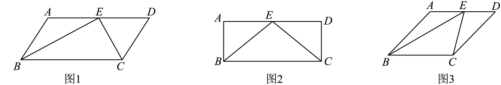

# Mathematics - 题目 309

**ID**: 25025fd328124a36921c7ae61a4a7526
**年级**: Grade 8
**难度**: Medium-Hard
**题型**: Calculation

## 题目
在 $▱ABCD$ 中，点E为 $AD$ 中点，连接 $BE，CE$ ， $\angle BEC=α$ ．（1）如图1，当 $α=90{}\degree $ 时，下列说法正确的是．（填序号）① $BC=2AB$ ；​​​​​​​‌② $\angle A=120{}\degree $ ；③ $BE$ 平分 $∠ABC$（2）如图2，当 $\angle ABE=\frac {1}{2}α$ 时，求证： $▱ABCD$ 是矩形；（3）如图3，当 $α=45{}\degree $ 且 $BE=\sqrt {2}AB=\sqrt {2}$ 时，求 $CE$ 的长及 $∠ABE$ 的度数．

## 解答

1. （1）解：取 $BC$ 的中点 $M$ ，连接 $EM$ ，
2. 
3. 当 $\angle BEC=α=90{}\degree $ 时，
4. $EM=BM=CM=\frac {1}{2}BC$ ，
5. ∴ $\angle EBM=\angle BME$ ，
6. ∵四边形 $ABCD$ 是平行四边形，
7. ∴ $AD=BC，AB=CD$ ， $AD/\mskip-4mu/BC，AB/\mskip-4mu/CD$
8. ∵点E为 $AD$ 中点，
9. ∴ $AE=\frac {1}{2}AD=\frac {1}{2}BC=BM$ ，
10. ∴四边形 $ABME$ 是平行四边形，
11. ∵ $EM=BM$ ，
12. ∴四边形 $ABME$ 是菱形，
13. ∴ $AB=EM=BM=CM=\frac {1}{2}BC$ ， $AB/\mskip-4mu/ME$ ，
14. ∴ $BC=2AB$ , $\angle ABM=\angle BEM$ ，
15. ∴ $\angle ABM=\angle EBM$ ，即 $BE$ 平分 $∠ABC$ ，
16. 故①③正确；
17. 无法证明 $\angle A=120{}\degree $ ；故②错误；
18. （2）延长 $BE，CD$ 交于点F，
19. 
20. 在 $▱ABCD$ 中 $，AB=CD$ ， $AB/\mskip-4mu/CD$ ，
21. ∴ $\angle ABE=\angle F=\frac {1}{2}α$ ，
22. ∵点E为 $AD$ 中点，
23. ∴ $AE=DE$ ，
24. 在 $\vartriangle ABE$ 和 $\mathrm{△}DFE$ 中，
25. $\begin{cases}\angle ABE=\angle F\\\angle AEB=\angle DEF\\AE=DE\end{cases}$ ，
26. ∴ $\vartriangle ABE≌\vartriangle DFE$ ，
27. ∴ $BE=EF$ ，
28. 在 $\mathrm{△}ECF$ 中， $\angle BEC=\angle F+\angle ECF$ ，
29. 即 $α=\frac {1}{2}α+\angle ECF$ ，
30. ∴ $\angle ECF=\frac {1}{2}α$ ，
31. ∴ $\angle ECF=\angle F$ ，
32. ∴ $EC=EF$ ，
33. ∴ $EC=EF=BE$ ，
34. ∴ $\angle EBC=\angle ECB$ ，
35. ∵ $\angle EBC+\angle ECB+\angle ECF+\angle F=180{}\degree $ ，
36. ∴ $\angle ECB+\angle ECF=90{}\degree $ 即 $\angle BCD=90{}\degree $ ，
37. ∴ $▱ABCD$ 是矩形；
38. （3）延长 $BE，CD$ 交于点F，过点F作 $FH\bot CE$ 交 $CE$ 延长线于点H，连接 $DH$ ，
39. 
40. 由（2） $\vartriangle ABE≌\vartriangle DFE$ 可得 $DF=AB，EF=BE$ ，
41. ∵ $BE=\sqrt {2}AB=\sqrt {2}$ ，
42. ∴ $DF=AB=CD=1$ ， $EF=BE=\sqrt {2}$ ，
43. ∴ $CF=2$ ，
44. 在 ${\rm{R}}{\rm{t}}\mathrm{△}FHE$ 中， $\angle FEH=\angle BEC=45{}\degree $ ，
45. ∴ $\vartriangle FHE$ 是等腰直角三角形，
46. ∴ $FH=HE=1$ ，
47. ∴ $CH=\sqrt {3}$ ，
48. ∴ $CE=\sqrt {3}-1$ ，
49. 在 ${\rm{R}}{\rm{t}}\vartriangle HCF$ 中， $DF=CD$ ，
50. ∴ $DH=DF=1$ ，
51. ∴ $DH=DF=FH$ ，
52. ∴ $△DHF$ 是等边三角形，
53. ∴ $\angle HFD=60{}\degree $ ，
54. ∴ $\angle EFD=15{}\degree $ ，
55. ∴ $\angle ABE=\angle EFD=15{\rm °}$ ，
56. 综上 $CE=\sqrt {3}-1$ ， $\angle ABE=15{}\degree $ ．

## 知识点

**中文**:
  - 矩形的判定
  - 菱形的判定与性质综合

**English**:
  - Determination of Rectangles
  - Determination and Properties of Rhombuses

---
