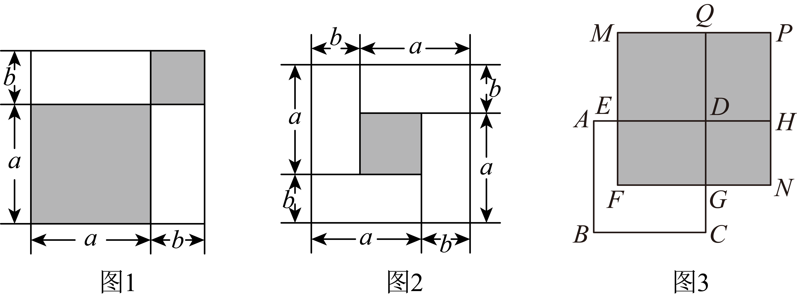

# Mathematics - 题目 3645

**ID**: 27270920ba9b45eb97101c28ca06c1a4
**年级**: Grade 8
**难度**: Medium-Hard
**题型**: Calculation

## 题目
数形结合是解决数学问题的一种重要的思想方法，借助图的直观性，可以帮助我们理解数学问题．【公式推导】（1）①如图1，将边长为 $a+b$ 的正方形分割成四部分，可得 $a{^{2}}+b{^{2}}={\left({a+b}\right)^{2}}-$；​​​​​​​‌②如图2，用4个长和宽分别为 $a,b$ 的长方形拼成一个大正方形，可得 ${\left({a+b}\right)^{2}}={\left({a-b}\right)^{2}}+$；【阅读理解】“若 $x$ 满足 $\left ({70-x}\right )\left ({x-50}\right )=30$ ，求 ${\left({70-x}\right)^{2}}+{\left({x-50}\right)^{2}}$ 的值．”解：设 $70-x=a,x-50=b$ ，则 $\left ({70-x}\right )\left ({x-50}\right )=ab=30,a+b=\left ({70-x}\right )+\left ({x-50}\right )=20$ ． $\therefore {\left({70-x}\right)^{2}}+{\left({x-50}\right)^{2}}=a{^{2}}+b{^{2}}={\left({a+b}\right)^{2}}-2ab=20{^{2}}-2\times 30=340$ ．【解决问题】（2）若 $x$ 满足 $\left ({50-x}\right )\left ({x-20}\right )=120$ ，求 ${\left({50-x}\right)^{2}}+{\left({x-20}\right)^{2}}$ 的值；（3）如图3，正方形 $ABCD$ 的边长为 $x,AE=4,CG=9$ ，长方形 $EFGD$ 的面积是132，四边形 $DGNH$ 和 $MEDQ$ 都是正方形，四边形 $PQDH$ 是长方形，请直接写出图中阴影部分的面积．（结果必须是一个具体的数值）

## 解答

1. 解：（1）①由图1的面积可得： $a{^{2}}+b{^{2}}=(a+b){^{2}}-2ab$ ．
2. ②由图2正方形的面积可得： $(a+b){^{2}}=(a-b){^{2}}+4ab$ ．
3. （2）设 $50-x=a$ ， $x-20=b$ ，
4. 则 $\left ({50-x}\right )\left ({x-20}\right )=ab=120$ ，
5. $a+b=\left ({50-x}\right )+\left ({x-20}\right )=30$ ，
6. ${\left({50-x}\right)^{2}}+{\left({x-20}\right)^{2}}$
7. $=a{^{2}}+b{^{2}}$
8. $={\left({a+b}\right)^{2}}-2ab$
9. $=30{^{2}}-2\times 120$
10. $=660$ ；
11. （3）矩形 $EFGD$ 的面积 $=\left ({x-4}\right )\left ({x-9}\right )=132$ ，
12. 设 $x-4=a$ ， $x-9=b$ ，
13. 则 $\left ({x-4}\right )\left ({x-9}\right )=ab=132$
14. $a-b=\left ({x-4}\right )-\left ({x-9}\right )=5$
15. ∴阴影部分的面积 $={\left({a+b}\right)^{2}}$
16. $={\left({a-b}\right)^{2}}+4ab$
17. $=5{^{2}}+4\times 132$
18. $=553$ ．
19. 答：阴影部分的面积为553．

## 知识点

**中文**:
  - 完全平方公式与几何图形

**English**:
  - Perfect Square Formula and Geometric Figures

---
