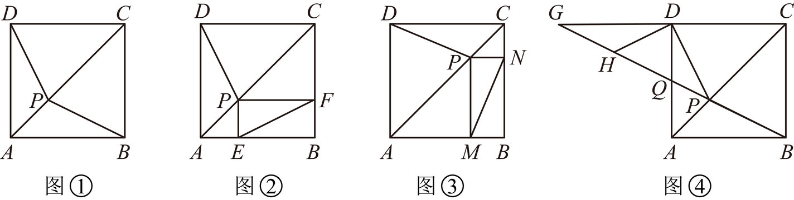

# Mathematics - 题目 1308

**ID**: 27f520c4920d46dfa9e41b7b0bf888c7
**年级**: Grade 8
**难度**: Medium-Hard
**题型**: Calculation

## 题目
【发现】如图①，已知四边形 $ABCD$ 是正方形，P是对角线 $AC$ 上的一点，求证， $PB=PD$ ；​​​​​​​‌【探究】①如图②，在正方形 $ABCD$ 中，P是对角线 $AC$ 上的一点， $PE\bot AB，PF\bot BC$ ，垂足分别为E、F，连接 $EF、DP$ ，猜想 $EF$ 与 $DP$ 的数量关系，并证明你的猜想；②如图③，在正方形 $ABCD$ 中，P是 $AC$ 上一点，过点P作 $PM\bot AB$ 于点 ${\rm \mathit{M}，}PN\bot BC$ 于点N，若 $AB=4$ ，则 $MN$ 的最小值为；【拓展应用】如图④，在正方形 $ABCD$ 中，P是对角线 $AC$ 上的一点，延长 $BP、CD$ 交于点 ${\rm \mathit{G}，}BG$ 与 $AD$ 交于点Q，H为 $GQ$ 的中点，连接 $HD、DP$ ，则 $\vartriangle DHP$ 的形状为．

## 解答

1. 【发现】证明：∵四边形 $ABCD$ 是正方形，
2. ∴ $AD=AB，\angle BAP=\angle DAP=45{}\degree $ ，
3. 在 $△APB$ 与 $\mathrm{△}APD$ 中，
4. $\begin{cases}AD=AB\\\angle BAP=\angle DAP=45{}\degree \\AP=AP\end{cases}$ ，
5. ∴ $\vartriangle APB≌\vartriangle APD\left ({{\rm{S}}{\rm{A}}{\rm{S}}}\right )$ ，
6. ∴ $PB=PD$ .
7. 【探究】① $PD=EF$ ；如图，连接 $PB$ ，
8. 
9. 证明：由【发现】可知， $PB=PD$ ，
10. ∵四边形 $ABCD$ 是正方形，
11. $\therefore \angle ABC=90{}\degree $ ，
12. 又∵ $PE\bot AB，PF\bot BC$ ，垂足分别为E、F，
13. ∴四边形 $PEBF$ 是矩形，
14. ∴ $PB=EF$ ，
15. ∴ $DP=EF$ ；
16. ②连接 $BD，PB$ ，如图，
17. 
18. ∵四边形 $PMBN$ 是矩形，
19. ∴ $PB=MN$ ，
20. ∵四边形 $ABCD$ 是正方形，
21. ∴ $\angle DCB=\angle B=90{}\degree ，DC=BC=AD=AB=4$ ，
22. ∴ $BD=\sqrt {2}AB=\sqrt {2}\times 4=4\sqrt {2}$ ，
23. ∵四边形 $ABCD$ 是正方形，
24. ∴ $BD\bot AC$ ，
25. 当 $PB\bot AC$ 时， $PB$ 最小，
26. 此时 $PB=\frac {1}{2}BD=2\sqrt {2}$ ，
27. ∴ $MN$ 的最小值为 $2\sqrt {2}$ ，
28. 故答案为： $2\sqrt {2}$ ；
29. 【拓展应用】 $\vartriangle DHP$ 的形状为直角三角形；理由如下：
30. ∵H为 $GQ$ 的中点， $\angle ADG=90{}\degree $ ，
31. ∴ $GH=DH，\angle GDH+\angle ADH=90{}\degree $ ，
32. ∴ $\angle G=\angle GDH$ ，
33. 在 ${\rm{R}}{\rm{t}}\vartriangle BCG$ 中， $\angle G+\angle CBG=90{}\degree $ ，
34. 在 $△CDP$ 与 $\vartriangle CBP$ 中，
35. $\begin{cases}PB=PD\\CD=CB\\CP=CP\end{cases}$ ，
36. ∴ $\vartriangle CDP≌\vartriangle CBP\left ({{\rm{S}}{\rm{S}}{\rm{S}}}\right )$ ，
37. ∴ $\angle CDP=\angle CBP$ ，
38. ∴ $\angle GDH+\angle CDP=90{}\degree $ ，
39. ∴ $\angle HDP=90{}\degree $ ，
40. ∴ $\vartriangle DHP$ 的形状为直角三角形，
41. 故答案为：直角三角形．

## 知识点

**中文**:
  - 正方形的性质
  - 直角三角形斜边上的中线
  - 矩形的判定与性质综合

**English**:
  - Properties of Squares
  - Median to Hypotenuse of Right Triangle
  - Determination and Properties of Rectangles

---
