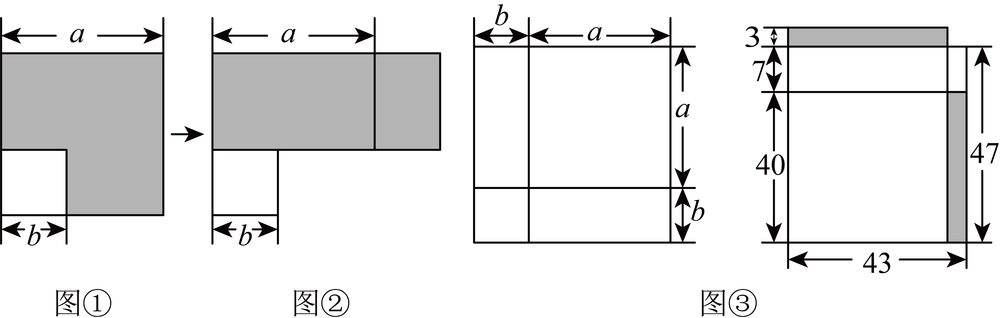
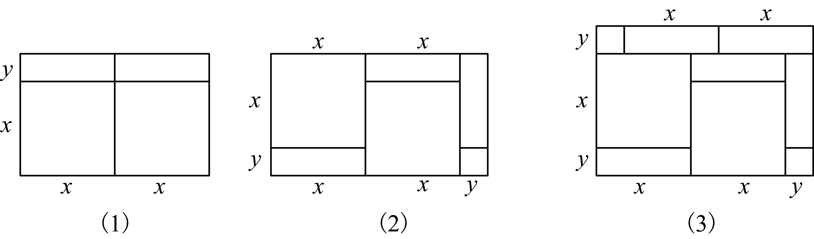

# Mathematics - 题目 3866

**ID**: 29a10e122c084a1cb143d00cdcf9db9d
**年级**: Grade 8
**难度**: Medium-Hard
**题型**: Calculation

## 题目
在前面的学习中，我们通过对同一面积的不同表达和比较，利用图①和图②发现并验证了平方差公式和完全平方公式，不仅更清晰地“看到”公式的结构，同时感受到这样的抽象代数运算也有直观的背景．这种利用面积关系解决问题的方法，使抽象的数量关系因几何直观而形象化．请你利用上述方法解决下列问题：（1）请写出图（1）、图（2）、图（3）所表示的代数恒等式．（2）试画出一个几何图形，使它的面积能表示 $\left ({x+y}\right )\left ({x+3y}\right )=x{^{2}}+4xy+3y{^{2}}$ ．（3）提出问题： $47\times 43，56\times 54，79\times 71$ ，……是一些十位数字相同，且个位数字之和是10的两个两位数相乘的算式，是否可以找到一种速算方法？几何建模：用矩形的面积表示两个正数的乘积，以 $47\times 43$ 为例：①画长为47，宽为43的矩形，如图③，将这个 $47\times 43$ 的矩形从右边切下长40，宽3的一条，拼接到原矩形的上面．②分析：几何建模步骤原矩形面积可以有两种不同的表达方式， $47\times 43$ 的矩形面积或 $\left ({40+7+3}\right )\times 40$ 的矩形与右上角3×7的矩形面积之和，即 $47\times 43=\left ({40+10}\right )\times 40+3\times 7=5\times 4\times 100+3\times 7=2021$ ，用文字表述 $47\times 43$ 的速算方法是：十位数字4加1的和与4相乘，再乘以100，加上个位数字3与7的积，构成运算结果．请你参照上述几何建模步骤，计算 $57\times 53$ ，要求画出示意图，写出几何建模步骤（标注有关线段）．（4）归纳提炼：两个十位数字相同，并且个位数字之和是10的两位数相乘的速算方法是（用文字表述）：_，证明上述速算方法的正确性．​​​​​​​‌

## 解答

1. （1）解：根据题意，图（1）所表示的代数恒等式： $\left ({x+y}\right )·2x=2x{^{2}}+2xy$ ，
2. 图（2）所表示的代数恒等式： $\left ({x+y}\right )\left ({2x+y}\right )=2x{^{2}}+3xy+y{^{2}}$
3. 图（3）所表示的代数恒等式： $\left ({x+2y}\right )\left ({2x+y}\right )=2x{^{2}}+5xy+2y{^{2}}$ ；
4. （2）解：根据题意，几何图形如图所示：
5. 
6. （3）解：示意图如下：
7. 用文字表述 $57\times 53$ 的速算方法是：十位数字5加1的和与5相乘，再乘以100，加上个位数字3与7的积，构成运算结果，即 $57\times 53=\left ({50+10}\right )\times 50+3\times 7=6\times 5\times 100+3\times 7=3021$ ；
8. （4）解：十位数字加1的和与十位数字相乘，再乘以100，加上两个个位数字的积，构成运算结果；
9. 故答案为：十位数字加1的和与十位数字相乘，再乘以100，加上两个个位数字的积，构成运算结果．
10. 证明：设两个十位数字相同，并且个位数字之和是10的两位数的十位数为a，个位数分别是b和 $\left ({10-b}\right )$
11. 则这两个数为分别为： $10a+b、10a+10-b$ ，
12. ∴这两个数的乘积为： $\left ({10a+b}\right )\left ({10a+10-b}\right )=100a{^{2}}+100a-10ab+10ab+10b-b{^{2}}=100a{^{2}}+100a+10b-b{^{2}}=100\times \left ({a+1}\right )\times a+b\left ({10-b}\right )$ ；
13. 即十位数字加1的和与十位数字相乘，再乘以100，加上两个个位数字的积，
14. 故速算方法正确．

## 知识点

**中文**:
  - 多项式乘多项式
  - 规律型：数与式的变化类
  - 规律型：图形的变化类
  - 数字问题

**English**:
  - Polynomial times Polynomial
  - Patterns: Number and Expression Variations
  - Patterns: Geometric Variations
  - Number Problems

---
