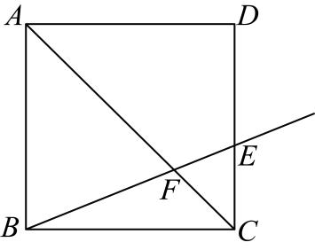

# Mathematics - 题目 401

**ID**: 2e4f34b1c1f14863b4d67982a8ccab71
**年级**: Grade 8
**难度**: Medium-Hard
**题型**: Calculation

## 题目
正方形 $ABCD$ ，点E是线段 $CD$ 上一点，作射线 $BE$ ，交 $AC$ 于点F， $\angle CBE=α\left ({0{}\degree <α<45{}\degree }\right )$ ．点A关于射线 $BE$ 的对称点为点G，连接 $BG$ ， $CG$ ，线段 $AG$ 与 $BE$ ， $BC$ 分别交于点P，Q．（1）①补全图形；​​​​​​​‌②求 $\angle AGC$ 的度数；（2）延长 $GC$ 交射线 $BF$ 于点H，连接 $AH$ ，若 $PF=CF$ ，用等式表示 $BQ$ ， $CH$ ， $AG$ 的数量关系，并证明．

## 解答

1. （1）解：①补全图形如下；
2. 
3. ② $\because $ 点 $\mathrm{A}$ ， $G$ 关于射线 $BE$ 对称，
4. $\therefore AG\bot BE$ ， $AP=GP$ ，
5. $\therefore AB=BG$ ，
6. $\therefore \angle BAP=\angle BGP$ ，
7. $\because $ 四边形 $ABCD$ 为正方形，
8. $\therefore \angle CBE+\angle ABE=90{}\degree $ ，
9. $\because \angle BAP+\angle ABE=180{}\degree -\angle APB=90{}\degree $ ，
10. $\therefore \angle BAP=\angle CBE=α$ ，
11. $\therefore \angle BGP=\angle BAP=α$ ，
12. $\therefore \angle CBG=180{}\degree -\angle BPG-\angle BGP-\angle CBE=90{}\degree -2α$ ，
13. $\because BC=AB=BG$ ，
14. $\therefore \angle BGC=\angle BCG=(180{}\degree -\angle CBG)\div 2=α+45{}\degree $ ，
15. $\therefore \angle AGC=\angle BGC-\angle BGP=45{}\degree $ ；
16. （2）解： $AG=2\sqrt {2}BQ+\sqrt {2}CH$ ，
17. 理由：如图，连接 $BD$ 交 $AC$ 于点 $O$ ，连接 $OP$ ，
18. $\because AP=PG$ ， $AO=OC$ ，
19. $\therefore PO\mathrm{/\mskip-4mu/}GC$ ， $GC=2PO$ ，
20. $\therefore \angle APO=\angle AGC=45{}\degree $ ，
21. $\therefore \angle OPF=90{}\degree -\angle APO=45{}\degree $ ，
22. $\because $  $∠ACD=\frac {1}{2}∠BCD=45{}\degree $ ，
23. $\therefore \angle OPF=\angle ACD$ ，
24. 在 $\mathrm{△}OFP$ 与 $\vartriangle EFC$ 中，
25. $\begin{cases}\angle OPF=\angle ACD\\PF=CF\\\angle OFP=\angle EFC\end{cases}$ ，
26. $\therefore $  $△OFP≌△EFC({\rm{A}}{\rm{S}}{\rm{A}})$ ，
27. $\therefore PO=EC$ ，
28. $\because AB=BC$ ， $\angle ABC=\angle BCD=90{}\degree $ ， $\angle BAQ=\angle CBE$ ，
29. $\therefore $  $△BAQ≌△CBE({\rm{A}}{\rm{S}}{\rm{A}})$ ，
30. $\therefore BQ=CE$ ，
31. $\therefore BQ=PO$ ，
32. $\therefore GC=2BQ$ ，
33. $\because AH=GH$ ， $\mathrm{∠}AGC=45{}\degree $ ，
34. $\therefore \angle GAH=\angle AGC=45{}\degree $ ， $\angle AHG=90{}\degree $ ，
35. $\therefore $  $AG=\sqrt {2}HG=\sqrt {2}\left ({GC+CH}\right )=\sqrt {2}\left ({2QB+CH}\right )$ ，
36. $\therefore $  $AG=2\sqrt {2}BQ+\sqrt {2}CH$ ．

## 知识点

**中文**:
  - 正方形的性质
  - 轴对称的性质
  - 等腰直角三角形的性质

**English**:
  - Properties of Squares
  - Properties of Axial Symmetry
  - Properties of Isosceles Right Triangles

---
