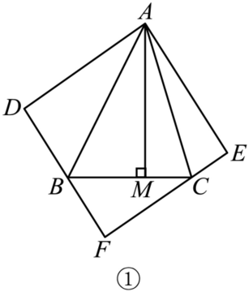
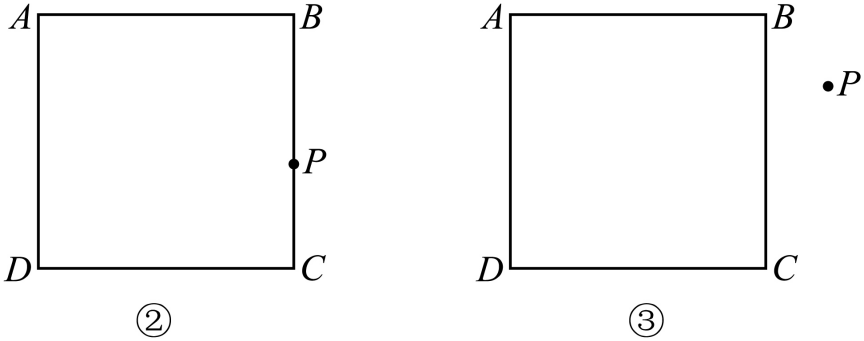

# Mathematics - 题目 1463

**ID**: 2fd8f5e2ca524bf68ec76143cdaa64e2
**年级**: Grade 8
**难度**: Medium-Hard
**题型**: Calculation

## 题目
（1）如图①，在 $\vartriangle ABC$ 中， $\angle BAC=45{}\degree $ ， $AM$ 是边 $BC$ 上的高．将 $\vartriangle ABM$ ， $△ACM$ 分别沿 $AB$ ， $AC$ 翻折得到 $\mathrm{△}ABD$ ， $△ACE$ ．延长 $DB$ ， $EC$ 交于点F．①求证：四边形 $ADFE$ 是正方形；​​​​​​​‌②若 $AM=6$ ，则 $\vartriangle BCF$ 的周长为．（2）已知正方形 $ABCD$ ，直线 $l$ 与正方形相邻的两边都相交，且所截得的直角三角形的周长等于正方形 $ABCD$ 周长的一半．求作：经过点P的一条直线 $l$ ．①如图②，当点P在正方形 $ABCD$ 的 $BC$ 边上时；②如图③，当点P在正方形 $ABCD$ 的外部时．（要求：尺规作图，保留作图痕迹，写出必要的文字说明）

## 解答

1. （1）①证明：根据折叠的性质，得 $\vartriangle AMC≌\vartriangle AEC,\vartriangle AMB≌\vartriangle ADB$ ，
2. ∴ $AM=AE=AD,\angle MAC=\angle EAC,\angle MAB=\angle DAB$ ， $\angle ADE=\angle GDE$ ，
3. $\angle AMB=\angle ADB=\angle AMC=\angle AEC=90{}\degree $ ，
4. ∵ $\angle BAC=45{}\degree $ ，
5. ∴ $\angle MAB+\angle MAC=45{}\degree $ ，
6. ∴ $\angle MAC+\angle EAC+\angle MAB+\angle DAB=2\left ({\angle MAC+\angle MAB}\right )=90{}\degree $ ，
7. ∴ $∠DAE{\rm{=}}{{9}}{{0}}{}\degree $ ，
8. ∴四边形 $ADFE$ 是矩形，
9. ∵ $AD=AE$ ，
10. ∴四边形 $ADFE$ 是正方形．
11. ②解：根据折叠的性质，得 $\vartriangle AMC≌\vartriangle AEC,\vartriangle AMB≌\vartriangle ADB$ ，
12. ∴ $DB=BM,EC=MC$ ，
13. ∴ $BC=BM+MC=BD+EC$ ，
14. ∵ $AM=6$ ，
15. ∴正方形 $ADFE$ 的边长为6，
16. ∴ $\vartriangle BCF$ 的周长为 $BF+BF+FC=BF+BD+FC+EC=FD+FE=12$ .
17. （2）①解：当点P在正方形 $ABCD$ 的 $BC$ 边上时
18. 根据（1）的证明，得到 $\vartriangle BCF$ 的周长为正方形周长的一半，
19. 
20. 连接 $AP$ ，再作 $\angle BAP=\angle NAP$ ，最后作 $\angle DAN$ 的平分线 $AM$ ，
21. 作直线 $PM$ ，
22. 则直线 $PM$ 即为所求的直线 $l$ ；
23. ②解：当点P在正方形 $ABCD$ 的外部时
24. 
25. ${\rm （\mathit{a}）}$ 以A为圆心，以 $AB$ 为半径作 $\odot A$ ；
26. ${\rm （\mathit{b}）}$ 连接 $AP$ ，作 $AP$ 的垂直平分线交 $AP$ 于点O；
27. ${\rm （\mathit{c}）}$ 以O为圆心，以 $OA$ 为半径作 $\odot O$ 与 $\odot A$ 交于点Q；
28. 作直线 $PQ$ ，
29. 则直线 $PQ$ 即为所求直线 $l$ ．理由如下：
30. 设直线 $PQ$ 与 $BC$ 交于点G，交 $DC$ 于点H，
31. 根据作图，得 $\angle AQP=\angle ABG=90{}\degree $ ，
32. ∵ $AB=AQ,AG=AG$ ，
33. ∴ $\vartriangle ABG≌\vartriangle AQG$ ，
34. ∴ $\angle BAG=\angle QAG$ ，
35. 同理可证， $\angle DAH=\angle QAH$ ，
36. 于是可得 $\angle GAH=45{}\degree $ ，
37. 符合了问题1的条件，结论自然成立，
38. 则 $\vartriangle HGC$ 即为所求．

## 知识点

**中文**:
  - 正方形的性质

**English**:
  - Properties of Squares

---
