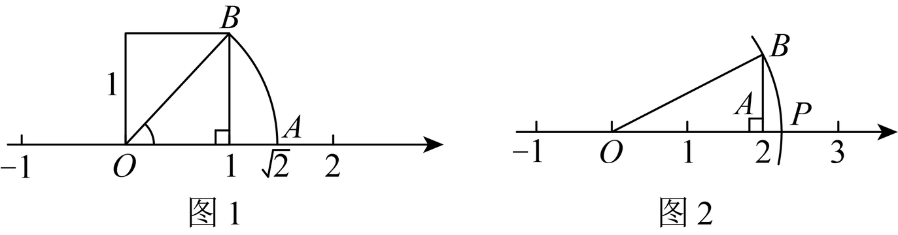
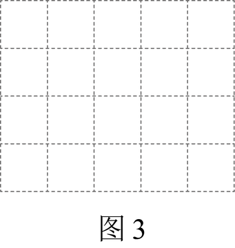
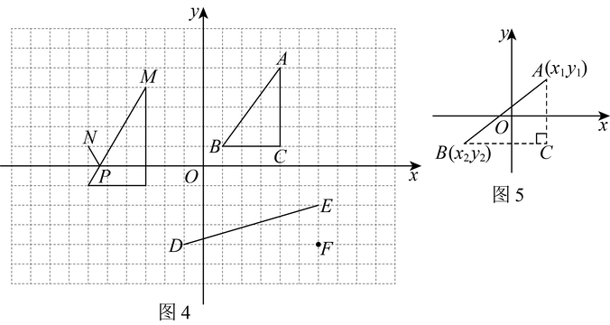

# Mathematics - 题目 130

**ID**: 39c41b71e92a448386280040aef93285
**年级**: Grade 8
**难度**: Medium-Hard
**题型**: Calculation

## 题目
在“勾股定理”一章的学习中，我们体会到了勾股定理应用的广泛性，以及“数形结合”是解决数学问题的一种重要的思想方法．（1）【已有认识】 $\sqrt {2}$ 既可以从算术平方根的角度理解，结合勾股定理的知识，也能将其看成是直角边都为1的直角三角形的斜边长，即 $\sqrt {2}=\sqrt {1{^{2}}+1{^{2}}}$ ，由此得到在数轴上寻找 $\sqrt {2}$ 所表示的点的方法，如图1．【拓展运用】如图2，点 $O$ 、点 $A$ 在数轴上，且 $OA=2$ ， $AB=1$ ， $AB\bot OA$ 于 $A$ ，以点 $O$ 为圆心， $OB$ 长为半径画弧，交数轴于点 $P$ ，则数轴中点 $P$ 表示的数是_．（直接写出答案）（2）【已有认识】结合正方形网格，我们还可以表示某些长度为无理数的线段．【拓展运用】请在图3正方形网格（每个小正方形的边长为1）内画出顶点在格点的 $\vartriangle ABC$ ，其中 $AC=\sqrt {2}$ ， $BC=2\sqrt {2}$ ， $AB=\sqrt {10}$ ，并求出 $\vartriangle ABC$ 的面积，以及点 $C$ 到 $AB$ 边的距离．（3）【已有认识】如图4，结合直角坐标系，我们发现：要求出坐标系中 $A$ 、 $B$ 两点的距离，显然是转化为求 $Rt{\rm △}$  $ABC$ 的斜边长．下面以求 $DE$ 为例来说明如何解决：从坐标系中发现： $D\left ({-1,\,-4}\right ),\,E\left ({6,\,-2}\right )$ ，所以 $DF=\left |{6-\left ({-1}\right )}\right |=7,\,EF=\left |{-2-\left ({-4}\right )}\right |=2$ ，所以由勾股定理可得， $DE=\sqrt {7{^{2}}+2{^{2}}}=\sqrt {53}$ ．【拓展运用】①在图5中，设 $A\left ({x{{}_{1}},\,y{{}_{1}}}\right ),\,B\left ({x{{}_{2}},\,y{{}_{2}}}\right )$ ， $AC{\rm{/\mskip-4mu/}}y$ 轴， $BC{\rm{/\mskip-4mu/}}x$ 轴， $AC\bot BC$ 于点 $C$ ，则 $AC=$， $BC=$，由此得到平面直角坐标系内任意两点间的距离公式， $AB=\sqrt {{\left({x{{}_{1}}-x{{}_{2}}}\right)^{2}}+{\left({y{{}_{1}}-y{{}_{2}}}\right)^{2}}}$ （直接写出答案）②图4中，平面直角坐标系中有两点 $M\left ({-3,\,4}\right ),\,N\left ({-6,\,1}\right )$ ， $P$ 为 $x$ 轴上任一点，则 $PM+PN$ 的最小值为；​​​​​​​‌（直接写出答案）③应用平面内两点间的距离公式，求代数式 $\sqrt {{\left({x+1}\right)^{2}}+{\left({y-2}\right)^{2}}}+\sqrt {{\left({x-5}\right)^{2}}+{\left({y+1}\right)^{2}}}$ 的最小值为：．（直接写出答案）

## 解答

1. （1）解：∵ $OA=2$ ， $AB=1$ ， $AB\bot OA$ ，
2. ∴ $OP=OB=\sqrt {2{^{2}}+1{^{2}}}=\sqrt {5}$ ，
3. ∴数轴中点 $P$ 表示的数是 $\sqrt {5}$ .
4. （2）解： $AC=\sqrt {1{^{2}}+1{^{2}}}=\sqrt {2}$ ， $BC=\sqrt {2{^{2}}+2{^{2}}}=2\sqrt {2}$ ， $AB=\sqrt {3{^{2}}+1{^{2}}}=\sqrt {10}$ ，
5. $\vartriangle ABC$ 如图所示，
6. $\vartriangle ABC$ 的面积为 $2\times 3-\frac {1}{2}\times 1\times 3-\frac {1}{2}\times 2\times 2-\frac {1}{2}\times 1\times 1=2$ ，
7. 点 $C$ 到 $AB$ 边的距离为 $\frac {2\times 2}{\sqrt {10}}=\frac {2\sqrt {10}}{2}$ ；
8. （3）解：①∵ $A\left ({x{{}_{1}},\,y{{}_{1}}}\right ),\,B\left ({x{{}_{2}},\,y{{}_{2}}}\right )$ ， $AC{\rm{/\mskip-4mu/}}y$ 轴， $BC{\rm{/\mskip-4mu/}}x$ 轴， $AC\bot BC$ 于点 $C$ ，则 $AC=\left ({y{{}_{1}}-y{{}_{2}}}\right )$ ， $BC=\left ({x{{}_{1}}-x{{}_{2}}}\right )$ ，由此得到平面直角坐标系内任意两点间的距离公式， $AB=\sqrt {{\left({x{{}_{1}}-x{{}_{2}}}\right)^{2}}+{\left({y{{}_{1}}-y{{}_{2}}}\right)^{2}}}$ ；
9. 
10. ②作点 $N$ 关于 $x$ 轴对称的点 $N^{′}$ ，连接 $MN^{′}$ ，直线 $MN^{′}$ 于 $x$ 轴的交点即为所求的点 $P$ ， $PM+PN$ 的最小值就是线段 $MN^{′}$ 的长度，
11. 
12. ∵ $N\left ({-6,\,1}\right )$ ，
13. ∴ $N^{′}{\left ({-6,\,-1}\right )}$ ，
14. ∵ $M\left ({-3,\,4}\right )$ ，
15. $\therefore PM+PN=PM+PN^{′}=MN^{′}=\sqrt {{\left({-3+6}\right)^{2}}+{\left({4+1}\right)^{2}}}=\sqrt {34}$ ，
16. 即 $PM+PN$ 的最小值为 $\sqrt {34}$ .
17. ③ $\sqrt {x{^{2}}+(y-2){^{2}}}+\sqrt {(x-3){^{2}}+(y-1){^{2}}}$ ，
18. 故原式表示点 $\left ({x,y}\right )$ 到 $\left ({-1,2}\right )$ 和 $\left ({5,-1}\right )$ 的距离之和．
19. 由两点之间线段最短，点 $\left ({x,y}\right )$ 在以 $\left ({-1,2}\right )$ 和 $\left ({5,-1}\right )$ 为端点的线段上时，原式值最小．
20. 利用公式，原式 $=\sqrt {{\left({5+1}\right)^{2}}+{\left({1+2}\right)^{2}}}=3\sqrt {5}$ ．

## 知识点

**中文**:
  - 两点间的距离公式
  - 勾股定理
  - 轴对称的性质

**English**:
  - Distance Formula
  - Pythagorean Theorem
  - Properties of Axial Symmetry

---
