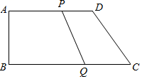

# Mathematics - 题目 1154

**ID**: 3b6abfa561c54010bc66f2f44aebb18f
**年级**: Grade 8
**难度**: Medium-Hard
**题型**: Calculation

## 题目
如图，在四边形ABCD中，AD∥BC，∠B＝90°，且AD＝12cm，AB＝8cm，DC＝10cm，若动点P从A点出发，以每秒2cm的速度沿线段AD向点D运动；​​​​​​​‌动点Q从C点出发以每秒3cm的速度沿CB向B点运动，当P点到达D点时，动点P、Q同时停止运动，设点P、Q同时出发，并运动了t秒，回答下列问题：（1）BC＝cm；（2）当t＝秒时，四边形PQBA成为矩形．（3）当t为多少时，PQ＝CD？（4）是否存在t，使得 ${\rm △\mathit{DQC}}$ 是等腰三角形？若存在，请求出t的值；若不存在，说明理由．

## 解答

1. 解：（1）根据题意得：PA=2tcm，CQ=3tcm，则 ${\rm \mathit{PD}=\mathit{AD}-\mathit{PA}=(12-2\mathit{t})cm，}0\leqslant t\leqslant 6$  ，
2. 如图，过D点作 $DE\bot BC$ 于E，
3. 
4. ∵AD∥BC，∠B＝90°，
5. ∴ $\angle A=90\degree $  ，
6. ∴四边形ABED为矩形，
7. ∴DE=AB=8cm，AD=BE=12cm，
8. 在Rt△CDE中，
9. ∵ ${\rm ∠\mathit{CED}=90°，\mathit{DC}=10cm，\mathit{DE}=8cm}$ ，
10. ∴ $EC=\sqrt {DC{^{2}}-DE{^{2}}}{\rm =6cm}$ ，
11. ∴BC=BE+EC=18cm；
12. （2）∵ $AD//BC{\rm ，∠\mathit{B}=90°}$
13. ∴当PA=BQ时，四边形PQBA为矩形，
14. 即2t=18−3t，解得 ${\rm \mathit{t}=}\frac {18}{5}$ 秒，
15. 故当 ${\rm \mathit{t}=}\frac {18}{5}$ 秒时，四边形PQBA为矩形；
16. （3）①当 $P^{′}Q^{′}//CD$ 时，如图，
17. ∵ $AD//BC$ ，
18. ∴四边形 $CDP^{′}Q^{′}$ 是平行四边形，
19. ∴ $P^{′}Q^{′}=CD$ ， $DP^{′}=CQ^{′}$ ，
20. ∴12−2t=3t，
21. ∴ ${\rm \mathit{t}=}\frac {12}{5}$ 秒；
22. 
23. ②如图，梯形PDCQ是等腰梯形时，PQ=CD，
24. 过点P作 $PF\bot BC$  于点F，则 $\angle PFE=\angle DEF=\angle PDE=90\degree $  ，
25. ∴四边形PDEF是矩形，
26. ∴ $PF=DE$  ，EF=DP=12−2t，
27. ∴ $\vartriangle CDE\cong \vartriangle QPF$ ，
28. ∴FQ=CE=6cm，
29. ∴CQ=FQ+EF+CE=6+12−2t+6=3t，
30. ∴ ${\rm \mathit{t}=}\frac {24}{5}$ ；
31. ∴当t为 $\frac {12}{5}$ 或 $\frac {24}{5}$ 时，PQ＝CD；
32. （4）△DQC是等腰三角形时，分三种情况讨论：
33. ①当QC=DC时，即3t=10，
34. ∴ ${\rm \mathit{t}=}\frac {10}{3}$ ；
35. ②当DQ=DC时， $CQ=2CE$  ，
36. 即 $3t=6\times 2$ ，
37. ∴t=4；
38. ③如图，当QD=QC时，则 $QD=3tcm$  ， $QE=QC-CE=\left ({3t-6}\right )cm$  ，
39. 
40. 在 $Rt\vartriangle QDE$  中， $QD{^{2}}=QE{^{2}}+DE{^{2}}$  ，
41. 即 ${\left({3t}\right)^{2}}={\left({3t-6}\right)^{2}}+8{^{2}}$  ，
42. 解得： ${\rm \mathit{t}=}\frac {25}{9}$ ．
43. 故存在t，使得 ${\rm △\mathit{DQC}}$ 是等腰三角形，此时t的值为 $\frac {10}{3}$ 秒或4秒或 $\frac {25}{9}$ 秒．

## 知识点

**中文**:
  - 四边形综合
  - 等腰三角形的判定与性质

**English**:
  - Comprehensive Quadrilateral Problems
  - Determination and Properties

---
