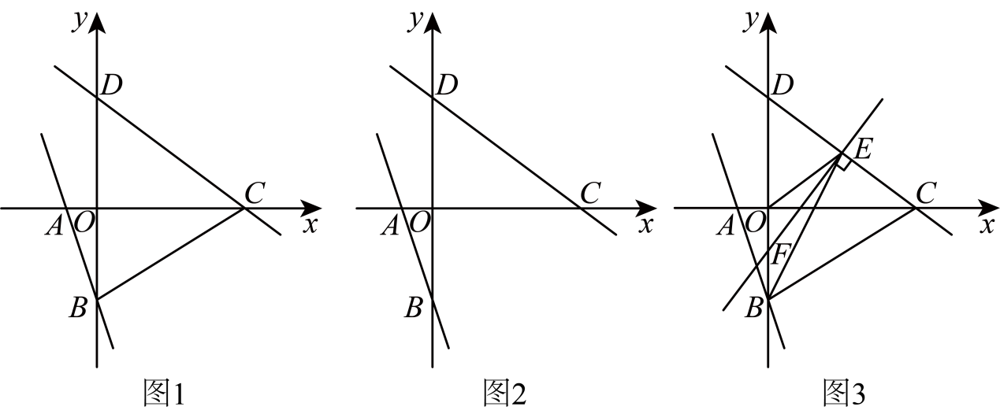

# Mathematics - 题目 3393

**ID**: 470ca0d7e0cb4300bcf9cfc536bac0b9
**年级**: Grade 8
**难度**: Medium-Hard
**题型**: Calculation

## 题目
在平面直角坐标系中，直线 $y=-3x-\frac {5}{2}$ 交x轴于点A，交y轴于点B，直线 $y=-\frac {3}{4}x+3$ 交x轴于点C，交y轴于点D（1）如图1，连接BC，求 $\mathrm{△}BCD$ 的面积；​​​​​​​‌（2）如图2，在直线 $y=-\frac {3}{4}x+3$ 上存在点E，使得 $∠ABE{\rm{=}}{{4}}{{5}}{}\degree $ ，求点E的坐标；（3）如图3，在（2）的条件下，连接 $OE$ ，过点E作 $CD$ 的垂线交y轴于点F，点P在直线 $EF$ 上，在平面中存在一点Q，使得以O，E，P，Q为顶点的四边形为矩形，请直接写出点Q的坐标．

## 解答

1. （1）解：对于直线 $y=-3x-\frac {5}{2}$ ，令 $x=0$ ，则 $y=-\frac {5}{2}$ ，故点 $B\left ({0{\rm{,}}-\frac {5}{2}}\right )$ ；
2. 对于 $y=-\frac {3}{4}x+3$ ，令 $x=0$ ，则 $y=3$ ，令 $y=0$ ，即 $-\frac {3}{4}x+3=0$ ，
3. 解得： $x=4$ ，
4. 故点 $D(0{\rm{,}}3)$ 、 $C(4{\rm{,}}0)$ ，
5. 则 $BD=3+\frac {5}{2}=\frac {11}{2}$ ， $OC=4$ ，
6. 所以， $\mathrm{△}BCD$ 的面积 $=\frac {1}{2}\times BD\times OC=\frac {1}{2}\times \frac {11}{2}\times 4=11$ ；
7. （2）解：由题意， $∠ABE{\rm{=}}{{4}}{{5}}{}\degree $ ，观察图象可知，点E只能直线在 $AB$ 的右侧，过点E作 $BE$ 的垂线交 $AB$ 于点R，过点E作y轴的平行线交过点R与x轴的平行线于点G，交过点B与x轴的平行线于点H，如图2，
8. 
9. 设点 $E\left ({m{\rm{,}}-\frac {3}{4}m+3}\right )$ ，点 $R\left ({n{\rm{,}}-3n-\frac {5}{2}}\right )$ ，
10. ∵ $∠ABE{\rm{=}}{{4}}{{5}}{}\degree $ ，故 $ER=EB$ ，
11. ∵ $\angle REG+\angle BEH=90{}\degree ，\angle BEH+\angle EBH=90{}\degree $ ，
12. ∴ $\angle REG=\angle EBH$ ，
13. ∵ $\angle EHB=\angle RGE=90{}\degree ，EB=ER$ ，
14. ∴ $\vartriangle EHB≌\vartriangle RGE\left ({{\rm{A}}{\rm{A}}{\rm{S}}}\right )$ ，
15. ∴ $RG=EH，BH=GE$ ，
16. 即 $m=-3n-\frac {5}{2}+\frac {3}{4}m-3$ ， $-\frac {3}{4}m+3+\frac {5}{2}=m-n$ ，
17. 解得， $\begin{cases}m=2\\n=-2\end{cases}$ ，
18. 故点 $E\left ({2{\rm{,}}\frac {3}{2}}\right )$ ；
19. （3）解：如图3，设 $EF$ 交x轴于点M，
20. 
21. ∵点 $E\left ({2{\rm{,}}\frac {3}{2}}\right ){\rm{,}}C\left ({4{\rm{,}}0}\right ){\rm{,}}D\left ({0{\rm{,}}3}\right )$ ，
22. ∴ $EC=\sqrt {{\left({4-2}\right)^{2}}+{\left({\frac {3}{2}}\right)^{2}}}=\frac {5}{2}$ ， $CD=\sqrt {3{^{2}}+4{^{2}}}=5$ ，
23. ∵过点E作 $CD$ 的垂线交y轴于点F，
24. ∴ $\angle MEC=90{}\degree $ ，
25. ∴ $\vartriangle CEM∽\vartriangle COD$ ，
26. ∴ $\frac {CM}{CD}=\frac {CE}{CO}$ ，
27. ∴ $\frac {CM}{5}=\frac {\frac {5}{2}}{4}$ ，
28. 解得： $CM=\frac {25}{8}$ ，
29. ∴ $OM=4-\frac {25}{8}=\frac {7}{8}$ ，
30. 设直线 $EF$ 的表达式为 $y=kx+b$ ，
31. 把 $E\left ({2{\rm{,}}\frac {3}{2}}\right ){\rm{,}}$  $M\left ({\frac {7}{8},0}\right )$ 代入 $y=kx+b$ ，得：
32. $\begin{cases}2k+b=\frac {3}{2}\\\frac {7}{8}k+b=0\end{cases}$ ，
33. 解得， $\begin{cases}k=\frac {4}{3}\\b=-\frac {7}{6}\end{cases}$ ，
34. 所以，直线 $EF$ 的表达式为 $y=\frac {4}{3}x-\frac {7}{6}$ ，
35. 设点 $P\left ({a{\rm{,}}\frac {4}{3}a-\frac {7}{6}}\right )$ ，点 $Q(s{\rm{,}}t)$ ，
36. 点O向右平移2个单位向上平移 $\frac {3}{2}$ 个单位得到E，
37. 同样点 $P\left ({Q}\right )$ 向右平移2个单位向上平移 $\frac {3}{2}$ 个单位得到 $Q\left ({P}\right )$ ，
38. 当点P在点Q的下方时，则 $a+2=s$ 且 $\frac {4}{3}a-\frac {7}{6}+\frac {3}{2}=t$ ①，
39. $OE=OP$ ，即 $2{^{2}}+{\left({\frac {3}{2}}\right)^{2}}=a{^{2}}+{\left({\frac {4}{3}a-\frac {7}{6}}\right)^{2}}$ ②，
40. 联立①②并解得：a=2或 $-\frac {22}{25}$ ，
41. 故点Q的坐标为 $\left ({\frac {28}{25}{\rm{,}}-\frac {21}{25}}\right )$ （不合题意的值已舍去）；
42. 当点P在点Q的上方时，
43. 同理可得，点Q的坐标为 $\left ({\frac {3}{2}{\rm{,}}2}\right )$ 或 $\left ({-\frac {3}{2}{\rm{,}}-2}\right )$ ．
44. 综上，点Q的坐标为 $\left ({\frac {28}{25}{\rm{,}}-\frac {21}{25}}\right )$ 或 $\left ({\frac {3}{2}{\rm{,}}2}\right )$ 或 $\left ({-\frac {3}{2}{\rm{,}}-2}\right )$ ．

## 知识点

**中文**:
  - 一次函数图象的平移
  - 一次函数的图象和性质
  - 全等三角形的判定与性质

**English**:
  - Translation of Linear Function Graphs
  - Graphs and Properties of Linear Functions
  - Determination and Properties

---
