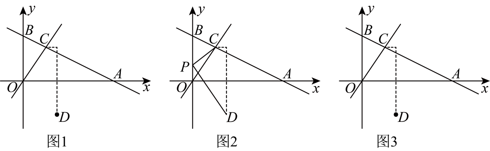

# Mathematics - 题目 2557

**ID**: 47819a3139dc4c5da0b1475a078d3809
**年级**: Grade 8
**难度**: Medium-Hard
**题型**: Calculation

## 题目
如图1，一次函数 $y=-\frac {1}{2}x+4$ 的图象与 $x$ 轴、 $y$ 轴分别交于点A、点 $B$ ，与正比例函数 $y=\frac {3}{2}x$ 的图象交于点 $C$ ，将点 $C$ 向右平移1个单位，再向下平移6个单位得到点 $D$ ．(1)求 $OA$ 、 $OB$ 的长度和点 $D$ 的坐标；​​​​​​​‌(2)如图2，点 $P$ 是 $y$ 轴上一动点，当 $CP+PD$ 最小时，求点 $P$ 的坐标；(3)若点 $Q$ 是 $x$ 轴上一动点，当 $\mathrm{△}OQD$ 为等腰三角形时，求出点 $Q$ 的坐标．

## 解答

1. （1）在 $y=-\frac {1}{2}x+4$ 中，
2. 当 $x=0$ 时， $y=4$ ，当 $y=0$ 时，由 $0=-\frac {1}{2}x+4$ 得： $x=8$ ，
3. ∴ $A\left ({8,0}\right )$ 、 $B\left ({0,4}\right )$ ．
4. ∴ $OA=8$ ， $OB=4$ ．
5. 联立 $y=-\frac {1}{2}x+4$ 与 $y=\frac {3}{2}x$ ，解得： $\begin{cases}x=2\\y=3\end{cases}$ ．
6. ∴点 $C\left ({2,3}\right )$ ．
7. 由题意得：点 $D\left ({3,-3}\right )$ ；
8. （2）作点 $D$ 关于 $y$ 轴的对称点 $D^{′}$ ，则 $D^{′}(-3,-3)$ ．
9. 连接 $CD^{′}$ 交 $y$ 轴于点 $P^{′}$ ．
10. 连接 $P^{′}D$ ，此时 $CP^{′}+PD$ 最小．
11. 设直线 $CD^{′}$ 的解析式为 $y=kx+b$ ，把点 $C\left ({2,3}\right )$ ， $D^{′}{\left ({-3,-3}\right )}$ 代入得：
12. $\begin{cases}2k+b=3\\-3k+b=-3\end{cases}$ ．解得： $k=\frac {6}{5}$ ， $b=\frac {3}{5}$ ．
13. ∴直线 $CD^{′}$ 的解析式为 $y=\frac {6}{5}x+\frac {3}{5}$ ．
14. 当 $x=0$ 时， $y=\frac {3}{5}$ ．
15. ∴点 $P^{′}{\left ({0,\frac {3}{5}}\right )}$ ，
16. 即当 $CP+PD$ 最小时，点 $P$ 的坐标为 $\left ({0,\frac {3}{5}}\right )$ ；
17. （3）设点 $Q\left ({x,0}\right )$ ，
18. ∵ $D\left ({3,-3}\right )$ ， $O\left ({0,0}\right )$
19. $\therefore OD{^{2}}={\left({3-0}\right)^{2}}+{\left({-3-0}\right)^{2}}=18$ ，
20. $OQ{^{2}}={\left({x-0}\right)^{2}}+{\left({0-0}\right)^{2}}=x{^{2}}$ ，
21. $DQ{^{2}}={\left({x-3}\right)^{2}}+{\left({0+3}\right)^{2}}={\left({x-3}\right)^{2}}+9$ ，
22. 当 $\mathrm{△}OQD$ 为等腰三角形时，可分三种情况：
23. 当 $OD=OQ$ 时，由 $18=x{^{2}}$ 得： $x=\pm 3\sqrt {2}$ ，
24. ∴ $Q\left ({-3\sqrt {2},0}\right )$ ，或 $Q\left ({3\sqrt {2},0}\right )$ ，
25. 当 $OD=DQ$ 时，由 $18={\left({x-3}\right)^{2}}+9$ 得：
26. $x=6$ 或 $x=0$ （与 $O$ 重合，舍去），
27. ∴ $Q\left ({6,0}\right )$ ，
28. 当 $OQ=DQ$ 时，由 $x{^{2}}={\left({x-3}\right)^{2}}+9$ 得： $x=3$ ，
29. ∴ $Q\left ({3,0}\right )$ ，
30. 综上， $\mathrm{△}OQD$ 为等腰三角形时，点 $Q$ 坐标为 $Q\left ({-3\sqrt {2},0}\right )$ ，或 $Q\left ({3\sqrt {2},0}\right )$ ，或 $Q\left ({3,0}\right )$ 或 $Q\left ({6,0}\right )$ ．

## 知识点

**中文**:
  - 一次函数图象的平移
  - 一次函数的图象和性质
  - 等腰三角形的性质
  - 最短路径问题

**English**:
  - Translation of Linear Function Graphs
  - Graphs and Properties of Linear Functions
  - Properties of Isosceles Triangles
  - Shortest Path Problems

---
