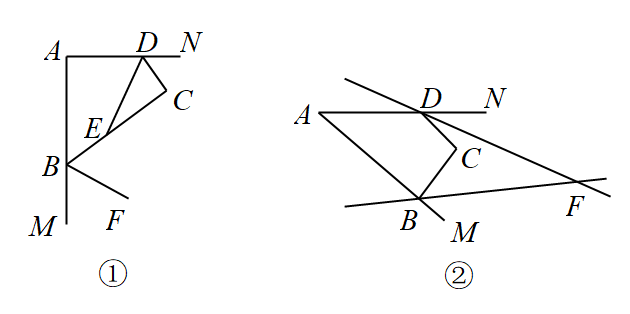

# Mathematics - 题目 2868

**ID**: 532fe5f373b046a8ad675748e3f60fde
**年级**: Grade 8
**难度**: Medium-Hard
**题型**: Calculation

## 题目
已知在四边形 $ABCD$ 中， $\angle A=x$ ， $\angle C=y$ （ $0{}^\circ <x<180{}^\circ $ ， $0{}^\circ <y<180{}^\circ $ ）．(1) $\angle ABC+\angle ADC=$（用含 $x$ 、 $y$ 的代数式表示）．(2)如图①，若 $x=y=90{}^\circ $ ， $DE$ 平分 $∠ADC$ ， $BF$ 平分与 $∠ABC$ 相邻的外角，请写出 $DE$ 与 $BF$ 的位置关系，并说明理由．(3)如图②， $\angle DFB$ 为与 $∠ABC$ 、 $∠ADC$ 相邻的外角平分线所在直线构成的锐角．①当 $x<y$ 时，若 $x+y=140{}^\circ $ ， $\angle DFB=30{}^\circ $ 试求 $x$ 、 $y$ ；​​​​​​​‌②小明在作图时，发现 $\angle DFB$ 不一定存在，请指出 $x$ 、 $y$ 满足什么条件时， $\angle DFB$ 不存在．

## 解答

1. （1）解：∵在四边形 $ABCD$ 中，
2. ∴ $\angle ABC+\angle ADC{\rm{+}}\angle A+\angle C=360{}^\circ $ ，
3. ∵ $\angle A=x$ ， $\angle C=y$ ，
4. ∴ $\angle ABC+\angle ADC=360{}^\circ -x-y$ ；
5. （2）解： $DE\bot BF$ ，理由：如答图①，延长 $DE$ 交 $BF$ 于点 $G$ ，
6. 
7. 由（1）知： $∠ABC+∠ADC=360{}^\circ -\left ({∠A+∠C}\right )=360{}^\circ -x-y$ ，
8. ∴当 $x=y=90{}^\circ $ 时， $\angle ABC+\angle ADC=180{}^\circ $ ，
9. ∵ $\angle ABC+\angle CBM=180{}^\circ $ ，
10. ∴ $\angle CBM=\angle ADC$ ，
11. ∵ $DE$ 平分 $∠ADC$ ， $BF$ 平分 $\angle CBM$ ，
12. ∴ $\angle EDC=\angle CBF$ ，
13. 又∵ $\angle C=90{}^\circ $ ，
14. $\therefore ∠EDC+∠DEC=180{}^\circ -∠C=90{}^\circ $ ，
15. ∵ $\angle BEG=\angle DEC$ ， $\angle EDC=\angle CBF$ ，
16. ∴ $∠CBF+∠BEG=90{}^\circ $ ，
17. .∴ $∠EGB=180{}^\circ -90{}^\circ =90{}^\circ $ ，
18. ∴ $DE\bot BF$ ；
19. （3）解：①如答图②，连接 $FC$ 并延长至点 $H$ ，
20. 
21. ∵ $x+y=140{}^\circ $ ，
22. ∴ $∠ABC+∠ADC=360{}^\circ -\left ({∠A+∠C}\right )==360{}^\circ -x-y=220{}^\circ $ ，
23. ∵ $DF$ 平分 $\angle NDC$ ，
24. ∴ $∠FDC=\frac {1}{2}∠NDC=\frac {1}{2}\left ({180{}^\circ -∠ADC}\right )=90{}^\circ -\frac {1}{2}∠ADC$
25. 同理可证， $∠FBC=90{}^\circ -\frac {1}{2}∠ABC$ .
26. ∵ $\angle DCH=\angle CDF+\angle DFC$ ， $\angle HCB=\angle CBF+\angle HFB$ ，
27. ∴ $\angle DCB=\angle DCH+\angle HCB=\angle CDF+\angle CBF+∠DFB=210{}^\circ -\frac {1}{2}\left ({∠ADC+∠ABC}\right )=100{}^\circ $ ，
28. $\therefore y=100{}^\circ $ ， $x=40{}^\circ $ ；
29. ②如答图③，过点 $C$ 作 $KQ\mathrm{/\mskip-4mu/}DE$ ，
30. 
31. 由①得： $∠EDC=90{}^\circ -\frac {1}{2}∠ADC$ ， $∠CBF=90{}^\circ -\frac {1}{2}∠ABC$ ，
32. ∵ $KQ\mathrm{/\mskip-4mu/}DE$ ，
33. ∴ $∠EDC=∠DCK=90{}^\circ -\frac {1}{2}∠ADC$ ，
34. ∴ $∠BCK=∠DCB-∠DCK=y-\left ({90{}^\circ -\frac {1}{2}∠ADC}\right )$ .
35. 又∵ $∠ABC+∠ADC=360{}^\circ -\left ({∠A+∠C}\right )=360{}^\circ -x-y$ ，
36. ∴当 $x=y$ 时， $∠ABC+∠ADC=360{}^\circ -2y$ ，
37. ∴ $∠ABC=360{}^\circ -2y-∠ADC$ .
38. ∴，
39. $\therefore ∠KCB=∠CBF$ ，
40. $\therefore KQ\mathrm{/\mskip-4mu/}BF$ ，
41. $\therefore DE\parallel BF$ ，
42. 此时， $DE$ 与 $BF$ 没有交点，
43. ∴当 $0{}^\circ <x<180{}^\circ $ 且 $x=y$ 时， $\angle DFB$ 不存在；
44. 【点睛】本题考查根据角平分线求解，四边形内角和定理，平行线性质与判定，解题的关键是作出辅助线及注意整体代换的思想．

## 知识点

**中文**:
  - 多边形的内角

**English**:
  - Interior Angles of Polygons

---
