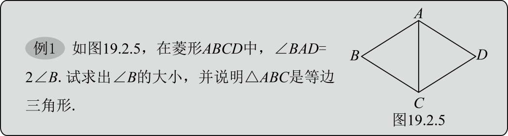
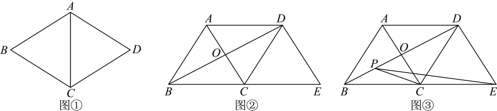

# Mathematics - 题目 2989

**ID**: 59c16d7c940f4fb4831b3d9e6a94b682
**年级**: Grade 8
**难度**: Medium-Hard
**题型**: Calculation

## 题目
【教材呈现】下图是华师版八年级下册数学教材第111页的部分内容．请结合图①，写出例1的完整解答过程．【问题探究】如图②，在菱形 $ABCD$ 中，对角线 $AC、BD$ 相交于点 ${\rm \mathit{O}，}AB=2$ ， $\angle BAD=2\angle ABC$ ．过点D作 $DE{\rm{/\mskip-4mu/}}AC$ 交 $BC$ 的延长线于点E．（1）四边形 $ACED$ 的周长为_；​​​​​​​‌（2）在（1）的条件下，若点P是对角线 $BD$ 上的一个动点，如图③，连结 $PC{\rm{、}}PE$ ，则 $PC{{+}}PE$ 的最小值为_．

## 解答

1. 解：教材呈现：∵四边形 $ABCD$ 是菱形，
2. ∴ $AD{\rm{/\mskip-4mu/}}BC{\rm{，}}AB=BC$ ，
3. ∴ $\angle BAD+\angle B=180{}\degree $ ，
4. ∵ $\angle BAD=2\angle B$ ，
5. ∴ $∠B{\rm{=}}{{6}}{{0}}{}\degree $ ，
6. ∵ $AB=BC{\rm{，}}\angle B=60{}\degree $ ，
7. ∴ $\vartriangle ABC$ 为等边三角形；
8. （1）由教材呈现可知， $\vartriangle ABC$ 为等边三角形，
9. ∴ $AC=BC=AB=2$ ,
10. ∵四边形 $ABCD$ 为菱形，
11. ∴ $AD{\rm{/\mskip-4mu/}}BC{\rm{，}}AD=BC$
12. ∴ $AD=AC=2$
13. ∵ $DE{\rm{/\mskip-4mu/}}AC$ ，
14. ∴四边形 $ACED$ 为平行四边形，
15. ∴四边形 $ACED$ 为菱形，
16. ∴四边形 $ACED$ 的周长为 $4\times 2=8$ ，
17. 故答案为：8；
18. （2）∵四边形 $ABCD$ 为菱形，
19. ∴点C与点A关于 $BD$ 对称，
20. 连接 $AE$ 交 $BD$ 于P，则 $PC+PE$ 最小，且 $PC+PE=AE$ ，
21. 
22. ∵ $△ADC$ 和 $\mathrm{△}EDC$ 是等边三角形，四边形 $ACED$ 为菱形，
23. ∴ $\angle BAC+\angle CAE=60{}\degree +30{}\degree =90{}\degree $ ，
24. ∵ $AB=2,BE=BC+CE=2+2=4$
25. ∴ $AE=\sqrt {BE{^{2}}-AB{^{2}}}=\sqrt {4{^{2}}-2{^{2}}}=2\sqrt {3}$ ，
26. 所以， $PC{{+}}PE$ 的最小值为 $2\sqrt {3}$ ．
27. 故答案为： $2\sqrt {3}$ ．

## 知识点

**中文**:
  - 等边三角形的判定与性质
  - 菱形的判定与性质综合
  - 轴对称的性质

**English**:
  - Determination and Properties
  - Determination and Properties of Rhombuses
  - Properties of Axial Symmetry

---
