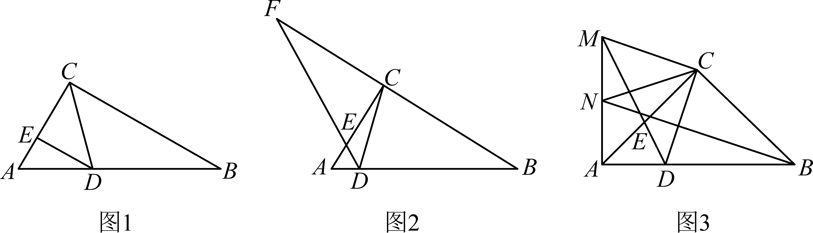

# Mathematics - 题目 3254

**ID**: 5e84a9a21dd541c2a2200d28a6546984
**年级**: Grade 8
**难度**: Medium-Hard
**题型**: Calculation

## 题目
在 $\vartriangle ABC$ 中， $∠ACB=90{}\degree $ ，点D是边 $AB$ 上一动点，点E是直线 $AC$ 上的点，且 $∠CDE=45{}\degree $ ．（1）如图1，若 $∠B=30{}\degree $ ， $DE{\rm{/\mskip-4mu/}}BC$ ，且 $AE=1$ ，求线段 $CD$ 的长；​​​​​​​‌（2）如图2，若 $BC=BD$ ， $DE$ 的延长线交 $BC$ 的延长线于点F，求证： $CF=AC+AD$ ；（3）如图3，若 $AC=BC$ ，且 $BC=4$ ，过点C作 $CM\bot CD$ 交 $DE$ 的延长线于点M，连接 $AM$ ，点N为线段 $AM$ 的中点，连接 $NC$ ， $NB$ ，当 $NC+NB$ 最小时，直接写出 $\vartriangle ADM$ 的面积．

## 解答

1. （1）解：∵ $DE{\rm{/\mskip-4mu/}}BC$ ， $∠ACB=90{}\degree $
2. ∴ $∠AED=∠CED=90{}\degree $
3. ∵ $∠B=30{}\degree $ ， $AE=1$ ，
4. ∴ $AD=2AE=2\times 1=2$
5. ∴ $DE=\sqrt {AD{^{2}}-AE{^{2}}}=\sqrt {2{^{2}}-1{^{2}}}=\sqrt {3}$
6. 在 ${\rm{R}}{\rm{t}}\vartriangle DEC$ 中， $∠CDE=45{}\degree $
7. ∴ $DE=CE=\sqrt {3}$
8. ∴ $CD=\sqrt {DE{^{2}}+CE{^{2}}}=\sqrt {(\sqrt {3)}{^{2}}+(\sqrt {3)}{^{2}}}=\sqrt {6}$ ；
9. （2）证明：在 $CA$ 的延长线上截取 $AG=AD$ ，连接 $FG，GD$ ，
10. 设 $∠CAB=x{}\degree $ ，则 $∠AGD=∠ADG=\frac {1}{2}x{}\degree $ ， $∠B=90{}\degree -x{}\degree $ ，
11. 在 $\vartriangle BCD$ 中， $BC=BD$ ，
12. ∴ $∠CDB=\frac {180{}\degree -\left ({90{}\degree -x{}\degree }\right )}{2}=45{}\degree +\frac {1}{2}x{}\degree $ ，
13. 又∵ $∠CDE=45{}\degree $
14. ∴ $∠FDA=180{}\degree -∠CDE-∠CDB=180{}\degree -45{}\degree -\left ({45{}\degree +\frac {1}{2}x{}\degree }\right )=90{}\degree -\frac {1}{2}x{}\degree $ ，
15. ∴ $∠FDG=∠FDA+∠ADG=90{}\degree -\frac {1}{2}x{}\degree +\frac {1}{2}x{}\degree =90{}\degree $ ，
16. 又∵ $∠FCG=90{}\degree $
17. ∴ $F、C、D、G$ 四点在以 $FG$ 为直径的圆上，
18. ∴ $∠FGC=∠FDC=45{}\degree $
19. ∴ $∠GFC=∠FGC=45{}\degree $
20. ∴ $FC=CG=CA+AG=CA+AD$
21. 
22. （3）解：∵ $CM\bot CD$ ， $∠ACB=90{}\degree $
23. ∴ $∠MCD=∠ACB=90{}\degree $
24. 即 $∠MCA=∠DCB$
25. $\because ∠CDM=45{}\degree $ ，
26. ∴ $CM=CD$ ，
27. 又∵ $AC=BC$ ，
28. ∴ $\vartriangle MCA≌\vartriangle DCB$
29. ∴ $∠MAC=∠CBD=45{}\degree $ ， $BD=AM$
30. ∴ $∠MAD=90{}\degree $
31. 作点B关于 $AM$  的对称点 $B^{′}$ ，连 $CB^{′}$ ，交 $AM$ 于点N，这时 $NC+NB$ 最小，过点C作 $CH\bot AB$ 于点H，
32. 则 $AB^{′}=AB=4，CH=AH=\frac {1}{2}AB=2$
33. $\because AN\parallel CH$ ，
34. ∴ $\vartriangle B^{′}AN∽\vartriangle BHC$
35. ∴ $\frac {AN}{CH}=\frac {B^{′}A}{B^{′}H}$ ，即 $\frac {AN}{2}=\frac {4}{6}$
36. 解得： $AN=1.5$
37. $\because $ 点N为线段 $AM$ 的中点，
38. ∴ $AM=3$
39. ∴ $BD=AM=3$
40. ∴ $AD=1$
41. ∴ $S{{}_{\vartriangle ADM}}=\frac {1}{2}\times AD\times AM=\frac {1}{2}\times 1\times 3=\frac {3}{2}$
42. 

## 知识点

**中文**:
  - 90°的圆周角所对的弦是直径
  - 轴对称的性质
  - 相似三角形的判定与性质综合
  - 全等三角形的判定与性质

**English**:
  - Chord of 90° Inscribed Angle is Diameter
  - Properties of Axial Symmetry
  - Determination and Properties
  - Determination and Properties

---
