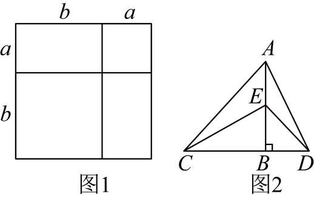

# Mathematics - 题目 2914

**ID**: 646f71c2e19b4014be987700961076c2
**年级**: Grade 8
**难度**: Medium-Hard
**题型**: Calculation

## 题目
知识生成：我们已经知道，通过计算几何图形的面积可以表示一些代数恒等式，如图1可以得到 ${\left({a+b}\right)^{2}}=a{^{2}}+2ab+b{^{2}}$ ，等式变形可得 $a{^{2}}+b{^{2}}={\left({a+b}\right)^{2}}-2ab$ ，基于此，请解答下列问题：（1）直接应用：若 $ab=3,a+b=3$ ，直接写出 $a{^{2}}+b{^{2}}$ 的值为；​​​​​​​‌（2）类比应用：若 $x\left ({2-x}\right )=1$ ，则 $x{^{2}}+{\left({2-x}\right)^{2}}=$；（直接写结果）（3）知识迁移：两个全等的直角三角形， ${\rm{R}}{\rm{t}}\vartriangle ABD≌{\rm{R}}{\rm{t}}\vartriangle CBE$ ，其中 $\angle ABD=\angle CBE=90{}\degree $ ．如图2所示放置，其中 $C$ ， $B$ ， $D$ 在一直线上，连接 $AC$ ， $DE$ ，若 $AE=4$ ， $S{{}_{\mathrm{△}ABD}}=10$ ，设 $AB=BC=a,BD=BE=b$ ，求四边形 $ACDE$ 的面积 $\mathrm{S}$ 的大小．

## 解答

1. （1）解：∵ $ab=3$ ， $a+b=3$ ，
2. ∴ $a{^{2}}+b{^{2}}={\left({a+b}\right)^{2}}-2ab$
3. $=3{^{2}}-2\times 3$
4. $=3$ .
5. （2）解：∵ $x\left ({2-x}\right )=1$ ， $x+\left ({2-x}\right )=2$ ，
6. ∴ $x{^{2}}+{\left({2-x}\right)^{2}}=\left [x+\left ({2-x}\right )\right ]{^{2}}-2x\left ({2-x}\right )$
7. $=2{^{2}}-2\times 1$
8. $=2$ .
9. （3）解：∵ ${\rm{R}}{\rm{t}}\vartriangle ABD≌{\rm{R}}{\rm{t}}\vartriangle CBE$ ，
10. ∴ $BD=BE$ ， $AB=CB$ ，
11. 设 $AB=CB=a\left ({a>0}\right )$ ， $BD=BE=b\left ({b>0}\right )$ ，
12. ∵ $AE=4$ ， $AB-BE=AE$ ，
13. ∴ $a-b=4$ ，
14. ∵ $S{{}_{\mathrm{△}ABD}}=10$ ， $\angle ABD=\angle CBE=90{}\degree $ ，
15. ∴ $\frac {1}{2}AB\cdot BD=\frac {1}{2}ab=10$ ，即 $ab=20$ ，
16. ∴四边形 $ACDE$ 的面积 $S=S{{}_{\vartriangle ABC}}+S{{}_{\vartriangle BDE}}$
17. $=\frac {1}{2}AB\cdot BC+\frac {1}{2}BD\cdot BE$
18. $=\frac {1}{2}a{^{2}}+\frac {1}{2}b{^{2}}$
19. $=\frac {1}{2}\left ({a{^{2}}+b{^{2}}}\right )$
20. $=\frac {1}{2}\left [{\left({a-b}\right)^{2}}+2ab\right ]$
21. $=\frac {1}{2}\times \left ({4{^{2}}+2\times 20}\right )$
22. $=28$ ，
23. 所以四边形 $ACDE$ 的面积 $\mathrm{S}$ 的大小为 $28$ ．

## 知识点

**中文**:
  - 完全平方公式
  - 完全平方公式与几何图形

**English**:
  - Perfect Square Formula
  - Perfect Square Formula and Geometric Figures

---
