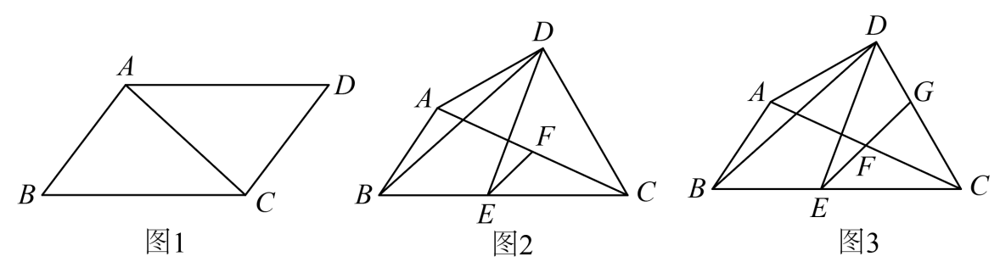

# Mathematics - 题目 2157

**ID**: 65d7211084c14e379ccbb99a8a8b68dd
**年级**: Grade 8
**难度**: Medium-Hard
**题型**: Calculation

## 题目
定义：若端点均在四边形边上的线段平分该四边形的面积，则我们称这条线段为该四边形的等积线．例：如图1，在 $▱ABCD$ 中，连结 $AC$ ，我们可以利用“夹在两条平行线间的垂线段相等”，结合“等底（同底）等高的两个三角形面积相等”来说明 $\vartriangle ABC$ 与 $△ADC$ 的面积相等，即 $AC$ 是 $▱ABCD$ 的等积线．(1)请利用图1完成例的证明．(2)如图2，在四边形 $ABCD$ 中，连结 $AC，BD$ ．已知点 $D$ 与 $BC$ 上一点 $E$ 的连线段 $DE$ 是四边形 $ABCD$ 的等积线，过点 $E$ 作 $BD$ 的平行线，交 $AC$ 于点 $F$ ，若 $AC=6$ ，求 $CF$ 的长度．(3)如图3，在（2）的条件下，延长 $EF$ ，交 $CD$ 于点 $G$ ．若 $FG=EF$ ，请在图中找出一条不同于 $DE$ 的四边形 $ABCD$ 的等积线，并说明理由．​​​​​​​‌

## 解答

1. （1）解：过 $\mathrm{A}$ 作 $AE\bot BC$ 于 $E$ ，过 $C$ 作 $CF\bot AD$ 于 $F$ ，
2. 
3. ∵ $▱ABCD$ ，
4. ∴ $AD=BC$ ， $AD{\rm{/\mskip-4mu/}}BC$ ，
5. ∵夹在两条平行线间的垂线段相等，
6. ∴ $AE=CF$ ，
7. ∵ $S{{}_{\mathrm{△}ABC}}=\frac {1}{2}AE\cdot BC$ ， $S{{}_{\vartriangle ADC}}=\frac {1}{2}CF\cdot AD$ ，
8. ∴ $S{{}_{\mathrm{△}ABC}}=S{{}_{\mathrm{△}ADC}}$ ，即 $AC$ 是 $▱ABCD$ 的等积线．
9. （2）解，连接 $DF$ ， $BF$ ，过 $B$ 作 $BM\bot AC$ 于 $M$ ，过 $D$ 作 $DN⊥AC$ 于 $N$ ，
10. 
11. ∵ $BD/\mskip-4mu/EF$ ，
12. ∴ $S{{}_{\vartriangle BDE}}=S{{}_{\vartriangle BDF}}$ ，
13. ∵线段 $DE$ 是四边形 $ABCD$ 的等积线，
14. ∴ $S{{}_{\vartriangle BDE}}+S{{}_{\vartriangle ABD}}=\frac {1}{2}S{{}_{ABCD}}$ ，
15. ∴ $S{{}_{\vartriangle BDF}}+S{{}_{\vartriangle ABD}}=S{{}_{四边形ABED}}=\frac {1}{2}S{{}_{四边形ABCD}}$ ，
16. ∴ $S{{}_{\vartriangle CDF}}+S{{}_{\vartriangle CBF}}=S{{}_{四边形ABCD}}-S{{}_{四边形ABFD}}=S{{}_{四边形ABCD}}-S{{}_{四边形ABED}}=\frac {1}{2}S{{}_{四边形ABCD}}$ ，
17. ∵ $S{{}_{\vartriangle BDF}}+S{{}_{\vartriangle ABD}}=S{{}_{四边形ABED}}=S{{}_{\vartriangle ADF}}+S{{}_{\vartriangle ABF}}$ ，
18. ∴ $S{{}_{\vartriangle ADF}}+S{{}_{\vartriangle ABF}}=S{{}_{四边形ABED}}=\frac {1}{2}S{{}_{四边形ABCD}}=S{{}_{\vartriangle CDF}}+S{{}_{\vartriangle CBF}}$ ，
19. ∴ $\frac {1}{2}BM\cdot AF+\frac {1}{2}DN\cdot AF=\frac {1}{2}BM\cdot CF+\frac {1}{2}DN\cdot CF$ ，
20. ∴ $AF=CF$ ，
21. ∵ $AC=6=AF+CF$ ，
22. ∴ $CF=\frac {1}{2}AC=3$ ；
23. （3）连接 $AG$ ， $AE$ ，
24. 
25. 由（2）可得 $AF=CF$ ，
26. ∵ $FG=EF$ ，
27. ∴四边形 $AECG$ 是平行四边形，
28. ∴ $AE{\rm{/\mskip-4mu/}}CG$ ，
29. ∴ $S{{}_{\vartriangle ADC}}=S{{}_{\vartriangle EDC}}$ ，
30. ∵线段 $DE$ 是四边形 $ABCD$ 的等积线，
31. ∴ $S{{}_{\vartriangle DEC}}=\frac {1}{2}S{{}_{四边形ABCD}}$ ，
32. ∴ $S{{}_{\vartriangle ADC}}=S{{}_{\vartriangle EDC}}=\frac {1}{2}S{{}_{四边形ABCD}}$ ，
33. ∴线段 $AC$ 是四边形 $ABCD$ 的等积线．

## 知识点

**中文**:
  - 平行四边形的判定与性质
  - 平行线之间的距离

**English**:
  - Determination and Properties
  - Distance Between Parallel Lines

---
