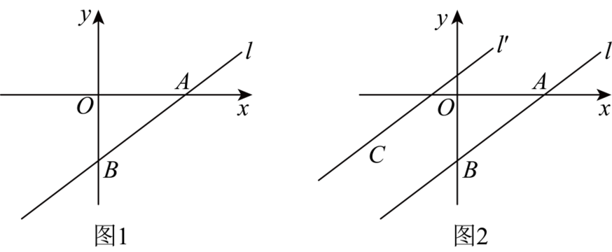

# Mathematics - 题目 70

**ID**: 6780f39a3ebf431b9d70f048e4b37432
**年级**: Grade 8
**难度**: Medium-Hard
**题型**: Calculation

## 题目
如图1，直线 $l:y=kx+b$ 分别交x轴和y轴交于点 $A\left ({a,0}\right ),B\left ({0,b}\right )$ 且 $\sqrt {a-4}+\sqrt {3+b}=0$ ．（1）求直线 $AB$ 的解析式；​​​​​​​‌（2）若点P为x轴上一动点，且 $S{{}_{△ABP}}=\frac {2}{3}S{{}_{△ABO}}$ ，求此时的P点坐标；（3）如图2，将直线 $AB$ 向上平移4个单位得到直线 $l^{′}$ ，平移后的直线 $l^{′}$ 经过点 $C\left ({-4,m}\right )$ ，若点M为平面内一点，且以A，B，C，M四点为顶点的四边形为平行四边形，请直接写出所有符合条件的点M的坐标．

## 解答

1. （1）解：∵ $\sqrt {a-4}+\sqrt {3+b}=0$ ，
2. ∴ $a-4=0$ ， $3+b=0$ ，
3. ∴ $a=4$ ， $b=-3$ ，
4. ∴ $A\left ({4,0}\right )$ ， $B\left ({0,-3}\right )$ ，
5. 把 $A\left ({4,0}\right )$ ， $B\left ({0,-3}\right )$ 代入 $y=kx+b$ ，得
6. $\begin{cases}4k+b=0\\b=-3\end{cases}$ ，解得， $\begin{cases}k=\frac {3}{4}\\b=-3\end{cases}$ ，
7. ∴直线 $AB$ 的解析式 $y=\frac {3}{4}x-3$ ．
8. （2）解：∵ $A\left ({4,0}\right )$ ， $B\left ({0,-3}\right )$ ，
9. ∴ $OA=4$ ， $OB=3$ ，
10. ∵ $S{{}_{△ABP}}=\frac {2}{3}S{{}_{△ABO}}$ ，
11. ∴ $\frac {1}{2}AP\cdot OB=\frac {2}{3}\times \frac {1}{2}OA\cdot OB$ ，
12. $\left |{4-x{{}_{P}}}\right |=\frac {2}{3}\times 4$ ，
13. 解得， $x{{}_{P}}=\frac {4}{3}$ ， $x{{}_{P}}=\frac {20}{3}$ ，
14. ∴点P的坐标为 $\left ({\frac {4}{3},0}\right )$ 或 $\left ({\frac {20}{3},0}\right )$ ．
15. （3）解：∵直线 $AB$ 的解析式 $y=\frac {3}{4}x-3$ ，将直线 $AB$ 向上平移4个单位得到直线 $l^{′}$ ，
16. ∴直线 $l^{′}$ 的解析式为 $y=\frac {3}{4}x-3+4=\frac {3}{4}x+1$ ，
17. 把 $C\left ({-4,m}\right )$ 代入 $y=\frac {3}{4}x+1$ ，得
18. $m=\frac {3}{4}\times \left ({-4}\right )+1=-2$ ，
19. ∴ $C\left ({-4,-2}\right )$ ，
20. 当以 $AC$ 为对角线的平行四边形 $ABCM$ 时，
21. ∵ $B\left ({0,-3}\right )$ ， $C\left ({-4,-2}\right )$ ，
22. ∴ $AB$ 向左平移4个单位，向上平移1个单位，可以得到 $MC$ ，
23. ∵ $A\left ({4,0}\right )$ ，
24. ∴点M的坐标为 $\left ({0,1}\right )$ ；
25. 当以 $AB$ 为对角线的平行四边形 $ACBM$ 时，
26. 同理可得点M的坐标为 $\left ({8,-1}\right )$ ；
27. 当以 $BC$ 为对角线的平行四边形 $ABMC$ 时，
28. 同理可得点M的坐标为 $\left ({-8,-5}\right )$ .
29. 综上，点M的坐标为 $\left ({0,1}\right )$ 或 $\left ({8,-1}\right )$ 或 $\left ({-8,-5}\right )$ ．

## 知识点

**中文**:
  - 一次函数图象的平移
  - 一次函数的图象和性质
  - 待定系数法求一次函数解析式

**English**:
  - Translation of Linear Function Graphs
  - Graphs and Properties of Linear Functions
  - Finding Expressions by Undetermined Coefficients

---
