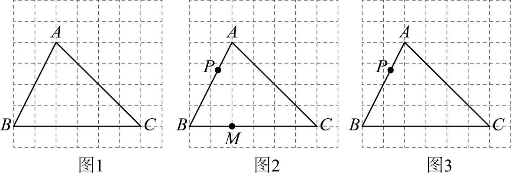

# Mathematics - 题目 859

**ID**: 6c57b372e6f54d298fe9461a95dff18c
**年级**: Grade 8
**难度**: Medium-Hard
**题型**: Calculation

## 题目
如图是由边长为1的小正方形构成的 $7\times 7$ 网格，每个小正方形的顶点叫做格点， $\vartriangle ABC$ 的顶点在格点上，仅用无刻度直尺在网格中完成下列作图．(1)在图1中，作 $\vartriangle ABC$ 的中线 $AQ$ ；​​​​​​​‌(2)在图1中，在 $AC$ 上画一点 $D$ ，使 $\angle ABD=45{}^\circ $ ；(3)已知 $P$ 是边 $AB$ 上任意一点，①在图2中， $M$ 为格点．在 $AC$ 上画一点 $E$ ，使 $PE+ME$ 最小；②在图3中，在 $BC$ 上画一点 $F$ ，使 $PF/\mskip-4mu/AC$ ．

## 解答

1. （1）解：如图， $AQ$ 即为所求．
2. 
3. （2）解：如图：点 $D$ 即为所求．
4. 
5. 作法：在 $AB$ 右侧确定一点 $E$ ，使得 $AE=BE$ ， $\angle AEB=90{}^\circ $ ；连接 $BE$ 并延长交 $AC$ 与点 $D$ ．如图：
6. 
7. （3）解：①如图：点 $E$ 即为所求．
8. 
9. 作法：过点 $M$ 作点 $M$ 关于 $AC$ 的对称点 $M^{′}$ ，连接 $PM^{′}$ ，与 $AC$ 交于点 $E$ ，点 $E$ 即为所求．如图：
10. 
11. 理由：∵点 $M$ 与点 $M^{′}$ 关于 $AC$ 对称，
12. ∴ $EM=EM^{′}$ ，
13. 则 $PE+ME=PE+EM^{′}=PM^{′}$ ，
14. 故此时 $PE+ME$ 的值最小．
15. ②如图： $PF$ 即为所求．
16. 
17. 作法：在 $AC$ 上确定一点 $G$ ，使得 $AB=BG$ ；确定 $AG$ 的中点为点 $D$ ，分别连接 $BD$ 、 $PG$ ，交于点 $E$ ，连接 $AE$ 并延长与 $BG$ 交于点 $M$ ，连接 $PM$ 并延长与 $BC$ 交于点 $F$ ；连接 $PF$ ，即为所求．如图：
18. 
19. 理由：∵ $AB=BG$ ，点 $D$ 为 $AG$ 的中点，
20. ∴ $BD$ 是等腰三角形 $ABG$ 的中线，
21. ∴ $BD\bot AG$ ，
22. ∴ $AE=EG$ ，
23. ∴ $∠EAD=∠EGD$ ，
24. 又∵ $\angle BAG=\angle BGA$ ，
25. ∴ $∠PAE=∠MGE$ ，
26. ∵ $∠PAE=∠MGE$ ， $AE=EG$ ， $∠AEP=∠GEM$ ，
27. ∴ $\vartriangle AEP≌\vartriangle GEM$ ，
28. ∴ $PE=ME$ ， $AP=GM$ ，
29. ∴ $BP=BM$ ，
30. ∴点 $E$ ，B在 $PM$ 的垂直平分线上，
31. 即 $BE\bot PM$ ，
32. ∴ $PM\mathrm{/\mskip-4mu/}AG$ ，
33. 即 $PF/\mskip-4mu/AC$ ．

## 知识点

**中文**:
  - 三角形的中线
  - 等腰三角形的性质
  - 轴对称的性质
  - 全等三角形的判定与性质

**English**:
  - Medians
  - Properties of Isosceles Triangles
  - Properties of Axial Symmetry
  - Determination and Properties

---
