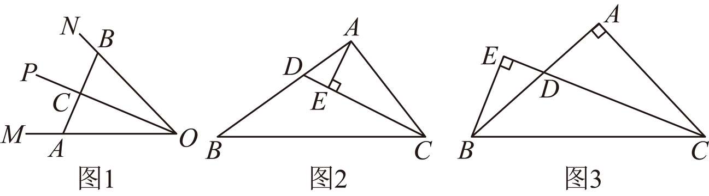
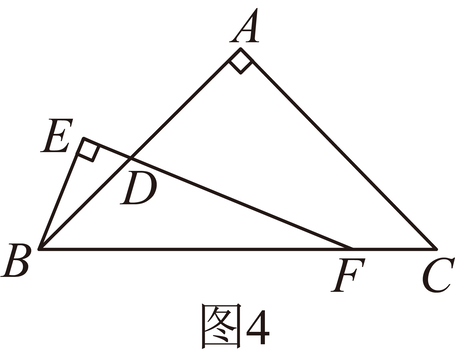

# Mathematics - 题目 1595

**ID**: 6fb6e1420d2f40b9ae71ce9b8c36e7b1
**年级**: Grade 8
**难度**: Medium-Hard
**题型**: Calculation

## 题目
【问题情境】利用角平分线构造全等三角形是常用的方法，如图 ${\rm 1，}OP$ 平分 $\angle MON$ ．点 $A$ 为 $OM$ 上一点，过点 $A$ 作 $AC\bot OP$ ，垂足为 $C$ ，延长 $AC$ 交 $ON$ 于点 $B$ ，可根据证明 $\vartriangle AOC\cong \vartriangle BOC$ ，则 $AO=BO，AC=BC$ （即点 $C$ 为 $AB$ 的中点）．【类比解答】如图2，在 $\vartriangle ABC$ 中， $CD$ 平分 $∠ACB，AE\bot CD$ 于 $E$ ，若 $∠EAC=63{}\degree ，∠B=37{}\degree $ ，通过上述构造全等的办法，可求得 $\angle DAE=$．【拓展延伸】（1）如图 ${\rm 3，}\vartriangle ABC$ 中， $AB=AC$ ， $\angle BAC=90{^{\circ }}$ ， $CD$ 平分 $∠ACB$ ， $BE\bot CD$ ，垂足E在 $CD$ 的延长线上，猜想 $BE$ 和 $CD$ 有何数量关系，并说明理由．（2）如图 ${\rm 4，}\vartriangle ABC$ 中， $AB=AC$ ， $\angle BAC=90{}\degree $ ，点 $D$ 在线段 $BC$ 上， $\angle EDB=\frac {1}{2}\angle C$ ， $BE⊥DE$ ，垂足为 $E，DE$ 与 $AB$ 相交于点 $F$ ．若 $BE=3$ ，则 $\mathrm{△}BFD$ 的面积为．（直接写出）​​​​​​​‌

## 解答

1. [问题情境]：
2. 解：∵ $OP$ 平分 $\angle MON$ ，
3. ∴ $\angle AOC=\angle BOC$ ，
4. ∵ $AC\bot OP$ ，
5. ∴ $\angle ACO=\angle BCO$ ，
6. ∵ $OC=OC$ ，
7. ∴ $\vartriangle AOC≌\vartriangle BOC\left ({ASA}\right )$ ，
8. ∴ $AO=BO$ ， $AC=BC$ .
9. [类比解答]：
10. 解：延长 $AE$ 交 $BC$ 于点F，如图，
11. 
12. 由问题情境可知， $AC=FC$ ，
13. ∴ $\angle EFC=\angle EAC=63{}\degree $ ，
14. ∵ $\angle EFC=\angle B+\angle DAE$ ，
15. ∴ $\angle DAE=\angle EFC-\angle B=63{}\degree -37{}\degree =26{}\degree $ .
16. [拓展延伸]：
17. （1） $BE=\frac {1}{2}CD$ ，证明如下：
18. 延长 $BE$ 、 $CA$ 交于点F，如图，
19. 
20. 则 $\angle BAF=180{}\degree -\angle BAC=90{}\degree $ ，
21. ∵ $BE\bot CD$ ，
22. ∴ $\angle BED=90{}\degree =\angle BAC$ ，
23. ∵ $\angle BDC=\angle ABF+\angle BED=\angle ACD+\angle BAC$ ，
24. ∴ $\angle ABF=\angle ACD$ ，
25. 又∵ $AB=AC$ ，
26. ∴ $\vartriangle ABF≌\vartriangle ACD\left ({ASA}\right )$ ，
27. ∴ $BF=CD$ ，
28. 由问题情境可知， $BE=FE=\frac {1}{2}BF$ ，
29. ∴ $BE=\frac {1}{2}CD$ ；
30. （2）过点D作 $DG{\rm{/\mskip-4mu/}}AC$ ，交 $BE$ 的延长线于点G，与 $AF$ 相交于H，如图，
31. 
32. ∵ $DG{\rm{/\mskip-4mu/}}AC$ ，
33. ∴ $\angle GDB=\angle C$ ， $\angle BHD=\angle A=90{}\degree $ ，
34. ∵ $\angle EDB=\frac {1}{2}\angle C$ ，
35. ∴ $\angle EDB=\angle EDG{\rm{=}}\frac {1}{2}\angle C$ ，
36. ∵ $BE⊥DE$ ，
37. ∴ $BE=GE=3$ ， $\angle BED=90{}\degree $ ，
38. ∴ $\angle BED=\angle BHD$ ，
39. ∵ $\angle EFB=\angle HFD$ ，
40. ∴ $\angle EBF=\angle HDF$ ，
41. ∵ $AB=AC$ ， $\angle BAC=90{}\degree $ ，
42. ∴ $\angle ABC=\angle ACB=45{}\degree $ ，
43. ∴ $\angle ABC=\angle GDB=45{}\degree $ ，
44. 则 $BH=DH$ ，
45. 在 $\vartriangle BGH$ 和 $\vartriangle DFH$ 中
46. $\begin{cases}\angle HBG=\angle HDF\\BH=DH\\\angle BHG=\angle DHF\end{cases}$
47. ∴ $\vartriangle BGH≌\vartriangle DFH\left ({ASA}\right )$ ，
48. ∴ $BG=DF=6$ ，
49. ∴ $S{{}_{\vartriangle BDF}}=\frac {1}{2}DF\cdot BE=\frac {1}{2}\times 6\times 3=9$ ．

## 知识点

**中文**:
  - 三角形的角平分线
  - 等腰三角形的性质
  - 全等三角形的判定与性质

**English**:
  - Angle Bisectors
  - Properties of Isosceles Triangles
  - Determination and Properties

---
