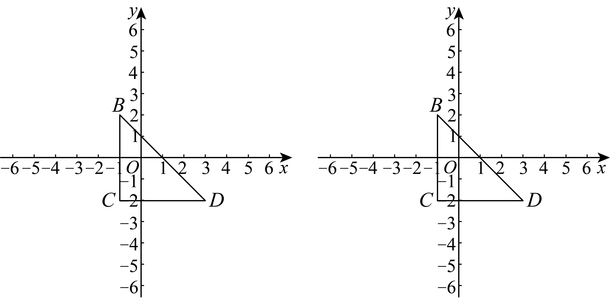

# Mathematics - 题目 3667

**ID**: 7416acc9e2e241cbae7c288653d834b6
**年级**: Grade 8
**难度**: Medium-Hard
**题型**: Calculation

## 题目
在平面直角坐标系 $xOy$ 中，已知点 $P$ ，直线 $l$ 和图形 $M$ ，给出如下定义：若图形 $M$ 内部或边上存在一点 $P^{′}$ ，使 $P$ 和 $P^{′}$ 关于直线 $l$ 轴对称，则称点 $P$ 为图形 $M$ 关于直线 $l$ 的“反射内含点”．已知 $\mathrm{△}BCD$ 的三个顶点的坐标分别是 $B\left ({-1,2}\right )$ ， $C\left ({-1,-2}\right )$ ， $D\left ({3,-2}\right )$ ．设点 $T\left ({t,0}\right )$ ，直线 $l{{}_{1}}$ 为过点 $T\left ({t,0}\right )$ 且与 $x$ 轴垂直的直线．（1）若 $t=3$ ，在点 $P{{}_{1}}\left ({6,-1}\right )$ ， $P{{}_{2}}\left ({5,0}\right )$ ， $P{{}_{3}}\left ({4,1}\right )$ 中，点是 $\mathrm{△}BCD$ 关于直线 $l{{}_{1}}$ 的“反射内含点”；​​​​​​​‌（2）当 $t\ne 0$ 时，若 $y$ 轴上存在 $\mathrm{△}BCD$ 关于直线 $l{{}_{1}}$ 的“反射内含点”，则 $t$ 的最大值为；（3）已知直线 $l{{}_{2}}$ 过点 $T\left ({t,0}\right )$ 且与第二、四象限角平分线平行．①若直线 $l{{}_{2}}$ 上存在 $\mathrm{△}BCD$ 关于直线 $l{{}_{1}}$ 的“反射内含点”，直接写出 $t$ 的取值范围为；②已知点 $N\left ({0,-t}\right )$ 为边长为1的正方形 $EFGH$ 的对角线交点，且正方形 $EFGH$ 的边与坐标轴平行．若正方形 $EFGH$ 边上的所有点都是 $\mathrm{△}BCD$ 关于直线 $l{{}_{2}}$ 的“反射内含点”，直接写出 $t$ 的取值范围为．

## 解答

1. （1）解：将各个点标示在平面直角坐标系中， $P{{}_{1}}\left ({6,-1}\right )$ ， $P{{}_{2}}\left ({5,0}\right )$ ， $P{{}_{3}}\left ({4,1}\right )$ ，
2. ∵ $P{{}_{1}}\left ({6,-1}\right )$ ， $P{{}_{2}}\left ({5,0}\right )$ ， $P{{}_{3}}\left ({4,1}\right )$ 关于直线 $x=3$ 的对称点为 $P{{}_{1}}{^{\prime }}\left ({0,-1}\right )$ ， $P{{}_{2}}{^{\prime }}\left ({1,0}\right )$ ， $P{{}_{3}}{^{\prime }}\left ({2,1}\right )$ ，
3. 
4. ∴点 $P{{}_{1}}\left ({6,-1}\right )$ 和点 $P{{}_{2}}\left ({5,0}\right )$ 是 $\mathrm{△}BCD$ 关于直线 $l{{}_{1}}$ 的“反射内含点”．
5. （2）解∶由题意可知：直线 $l{{}_{1}}$ 为 $x=t$ ，
6. 设y轴上点坐标为 $P\left ({0,y}\right )$ ，则其关于直线 $l{{}_{1}}$ 的对称点为 $P^{′}{\left ({2t,y}\right )}$ ，
7. ∴ $\mathrm{△}BCD$ 的三个顶点的坐标分别是 $B\left ({-1,2}\right )$ ， $C\left ({-1,-2}\right )$ ， $D\left ({3,-2}\right )$ ，
8. ∴ $-1\leqslant x\leqslant 3$ ，
9. ∵ $y$ 轴上存在 $\mathrm{△}BCD$ 关于直线 $l{{}_{1}}$ 的“反射内含点”，
10. ∴ $-1\mathrm{\leqslant }2t\mathrm{\leqslant }3$ ，
11. ∴ $-\frac {1}{2}\leqslant t\leqslant \frac {3}{2}$ ，
12. ∴t的最大值为 $\frac {3}{2}$ ．
13. （3）解：①由题意可知直线 $l{{}_{2}}$ 的解析式为 $y=-x+t$ ，
14. 则直线 $l{{}_{2}}$ 上的点 $\left ({a,-a+t}\right )$ 关于 $l{{}_{1}}:x=t$ 的对称点为 $\left ({2t-a,-a+t}\right )$ ，
15. ∴点 $\left ({2t-a,-a+t}\right )$ 在直线 $y=x-t$ 上，
16. ∴ $\mathrm{△}BCD$ 与直线 $y=x-t$ 有交点，且交点的临界值为 $D\left ({3,-2}\right )$ 和 $B\left ({-1,2}\right )$ ．
17. ∴当过点 $D$ 时，有 $-2=3-t$ ，解得： $t=5$ ，即t的最大值为5；
18. 当过点B时，有 $2=-1-t$ ，解得： $t=-3$ ，即t的最大值为 $-3$ ；
19. ∴直线 $l{{}_{2}}$ 上存在 $\mathrm{△}BCD$ 关于直线 $l{{}_{1}}$ 的“反射内含点”， $t$ 的取值范围为 $-3\leqslant t\leqslant 5$ ．
20. 
21. ②正方形 $EFGH$ 的对角线交点为 $N\left ({0,-t}\right )$ ，边长为1，则四个顶点坐标分别为 $E\left ({-\frac {1}{2},-t-\frac {1}{2}}\right ),F\left ({\frac {1}{2},-t-\frac {1}{2}}\right ),G\left ({\frac {1}{2},-t+\frac {1}{2}}\right ),H\left ({-\frac {1}{2},-t+\frac {1}{2}}\right )$ ，
22. 由①可知：直线 $l{{}_{2}}$ 的解析式为 $y=-x+t$ ，
23. 设正方形上一点 $P\left ({x,y}\right )$ ，过点P作 $PA\bot x$ 轴交直线 $l{{}_{2}}：y=-x+t$ 于点A，则点 $A\left ({x,-x+t}\right )$ ，连接 $AP{^{\prime }}$ ，结合直线 $l{{}_{2}}$ 和对称性即可知 $PA=P^{′}A=y+x-t$ ，
24. 
25. 那么，点 $P\left ({x,y}\right )$ 关于直线 $l{{}_{2}}：y=-x+t$ 的对称点 $P^{′}{\left ({t-y,t-x}\right )}$ ．
26. ∴正方形四个顶点及对角线交点关于直线 $l{{}_{2}}：y=-x+t$ 的对称点的坐标分别为 $E^{′}{\left ({2t+\frac {1}{2}，t+\frac {1}{2}}\right )}$ ， $F^{′}{\left ({2t+\frac {1}{2}，t-\frac {1}{2}}\right )}$ ， $G^{′}{\left ({2t-\frac {1}{2}，t-\frac {1}{2}}\right )}$ ， $H^{′}{\left ({2t-\frac {1}{2}，t+\frac {1}{2}}\right )}$ ，
27. ∵正方形 $EFGH$ 边上的所有点都是 $\mathrm{△}BCD$ 关于直线 $l{{}_{2}}$ 的“反射内含点”，且直线 $BD$ 的解析式为 $y=-x+1$ ，
28. ∴ $\left \{\hspace{-0.5em}\begin{array}{l}-1\leqslant 2t+\frac {1}{2}\leqslant 3\\\hspace{-0.5em}\begin{array}{l}-2\leqslant t+\frac {1}{2}\leqslant 2\\t+\frac {1}{2}\leqslant -2t-\frac {1}{2}+1\end{array}\hspace{-0.5em}\end{array}\hspace{-0.5em}\right.$ ， $\left \{\hspace{-0.5em}\begin{array}{l}-1\leqslant 2t+\frac {1}{2}\leqslant 3\\\hspace{-0.5em}\begin{array}{l}-2\leqslant t-\frac {1}{2}\leqslant 2\\t-\frac {1}{2}\leqslant -2t-\frac {1}{2}+1\end{array}\hspace{-0.5em}\end{array}\hspace{-0.5em}\right.$ ， $\left \{\hspace{-0.5em}\begin{array}{l}-1\leqslant 2t-\frac {1}{2}\leqslant 3\\\hspace{-0.5em}\begin{array}{l}-2\leqslant t-\frac {1}{2}\leqslant 2\\t-\frac {1}{2}\leqslant -2t+\frac {1}{2}+1\end{array}\hspace{-0.5em}\end{array}\hspace{-0.5em}\right.$ ， $\left \{\hspace{-0.5em}\begin{array}{l}-1\leqslant 2t-\frac {1}{2}\leqslant 3\\\hspace{-0.5em}\begin{array}{l}-2\leqslant t+\frac {1}{2}\leqslant 2\\t+\frac {1}{2}\leqslant -2t+\frac {1}{2}+1\end{array}\hspace{-0.5em}\end{array}\hspace{-0.5em}\right.$ ，
29. ∴ $-\frac {3}{4}\leqslant t\leqslant 0$ ， $-\frac {3}{4}\leqslant t\leqslant \frac {1}{3}$ ， $-\frac {1}{4}\leqslant t\leqslant \frac {2}{3}$ ， $-\frac {1}{4}\leqslant t\leqslant \frac {1}{3}$ ，
30. 综上，t的取值范围为 $-\frac {1}{4}\leqslant t\leqslant 0$ ．

## 知识点

**中文**:
  - 坐标与图形变化——轴对称
  - 坐标与图形性质

**English**:
  - Coordinates and Axial Symmetry
  - Coordinates and Geometric Properties

---
