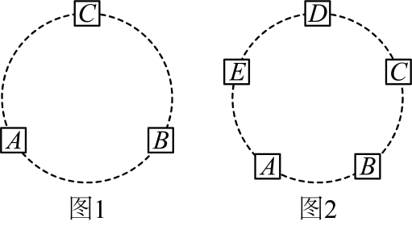

# Mathematics - 题目 3378

**ID**: 7496cb526a04421bb0133b2fd121e353
**年级**: Grade 8
**难度**: Medium-Hard
**题型**: Calculation

## 题目
在八年级“趣味数学”社团活动上，小星设计了一个“猜猜哪个数最大”的游戏，他准备了10张同样的卡片，正面分别写有数字 $\sqrt {3}$ ， $2\sqrt {3}$ ， $3\sqrt {3}$ ， $\cdots \cdots $ ， $9\sqrt {3}$ ， $10\sqrt {3}$ ．游戏规则是：先将卡片顺序打乱，参与者至少从中随机抽取三张，并将它们正面向下放置在桌面上．小星依次将相邻两张卡片上的数的和告诉参与者，请参与者猜出其中哪张卡片上的数字最大．【初步尝试】（1）小芳同学参与了该游戏，她随机抽取了三张卡片，并将它们正面向下放置在桌面上（如图1）．这三张卡片分别记为 $\mathrm{A}$ ， $B$ ， $C$ ．小芳将小星告诉她的相邻两张卡片上的数的和简记如下： $\left ({A,B}\right )=6\sqrt {3}$ ， $\left ({B,C}\right )=9\sqrt {3}$ ， $\left ({C,A}\right )=11\sqrt {3}$ ．然后进行如下推导：设 $\mathrm{A}$ ， $B$ ， $C$ 卡片上对应的数分别为 $a$ ， $b$ ， $c$ ．则 $a+b=6\sqrt {3}$ ①， $b+c=9\sqrt {3}$ ②， $c+a=11\sqrt {3}$ ③由②-①，得 $c-a=3\sqrt {3}>0$ ， $\therefore c>a$ .​​​​​​​‌由②-③，得 $b-a=-2\sqrt {3}<0$ ， $\therefore b<a$小芳经过以上的推导后，最终判断卡片上的数最大．【类比解答】（2）小华同学随机抽取了五张卡片，并将它们正面向下放置在桌面上（图2）．这五张卡片分别记为 $\mathrm{A}$ ， $B$ ， $C$ ， $D$ ， $E$ ．小华也将小星告诉他的相邻两张卡片上的数的和简记如下： $\left ({A,B}\right )=13\sqrt {3}$ ， $\left ({B,C}\right )=14\sqrt {3}$ ， $\left ({C,D}\right )=8\sqrt {3}$ ， $\left ({D,E}\right )=12\sqrt {3}$ ， $\left ({E,A}\right )=15\sqrt {3}$ ．请你帮小华判断，这五张卡片中，哪张卡片上的数字最大？并说明理由．【迁移运用】（3）在（2）的条件下，小华进一步思考，求出了卡片 $\mathrm{A}$ ， $B$ ， $C$ ， $D$ ， $E$ 上写的数字．它们分别是： $\mathrm{A}$， $B$， $C$， $D$， $E$．（直接写结果）

## 解答

1. 解：（1）根据题意得 $c>a$ . $b<a$ ，
2. $\therefore c>a>b$ ，
3. ∴C卡片上的数最大.
4. （2）设 $\mathrm{A}$ ， $B$ ， $C$ ， $D$ ， $E$ 卡片上对应的数分别为 $a$ ， $b$ ， $c{\rm ，\mathit{d}，\mathit{e}}$ ，
5. ∵ $\left ({A,B}\right )=13\sqrt {3}$ ， $\left ({B,C}\right )=14\sqrt {3}$ ， $\left ({C,D}\right )=8\sqrt {3}$ ， $\left ({D,E}\right )=12\sqrt {3}$ ， $\left ({E,A}\right )=15\sqrt {3}$
6. ∴ $a+b=13\sqrt {3}$ ①， $b+c=14\sqrt {3}$ ②， $c+d=8\sqrt {3}$ ③， $d+e=12\sqrt {3}$ ④， $e+a=15\sqrt {3}$ ⑤，
7. 由②-①，得 $c-a=\sqrt {3}>0$ ，
8. $\therefore c>a$ .
9. 由②-③，得 $b-d=6\sqrt {3}>0$ ，
10. $\therefore b>d$ ，
11. 由④-③，得 $e-c=4\sqrt {3}>0$ ，
12. $\therefore e>c$ .
13. 由⑤-④，得 $a-d=3\sqrt {3}>0$ ，
14. $\therefore a>d$ ，
15. 由⑤-①，得 $e-b=2\sqrt {3}>0$ ，
16. $\therefore e>b$ .
17. 综上可得： $e>c>a$ 且 $e>b>d$ ，
18. ∴e最大，即E卡片上的数字最大；
19. （3）由（2）得 $a+b=13\sqrt {3}$ ①， $b+c=14\sqrt {3}$ ②， $c+d=8\sqrt {3}$ ③， $d+e=12\sqrt {3}$ ④， $e+a=15\sqrt {3}$ ⑤， $c-a=\sqrt {3}$ ⑥， $b-d=6\sqrt {3}$ ⑦， $e-c=4\sqrt {3}$ ⑧， $a-d=3\sqrt {3}$ ⑨， $e-b=2\sqrt {3}$ ⑩，
20. ∴⑥+⑧得 $e-a=5\sqrt {3}$ ，
21. 联立得 $\begin{cases}e-a=5\sqrt {3}\\e+a=15\sqrt {3}\end{cases}$ ，解得： $\begin{cases}e=10\sqrt {3}\\a=5\sqrt {3}\end{cases}$ ，
22. 代入 $a=5\sqrt {3}$ 到①，得 $b=8\sqrt {3}$ ；
23. 代入 $b=8\sqrt {3}$ 到②，得 $c=6\sqrt {3}$ ；
24. 代入 $c=6\sqrt {3}$ 到③，得 $d=2\sqrt {3}$ .

## 知识点

**中文**:
  - 二次根式的应用
  - 二次根式的混合运算

**English**:
  - Applications of Secondary Radicals
  - Mixed Operations of Secondary Radicals

---
