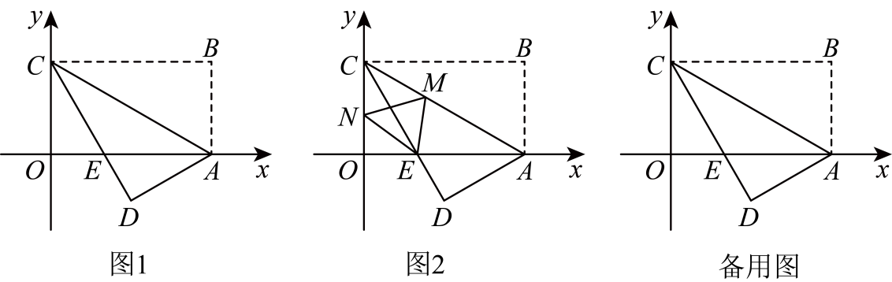

# Mathematics - 题目 3266

**ID**: 7c6af372ac1b43b290853713280c4219
**年级**: Grade 8
**难度**: Medium-Hard
**题型**: Calculation

## 题目
如图1，在平面直角坐标系中有矩形 $OABC$ ，点 $C(0,4)$ ，将矩形 $OABC$ 沿 $AC$ 折叠，使得点 $B$ 落在点 $D$ 处， $CD$ 边交 $x$ 轴于点 $E$ ， $\angle OAC=30{}\degree $ ．（1）求点E的坐标；​​​​​​​‌（2）如图2，在直线 $AC$ 以及 $y$ 轴上是否分别存在点 $M$ ， $N$ ，使得 $\vartriangle EMN$ 的周长最小？如果存在，求出 $\vartriangle EMN$ 周长的最小值；如果不存在，请说明理由；（3）点P为y轴上一动点，作直线 $AP$ 交直线 $CD$ 于点 $Q$ ，是否存在点 $P$ 使得 $\vartriangle CPQ$ 为等腰三角形？如果存在，请求出 $\angle OAP$ 的度数；如果不存在，请说明理由．

## 解答

1. （1）解： $\because $ 点 $C(0,4)$ ，
2. $\therefore OC=4$ ，
3. $\because $ 四边形 $AOCB$ 是矩形，
4. $\therefore BC\parallel OA$ ， $\angle OCB=90{}\degree $ ，
5. $\therefore \angle BCA=\angle OAC=30{}\degree $ ，
6. 由折叠可知： $\angle DCA=\angle BCA=30{}\degree $ ，
7. $\therefore \angle OCE=30{}\degree $ ，
8. 设 $OE=x$ ，则 $CE=2x$ ，
9. 根据勾股定理可得 $OE{^{2}}+CO{^{2}}=CE{^{2}}$ ，
10. 即 $x{^{2}}+16=4x{^{2}}$ ，
11. 解得 $x=\frac {4\sqrt {3}}{3}$ （负值舍去），
12. $\therefore $ 点 $E$ 的坐标 $\left ({\frac {4\sqrt {3}}{3},0}\right )$ ；
13. （2）解：如图2，过点 $E$ 作 $y$ 轴的对称点 $G$ ，过点 $E$ 作 $AC$ 的对称点 $H$ ，连接 $GH$ 交 $y$ 轴于点 $N$ ，与 $AC$ 交于 $M$ ，
14. 
15. ， $\therefore NG=ED,EM=HM$ ，
16. $\therefore △EMN$ 的周长为 $GN+NM+MH$ ，则点 $G,N,M,H$ 四点共线时最小值为 $GH$ ，
17. 由（1）可得 $CE=2OE=\frac {8\sqrt {3}}{3}$ ，
18. $\because $ 点 $G$ ，点 $E$ 关于 $y$ 轴对称，点 $E$ ，点 $H$ 关于 $AC$ 对称，
19. $\therefore OE=OG=\frac {4\sqrt {3}}{3}$ ， $CH=CE=\frac {8\sqrt {3}}{3}$ ，
20. $\therefore $ 点 $G\left ({-\frac {4\sqrt {3}}{3},0}\right )$ ，点 $H\left ({\frac {8\sqrt {3}}{3},4}\right )$ ，
21. $\therefore GH=\sqrt {{\left({\frac {8\sqrt {3}}{3}+\frac {4\sqrt {3}}{3}}\right)^{2}}+(4+0){^{2}}}=8$ ，
22. $\therefore $  $\vartriangle EMN$ 的周长最小值为8；
23. （3）解：存在点 $P$ 使得 ${\rm △}CPQ$ 为等腰三角形，
24. 若 $CP=CQ$ ，如图3，
25. 
26. $\because CP=CQ$ ， $\angle OCE=30{}\degree $ ，
27. $\therefore \angle CPQ=75{}\degree $ ，
28. $\mathrm{∴}\angle OAP=90{}\degree -\angle CPQ=15{}\degree $ ，
29. 若 $PQ=CQ$ 时，如图4，
30. 
31. $\because CQ=PQ$ ，
32. $\mathrm{∴}\angle QPC=\angle PCQ=30{}\degree $ ，
33. $\therefore \angle PAO=90{}\degree -\angle CPQ=60{}\degree $ ；
34. 若 $CP=PQ$ ，如图5，
35. 
36. $\mathrm{∴}\angle PCQ=\angle PQC=30{}\degree $ ，
37. $\therefore \angle OPA=60{}\degree $ ，
38. 此时点 $P$ 与点 $C$ 重合，
39. $\therefore $ 不存在这样的点 $P$ ．
40. 综上所述： $\angle OAP$ 的度数为 $15{}\degree $ 或 $60{}\degree $ ．

## 知识点

**中文**:
  - 几何变换——轴对称综合题
  - 勾股定理
  - 矩形的性质
  - 折叠问题

**English**:
  - Axial Symmetry Comprehensive Problems
  - Pythagorean Theorem
  - Properties of Rectangles
  - Folding Problems

---
