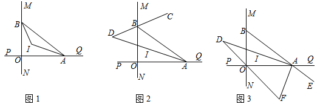

# Mathematics - 题目 3231

**ID**: 7d799b7de8db4804a3fdc7c525e66570
**年级**: Grade 8
**难度**: Medium-Hard
**题型**: Calculation

## 题目
直线 $MN$ 与 $PQ$ 相互垂直，垂足为点 $O$ ，点 $\mathrm{A}$ 在射线 $OQ$ 上运动，点 $B$ 在射线 $OM$ 上运动，点 $\mathrm{A}$ 、点 $B$ 均不与点 $O$ 重合．（1）如图 ${\rm 1，}AI$ 平分 $\angle BAO$ ， $BI$ 平分 $\angle ABO$ ，若 $\angle BAO=40{}\degree $ ，求 $\angle AIB$ 的度数；​​​​​​​‌（2）如图 ${\rm 2，}AI$ 平分 $\angle BAO$ ， $BC$ 平分 $\angle ABM$ ， $BC$ 的反向延长线交 $AI$ 于点 $D$ ．①若 $\angle BAO=40{}\degree $ ，则 $∠ADB=$度（直接写出结果，不需说理）；②点 $\mathrm{A}$ 、 $B$ 在运动的过程中， $∠ADB$ 是否发生变化，若不变，试求 $∠ADB$ 的度数：若变化，请说明变化规律．（3）如图3，已知点 $E$ 在 $BA$ 的延长线上， $\angle BAO$ 的角平分线 $AI$ 、 $\angle OAE$ 的角平分线 $AF$ 与 $\angle BOP$ 的角平分线所在的直线分别相交于的点 $D$ 、 $F$ ，在 $\mathrm{△}ADF$ 中，如果有一个角的度数是另一个角的4倍，请直接写出 $\angle ABO$ 的度数．

## 解答

1. 解：（1）如图1中， $\because MN\bot PQ$ ，
2. $\therefore \angle AOB=90{^{\circ }}$ ，
3. $\because $  $\angle BAO=40{}\degree $ ，
4. $\therefore $  $\angle ABO=90{^{\circ }}-50{^{\circ }}=40{}\degree $ ，
5. 又 $\because $  $AI$ 平分 $\angle BAO$ ， $BI$ 平分 $\angle ABO$ ，
6. $\therefore $  $\angle IBA=\frac {1}{2}ABO=25{^{\circ }}$ ， $\angle IAB=\frac {1}{2}OAB=20{^{\circ }}$ ，
7. $\therefore $  $\angle AIB=180{^{\circ }}-(\angle IBA+\angle IAB)=135{^{\circ }}$ ，
8. （2）如图2中：
9. ① $\angle MBA=\angle AOB+\angle BAD$ （三角形的一个外角等于与其不相邻的两个内角和），
10. $=90{^{\circ }}+40{^{\circ }}$
11. $=130{^{\circ }}$
12. $\because $  $AI$ 平分 $\angle BAO$ ， $BC$ 平分 $\angle ABM$ ，
13. $\therefore $  $\angle CBA=\frac {1}{2}\angle MBA=65{^{\circ }}$ ， $\angle BAI=\frac {1}{2}\angle BAO=20{^{\circ }}$ ，
14. $\because $  $\angle CBA=\angle ADB+\angle BAD$ ，
15. $\therefore $  $\angle ADB=45{^{\circ }}$ ；
16. ②结论：点A、B在运动过程中， $\angle ADB=45{^{\circ }}$ ，
17. 理由： $\because $  $\angle D=\angle CBA-\angle BAD$
18. $=\frac {1}{2}\angle MBA-\frac {1}{2}\angle BAO$
19. $=\frac {1}{2}(\angle MBA-\angle BAO)$
20. $=\frac {1}{2}\angle AOB$
21. $=\frac {1}{2}\times 90{^{\circ }}$
22. $=45{^{\circ }}$
23. $\therefore $ 点A、B在运动过程中， $∠ADB$ 的角度不变， $\angle ADB=45{^{\circ }}$ ；
24. （3）如图3中， $\angle BAO$ 的角平分线 $AI$ 、 $\angle OAE$ 的角平分线 $AF$ 与 $\angle BOP$ 的角平分线所在的直线分别相交于的点 $D$ 、 $F$ ，
25. $\therefore $  $\angle DAO=\frac {1}{2}\angle BAO$ ， $\angle FAO=\frac {1}{2}\angle EAP$ ，
26. 又 $\because $  $\angle BAO+\angle EAP$ 为平角，
27. $\therefore $  $\angle DAF=\frac {1}{2}\angle BAO+\frac {1}{2}\angle EAP=\frac {1}{2}\times 180{^{\circ }}=90{^{\circ }}$ ，
28. $\therefore $  $\angle D=\angle POD-\angle DAO=\frac {1}{2}\angle POB-\frac {1}{2}\angle BAO=\frac {1}{2}\angle ABO$ ，
29. $\therefore $  $\angle ABO=2\angle D$ ，
30. 又 $\because $ 在 $\vartriangle AOB$ 中： $\angle AOB=90{^{\circ }}$ ，
31. $\therefore $  $\angle ABO$ ﹤ $90{^{\circ }}$ ，
32. 在 $\mathrm{△}ADF$ 中，如果有一个角的度数是另一个角的4倍，则：
33. ①当 $\angle DAF=4\angle D$ 时， $\angle D=22.5{^{\circ }}$ ，
34. 此时 $\angle ABO=2\angle D=45{^{\circ }}$ ，
35. ② $\angle DAF=4\angle F$ 时， $\angle F=22.5{^{\circ }}$ ， $\angle D=67.5{^{\circ }}$ ，
36. 此时 $\angle ABO=2\angle D=135{^{\circ }}$ （不符合题意舍去），
37. ③ $\angle F=4\angle D$ 时， $\angle D=18{^{\circ }}$ ，
38. 此时 $\angle ABO=2\angle D=36{^{\circ }}$ ，
39. ④ $\angle D=4\angle F$ 时， $\angle D=72{^{\circ }}$ ，
40. 此时 $\angle ABO=2\angle D=144{^{\circ }}$ （不符合题意舍去），
41. 综上所述，当 $\angle ABO=45{^{\circ }}$ 或 $36{^{\circ }}$ 时，在 $\mathrm{△}ADF$ 中，有一个角的度数是另一个角的4倍．

## 知识点

**中文**:
  - 角平分线
  - 角的运算

**English**:
  - Angle Bisector
  - Operations with Angles

---
