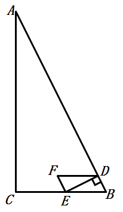

# Mathematics - 题目 3239

**ID**: 80367179190d4dd2b6ee9d64fb6837bc
**年级**: Grade 8
**难度**: Medium-Hard
**题型**: Calculation

## 题目
如图，在 $Rt\vartriangle ABC$ 中， $\angle ACB=90{}^\circ $ ， $AC=8$ ， $BC=4$ ，动点D从点B出发，以每秒1个单位长度的速度沿 $BA$ 向点A运动，到达点A停止运动，过点D作 $ED\bot AB$ 交射线 $BC$ 于点E，以 $BD$ 、 $BE$ 为邻边作平行四边形 $BDFE$ ．设点D运动时间为t秒，平行四边形 $BDFE$ 与 $Rt\vartriangle ABC$ 的重叠部分面积为S．（1）当点F落在 $AC$ 边上时，求t的值；​​​​​​​‌（2）求S关于t的函数解析式，并直接写出自变量t的取值范围．

## 解答

1. （1）当点F落在 $AC$ 边上时，如图1
2. ∵在 $Rt\vartriangle ABC$ 中， $AC=8$ ， $BC=4$ ， $\angle ACB=90{}^\circ $ ，∴ $AB=4\sqrt {5}$
3. ∵ $ED\bot AB$ 于D，∴ $\angle EDB=\angle ACB=90{}^\circ $ ， $\angle B=\angle B$ ，∴ $\mathrm{△}BED\mathrm{∽}\mathrm{△}BAC$ ，
4. ∴ $\frac {BD}{BC}=\frac {BE}{AB}$ ，∴ $\frac {t}{4}=\frac {BE}{4\sqrt {5}}$ ，∴ $BE=\sqrt {5}t$ ，
5. ∵四边形 $BDFE$ 为平行四边形，∴ $DF{\underline{{\underline{/\mskip-4mu/}}}}BE$ ，∴ $DF=\sqrt {5}t$ ， $\vartriangle ADF∽\vartriangle ABC$ ，
6. ∴ $\frac {DF}{BC}=\frac {AD}{AB}$ ，即 $\frac {\sqrt {5}t}{4}=\frac {4\sqrt {5}-t}{4\sqrt {5}}$ ，解得： $t=\frac {2\sqrt {5}}{3}$
7. ∴当点F落在 $AC$ 边上时，t的值为 $\frac {2\sqrt {5}}{3}$ ；
8. （2）当 $0<t\leqslant \frac {2\sqrt {5}}{3}$ 时，如图2，∵ $\vartriangle BDE∽\vartriangle BCA$ ，
9. ∴ $\frac {BD}{BC}=\frac {DE}{CA}$ ，∴ $\frac {t}{4}=\frac {DE}{8}$ ，∴ $DE=2t$ .
10. ∴ $S=S{{}_{▱BDFE}}=BD\cdot DE=t\cdot 2t=2t{^{2}}$ ；
11. 当点E与点C重合时，即 $\sqrt {5}t=4$ ， $t=\frac {4\sqrt {5}}{5}$ ，
12. ∴当 $\frac {2\sqrt {5}}{3}<t\leqslant \frac {4\sqrt {5}}{5}$ 时，如图3，
13. ∵ $DM/\mskip-4mu/BC$ ，∴ $△ADM∽△ABC$ ，∴ $\frac {DM}{BC}=\frac {AD}{AB}$ ，∴ $\frac {DM}{4}=\frac {4\sqrt {5}-t}{4\sqrt {5}}$ ，
14. ∴ $DM=4-\frac {\sqrt {5}}{5}t$ .
15. ∵ $DF=BE=\sqrt {5}t$ ，∴ $MF=\sqrt {5}t-\left ({4-\frac {\sqrt {5}}{5}t}\right )=\frac {6\sqrt {5}}{5}t-4$
16. 又∵ $△MNF∽△CAB$ ，∴ $\frac {MN}{CA}=\frac {MF}{CB}$ ，∴ $\frac {MN}{8}=\frac {MF}{4}$ ，∴ $MN=2MF$ .
17. ∴ $S{{}_{△MNF}}=\frac {1}{2}MN\cdot MF=MF{^{2}}={\left({\frac {6\sqrt {5}}{5}t-4}\right)^{2}}=\frac {36}{5}t{^{2}}-\frac {48\sqrt {5}}{5}t+16$
18. ∴ $S=S{{}_{▱BDFE}}-S{{}_{△MNF}}=2t{^{2}}-\left ({\frac {36}{5}t{^{2}}-\frac {48\sqrt {5}}{5}t+16}\right )$
19. ∴ $S=-\frac {26}{5}t{^{2}}+\frac {48\sqrt {5}}{5}t-16$ ；
20. 当 $\frac {4\sqrt {5}}{5}<t\leqslant 4\sqrt {5}$ 时，如图4.
21. ∵ $△ADM∽△ABC$ ，∴ $\frac {AD}{AB}=\frac {DM}{BC}=\frac {AM}{AC}$ ，
22. ∴ $\frac {4\sqrt {5}-t}{4\sqrt {5}}=\frac {DM}{4}=\frac {AM}{8}$ ，∴ $DM=4-\frac {\sqrt {5}}{5}t$ ， $AM=8-\frac {2\sqrt {5}}{5}t$ .
23. ∴ $MC=8-\left ({8-\frac {2\sqrt {5}}{5}t}\right )=\frac {2\sqrt {5}}{5}t$ .
24. ∵ $S=S{{}_{梯形BDMC}}$ .
25. ∴ $S=\frac {1}{2}\cdot \left ({4-\frac {\sqrt {5}}{5}t+4}\right )\times \frac {2\sqrt {5}}{5}t=-\frac {1}{5}t{^{2}}+\frac {8\sqrt {5}}{5}t$ .
26. 综上所述， $S=\begin{cases}2t{^{2}}\left ({0<t\leqslant \frac {2\sqrt {5}}{3}}\right )\\-\frac {26}{5}t{^{2}}+\frac {48\sqrt {5}}{5}t-16\left ({\frac {2\sqrt {5}}{3}\leqslant t\leqslant \frac {4\sqrt {5}}{5}}\right )\\-\frac {1}{5}t{^{2}}+\frac {8\sqrt {5}}{5}t\left ({\frac {4\sqrt {5}}{5}<t\leqslant 4\sqrt {5}}\right )\end{cases}$
27. ．

## 知识点

**中文**:
  - 解析式法

**English**:
  - Analytic Method

---
