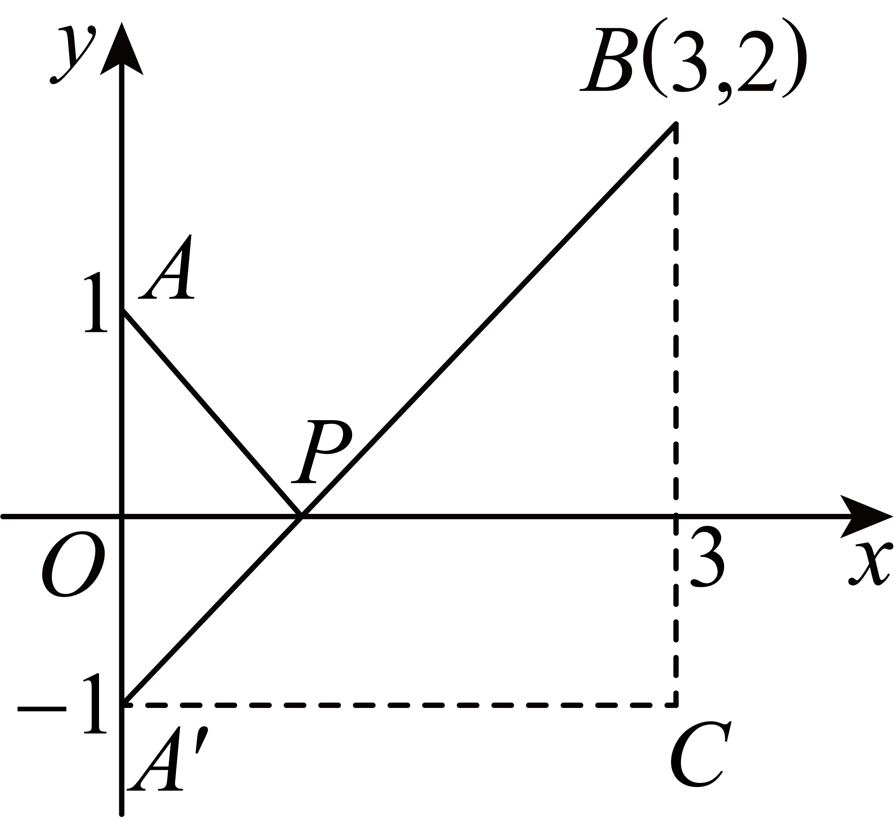

# Mathematics - 题目 2129

**ID**: 93ac2e5dea6043d9b9a70fcdde821479
**年级**: Grade 8
**难度**: Medium-Hard
**题型**: Calculation

## 题目
阅读材料：例：说明代数式 $\sqrt {x{^{2}}+1}+\sqrt {(x-3){^{2}}+4}$ 的几何意义，并求它的最小值．解： $\sqrt {x{^{2}}+1}+\sqrt {(x-3){^{2}}+4}=\sqrt {(x-0){^{2}}+1}+\sqrt {(x-3){^{2}}+2{^{2}}}$ ．几何意义：如图，建立平面直角坐标系，点 $P(x,0)$ 是 $x$ 轴上一点，则 $\sqrt {(x-0){^{2}}+1}$ 可以看成点 $P$ 与点 $A(0,1)$ 的距离， $\sqrt {(x-3){^{2}}+2{^{2}}}$ 可以看成点 $P$ 与点 $B(3,2)$ 的距离，所以原代数式的值可以看成线段 $PA$ 与 $PB$ 长度之和，它的最小值就是 $PA+PB$ 的最小值．求最小值：设点 $A$ 关于 $x$ 轴对称点为 $A^{′}$ ，则 $PA=PA^{′}$ ．因此，求 $PA+PB$ 的最小值，只需求 $PA^{′}+PB$ 的最小值，而点 $A^{′}$ ， $B$ 间的直线段距离最短，所以 $PA^{′}+PB$ 的最小值为线段 $A^{′}B$ 的长度．为此，构造直角三角形 $A^{′}CB$ ，因为 $A^{′}C=3$ ， $CB=3$ ，所以由勾股定理得 $A^{′}B=3\sqrt {2}$ ，即原式的最小值为 $3\sqrt {2}$ ．根据以上阅读材料，解答下列问题：(1)代数式 $\sqrt {(x-1){^{2}}+1}+\sqrt {（x-2）{^{2}}+16}$ 的值可以看成平面直角坐标系中点 $P(x,0)$ 与点 $A(1,1)$ ，点B的距离之和．（填写点B的坐标）(2)代数式 $\sqrt {x{^{2}}+25}+\sqrt {x{^{2}}-12x+45}$ 的值可以看成平面直角坐标系中点 $P\left ({x,0}\right )$与点A、点B的距离之和．（填写点A，B的坐标）(3)求出代数式 $\sqrt {x{^{2}}+25}$ + $\sqrt {x{^{2}}-12x+45}$ 的最小值．​​​​​​​‌

## 解答

1. （1）∵原式= $\sqrt {(x-1){^{2}}+1}+\sqrt {（x-2）{^{2}}+4{^{2}}}$  ，
2. ∴代数式 $\sqrt {(x-1){^{2}}+1}+\sqrt {（x-2）{^{2}}+16}$ 的值可以看成平面直角坐标系中点 $P\left ({x，0}\right )$ 与点 $A\left ({1，1}\right )$ ，点 $B\left ({2,4}\right )$ 的距离之和；
3. （2）∵原式= $\sqrt {x{^{2}}+5{^{2}}}+\sqrt {(x-6){^{2}}+3{^{2}}}$ 的形式，
4. ∴所求代数式的值可以看成平面直角坐标系中点 $P\left ({x，0}\right )$ 与点 $A\left ({0,5}\right ),B\left ({6,3}\right )$ 的距离之和．
5. （3）如图所示，设点A关于x轴的对称点为 $A^{′}$ ，则 $PA=PA^{′}$ ，
6. 
7. 要求 $PA+PB$ 的最小值，只需求 $PA^{′}+PB$ 的最小值，即线段 $A^{′}B$ 的长度，
8. ∵ $A\left ({0,5}\right ),B\left ({6,3}\right )$ ，
9. ∴ $A^{′}{\left ({0,-5}\right )}$ ， $A^{′}C=6,BC=8$ ，
10. ∴ $A^{′}B=\sqrt {A^{′}C{^{2}}+BC{^{2}}}=10$  ，
11. ∴代数式 $\sqrt {x{^{2}}+25}+\sqrt {x{^{2}}-12x+45}$ 的最小值为10．

## 知识点

**中文**:
  - 二次根式的应用
  - 数轴上两点之间的距离
  - 最短路径问题
  - 轴对称的性质

**English**:
  - Applications of Secondary Radicals
  - Distance Between Two Points on Number Line
  - Shortest Path Problems
  - Properties of Axial Symmetry

---
