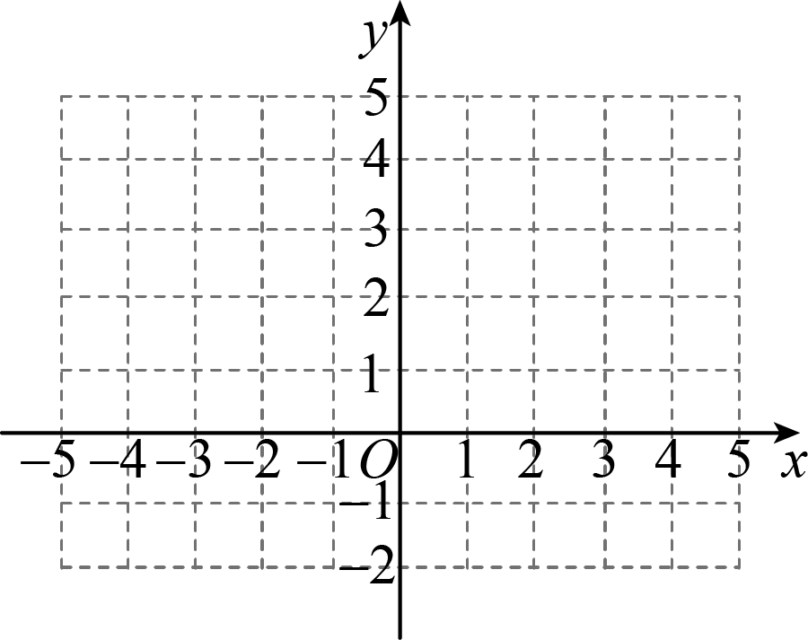

# Mathematics - 题目 3079

**ID**: 95c30754fa994c04a6ee08c275d90d17
**年级**: Grade 8
**难度**: Medium-Hard
**题型**: Calculation

## 题目
数学小组在学习“一元一次不等式与一次函数”这一节课后，尝试解决“一元一次不等式与其它函数”的关系问题．他们确定以函数 $y=|x+1|$ 为研究对象，通过作图，观察图象，归纳性质等探究过程，进一步理解一元一次不等式与函数的关系．请根据以下探究过程，回答问题．(1)作出函数 $y=|x+1|$ 的图象．①列表：$x$…$-4$$-3$$-2$$-1$012…$y$…3$a$10123…其中，表格中 $a$ 的值为；​​​​​​​‌②描点，连线：根据表格的数据，请在直角坐标系中描出对应值为坐标的点，并画出该函数的图象；(2)观察函数 $y=|x+1|$ 的图象，回答下列问题：①当 $x=$时，函数 $y=|x+1|$ 有最小值，最小值为；②当时（填自变量 $x$ 的取值范围）， $y$ 随 $x$ 的增大而增大；(3)已知直线 $y=-\frac {1}{3}x+1{\rm ，}$ 请结合图象，直接写出不等式 $-\frac {1}{3}x+1>\left |{x+1}\right |$ 的解集是；(4)若直线 $y=kx+\frac {1}{2}$ 与 $y=|x+1|$ 有2个交点，则 $k$ 的取值范围是．

## 解答

1. （1）解：①当 $x=-3$ 时 ${\rm ，}y=|x+1|=|-3+1|=2$
2. 故 $a$ 的值为 $2$
3. ②函数图象如图所示：
4. 
5. （2）解：由图象可知：
6. ①当 $x{\rm{=}}-{{1}}$ 时，函数 $y=|x+1|$ 有最小值，最小值为 $0$
7. ②当 $x>-1$ 时 ${\rm ，}y$ 随 $x$ 的增大而增大
8. （3）解：在同一坐标系中画出直线 $y=-\frac {1}{3}x+1$ 的图象，如图所示：
9. 
10. 交点坐标为 $\left ({0,1}\right )$ 和 $\left ({-3,2}\right )$
11. 故当 $-3<x<0$ 时 ${\rm ，}-\frac {1}{3}x+1>\left |{x+1}\right |$
12. （4）解： $y=kx+\frac {1}{2}$ 绕绕点 $\left ({0,\frac {1}{2}}\right )$ 旋转形成的直线簇：
13. 
14. 当直线 $y=kx+\frac {1}{2}$ 平行于直线 $y=|x+1|$ 左侧部分时 ${\rm ，}k=-1;$
15. 当直线 $y=kx+\frac {1}{2}$ 经过点 $\left ({-1,0}\right )$ 时 ${\rm ，}k=\frac {1}{2}$
16. 故当 $-1<k<\frac {1}{2}$ 时，直线 $y=kx+\frac {1}{2}$ 与 $y=|x+1|$ 有2个交点

## 知识点

**中文**:
  - 一次函数与一元一次不等式
  - 从函数的图象获取信息
  - 一次函数的图象和性质

**English**:
  - Linear Functions and Linear Inequalities
  - Extracting Information from Graphs
  - Graphs and Properties of Linear Functions

---
