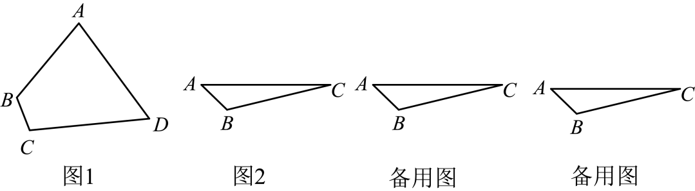

# Mathematics - 题目 987

**ID**: a585e2ee04d14cd2b1a089a63242b23e
**年级**: Grade 8
**难度**: Medium-Hard
**题型**: Calculation

## 题目
我们规定：有一组邻边相等，且这组邻边的夹角为 $60{}\degree $ 的凸四边形叫做“半等边四边形”．(1)如图1，在四边形 $ABCD$ 中， $\angle A+\angle C=180{}\degree $ ， $\angle B=120{}\degree $ ， $AD=CD$ ，求证：四边形 $ABCD$ 是“半等边四边形”；​​​​​​​‌(2)如图 ${\rm 2，}\vartriangle ABC$ 中 $\angle A=45{}\degree $ ， $\angle ABC=120{}\degree $ ， $AB=2$①求 $BC$ 、 $AC$ 的长；②设 $D$ 是 $\vartriangle ABC$ 所在平面内一点，当四边形 $ABCD$ 是“半等边四边形”时，请直接写出四边形 $ABCD$ 的面积．

## 解答

1. （1）（1）证明：在四边形 $ABCD$ 中， $\angle A+\angle B+\angle C+\angle D=360{}\degree $ ，
2. $\because \angle A+\angle C=180{}\degree $ ， $\angle B=120{}\degree $ ，
3. $\therefore \angle D=360{}\degree -(\angle A+\angle C+\angle B)=360{}\degree -(180+120{}\degree )=60{}\degree $ ，
4. $\because AD=CD$ ，
5. $\therefore $ 四边形 $ABCD$ 是“半等边四边形”；
6. （2）解：①如图1，过点 $C$ 作 $CH\bot AB$ ，交 $AB$ 延长线于 $H$ ，则 $\angle H=90{}\degree $ ，
7. $\because \angle A=45{}\degree $ ， $\angle ABC=120{}\degree $ ，
8. $\therefore △AHC$ 是等腰直角三角形， $\angle CBH=60\mathrm{°}$ ，
9. $\therefore AH=CH$ ， $\angle BCH=30{}\degree $ ，
10. $\therefore CB=2BH$ ，
11. 设 $BH=x$ ，则 $CB=2x$ ， $CH=AH=\sqrt {3}x$ ，
12. $\because AB=2$ ，
13. $\therefore 2+x=\sqrt {3}x$ ，
14. $\therefore x=\sqrt {3}+1$ ，
15. $\therefore BC=2x=2\sqrt {3}+2$ ， $AC=\sqrt {3}CH=\sqrt {3}\times \sqrt {3}x=3(\sqrt {3}+1)=3\sqrt {3}+3$ ；
16. ②分三种情况：
17. $i)$ 如图 ${\rm 2，}AD=CD$ ， $\angle ADC=60{}\degree $ ，
18. $\therefore \vartriangle ACD$ 是等边三角形，
19. 过点 $D$ 作 $DM⊥AC$ 于 $M$ ，过点 $C$ 作 $CH\bot AB$ 于 $H$ ，
20. $\therefore AM=CM=\frac {1}{2}AC=\frac {3\sqrt {3}+3}{2}$ ， $\angle ADM=30{}\degree $ ，
21. $\therefore DM=\sqrt {3}AM=\frac {9+3\sqrt {3}}{2}$ ，
22. $\therefore $ 四边形 $ABCD$ 的面积 $=S{{}_{\mathrm{△}ADC}}+S{{}_{\mathrm{△}ABC}}$
23. $=\frac {1}{2}\times (3\sqrt {3}+3)\times \frac {9+3\sqrt {3}}{2}+\frac {1}{2}\times 2\times (3+\sqrt {3})$
24. $=10\sqrt {3}+\frac {33}{2}$ ；
25. $ii)$ 如图 ${\rm 3，}BC=CD$ ， $\angle BCD=60{}\degree $ ，
26. 过点 $D$ 作 $DM⊥AC$ 于 $M$ ，
27. 
28. $\because \angle ACB=180{}\degree -45{}\degree -120{}\degree =15{}\degree $ ，
29. $\therefore \angle ACD=45{}\degree $ ，
30. $\therefore \mathrm{△}CDM$ 是等腰直角三角形，
31. $\therefore DM=\frac {CD}{\sqrt {2}}=\frac {2\sqrt {3}+2}{\sqrt {2}}=\sqrt {6}+\sqrt {2}$ ，
32. $\therefore $ 四边形 $ABCD$ 的面积 $=S{{}_{\mathrm{△}ADC}}+S{{}_{\mathrm{△}ABC}}$
33. $=\frac {1}{2}\times (3\sqrt {3}+3)\times (\sqrt {6}+\sqrt {2})+\frac {1}{2}\times 2\times (3+\sqrt {3})$
34. $=6\sqrt {2}+3\sqrt {6}+3+\sqrt {3}$ ；
35. $iii)$ 如图 ${\rm 4，}AB=AD=2$ ， $\angle BAD=60{}\degree $ ，
36. 连接 $BD$ ，过点 $\mathrm{A}$ 作 $AK\bot BD$ 于 $K$ ，过点 $C$ 作 $CG\bot BD$ 于 $G$ ，则 $\mathrm{△}ABD$ 是等边三角形，
37. 
38. $\therefore BD=2$ ， $\angle ABD=60{}\degree $ ， $AK=\sqrt {3}$ ，
39. $\because \angle ABC=120{}\degree $ ，
40. $\therefore \angle CBD=60{}\degree $ ，
41. ${\rm{R}}{\rm{t}}\vartriangle BCG$ 中， $\angle BCG=30{}\degree $ ， $BC=2\sqrt {3}+2$ ，
42. $\therefore BG=\frac {1}{2}BC=\sqrt {3}+1$ ， $CG=\sqrt {3}BG=3+\sqrt {3}$ ，
43. $\therefore $ 四边形 $ABCD$ 的面积 $=S{{}_{△ADB}}+S{{}_{△DBC}}$
44. $=\frac {1}{2}\times 2\times \sqrt {3}+\frac {1}{2}\times 2\times (3+\sqrt {3})$
45. $=2\sqrt {3}+3$ ；
46. 综上所述，四边形 $ABCD$ 的面积是 $10\sqrt {3}+\frac {33}{2}$ 或 $6\sqrt {2}+3\sqrt {6}+3+\sqrt {3}$ 或 $2\sqrt {3}+3$ ．

## 知识点

**中文**:
  - 多边形的内角
  - 等边三角形的判定与性质
  - 等腰直角三角形的性质

**English**:
  - Interior Angles of Polygons
  - Determination and Properties
  - Properties of Isosceles Right Triangles

---
