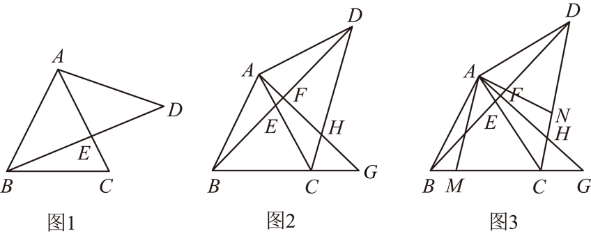

# Mathematics - 题目 343

**ID**: a62c91c454314bc99c987c8eb0fb8207
**年级**: Grade 8
**难度**: Medium-Hard
**题型**: Calculation

## 题目
在 $\vartriangle ABC$ 中， $AB=AC$ ，将线段 $AC$ 绕点A逆时针旋转一定角度至线段 $AD$ ，连接 $BD$ 交线段 $AC$ 于点 $E$ ．(1)如图1，若 $\angle CAD=α$ ，求 $\angle EBC$ 的角度；​​​​​​​‌(2)将线段 $AC$ 绕点A逆时针旋转 $90{}\degree $ 至线段 $AD$ ，过点A作 $AF\bot BD$ 于点F，交 $BC$ 延长线于点G，连接 $CD$ ，交 $AG$ 于点H；①如图2，若 $BC=2\sqrt {2}AF$ ，求证： $FH=GH$ ；②如图3，若 $\angle BAC=60{}\degree $ ， $AB=6$ ． $M{\rm ，\mathit{N}}$ 分别是线段 $BG$ ， $CD$ 上的动点，且满足 $HN=BM$ ，连接 $AM$ ， $AN$ ，当 $AM+AN$ 取得最小时，直接写出此时 $\vartriangle ABM$ 的面积．

## 解答

1. （1）解：由题意得， $AC=AD$ ，
2. $\because AB=AC$ ，
3. $\therefore AB=AD$ ，
4. $\therefore \angle ABD=\angle ADB$ ，
5. $\because AB=AC$ ，
6. $\therefore \angle ABC=\angle ACB$ ，
7. $\therefore \angle ACB=\angle ABD+\angle EBC=\angle ADB+\angle EBC.$
8. $\because \angle EAD+\angle ADB+\angle AED=180{}\degree $ ， $\angle EBC+\angle ACB+\angle BEC=180{}\degree $ ， $\angle AED=\angle BEC$ ，
9. $\therefore \angle EAD+\angle ADB=\angle EBC+\angle C$ ，
10. $\therefore α+\angle ADB=\angle EBC+\angle EBC+\angle ADB$ ，
11. $\therefore 2\angle EBC=α$ ，
12. $\therefore \angle EBC=\frac {1}{2}α$ ；
13. （2）①证明：过点C作 $CM\bot BD$ 于点M，如图，
14. 
15. 由题意得， $AD=AC$ ， $\angle CAD=90{}\degree $ ，
16. $\because AB=AC$ ，
17. $\therefore AB=AC=AD$ ，
18. 由（1）知： $\angle EBC=\frac {1}{2}\angle DAC=45{}\degree $ ，
19. $\because CM\bot BD$ ，
20. $\therefore BM=CM=\frac {\sqrt {2}}{2}BC$ ，
21. $\because BC=2\sqrt {2}AF$ ，
22. $\therefore BM=CM=2AF$ ，
23. $\because AF\bot BD$ ， $CM\bot BD$ ，
24. $\therefore CM\mathrm{/\mskip-4mu/}AF$ ，
25. $\therefore \mathrm{△}AEF\mathrm{∽}\mathrm{△}CEM$ ，
26. $\therefore \frac {AE}{EC}=\frac {FE}{EM}=\frac {AF}{CM}=\frac {1}{2}$ ，
27. 设 $AE=k$ ，则 $EC=2k$ ，
28. $\therefore AC=AE+EC=3k$ ，
29. $\therefore AD=AC=3k$ ，
30. $\because \angle CAD=90{}\degree $ ， $AF\bot BD$ ，
31. $\therefore \vartriangle AEF∽\vartriangle DAF$ ，
32. $\therefore \frac {EF}{AF}=\frac {AF}{DF}=\frac {AE}{AD}=\frac {1}{3}$ ，
33. 设 $EF=m$ ，则 $AF=3m$ ， $DF=9m$ ， $EM=2EF=2m$ ，
34. $\because AD=AB$ ， $AF\bot BD$ ，
35. $\therefore BF=DF=9m$ ，
36. $\therefore BM=BF-FM=6m$ ， $DM=DF+FM=12m$ ，
37. $\therefore CM=BM=6m$ ，
38. $\because CM\mathrm{/\mskip-4mu/}AG$ ，
39. $\therefore \vartriangle DFH∽\vartriangle DMC$ ，
40. $\therefore \frac {FH}{CM}=\frac {DF}{DM}=\frac {9m}{12m}=\frac {3}{4}$ ，
41. $\therefore FH=\frac {3}{4}CM=\frac {9}{2}m$ ，
42. $\because \angle DAC=45{}\degree $ ， $AF\bot BD$ ，
43. $\therefore FG=BF=9m$ ，
44. $\therefore GH=FH=\frac {1}{2}FG=\frac {9}{2}m$ ，
45. $\therefore FH=GH$ ；
46. ②解：当 $AM+AN$ 取得最小时，此时 $\vartriangle ABM$ 的面积为 $27\sqrt {2}-18\sqrt {3}$ ．
47. 过点A作 $AK\bot BC$ 于点K，如图，
48. 
49. $\because AB=AC$ ， $\angle BAC=60{}\degree $ ， $AB=6$ ，
50. $\therefore BK=KC=\frac {1}{2}BC=3$ ，
51. $\therefore AK=\sqrt {AC{^{2}}-KC{^{2}}}=3\sqrt {3}$ ，
52. 由题意： $\angle BAD=\angle BAC+\angle CAD=60{}\degree +90{}\degree =150{}\degree $ ，
53. $\because AB=AD$ ， $AF\bot BD$ ，
54. $\therefore \angle BAG=\angle DAG=\frac {1}{2}\angle BAD=75{}\degree $ ，
55. $\therefore \angle G=45{}\degree $ ，
56. $\therefore AK=KG=3\sqrt {3}$ ，
57. $\therefore AG=\sqrt {2}AK=3\sqrt {6}$ ，
58. $\because \angle CAH=\angle GAC$ ， $\angle ACD=\angle G=45{}\degree $ ，
59. $\therefore \vartriangle ACH∽\vartriangle AGC$ ，
60. $\therefore \frac {AH}{AC}=\frac {AC}{AG}$ ，
61. $\therefore \frac {AH}{6}=\frac {6}{3\sqrt {6}}$ ，
62. $\therefore AH=2\sqrt {6}$ ；
63. 作 $∠MBQ=60{}\degree $ ，使 $BQ=AH=2\sqrt {6}$ ，连接 $MQ$ ， $AQ$ ，如图，
64. 
65. $\because AB=AC$ ， $\angle BAC=60{}\degree $ ，
66. $\therefore \vartriangle ABC$ 为等边三角形，
67. $\therefore \angle ABC=\angle ACB=60{}\degree $ ；
68. 由题意： $\angle BAD=150{}\degree $ ，
69. $\because AB=AD$ ， $AF\bot BD$ ，
70. $\therefore \angle BAG=\angle DAG=\frac {1}{2}\angle BAD=75{}\degree $ ，
71. $\therefore \angle G=45{}\degree $ ，
72. $\because \angle ACD=45{}\degree $ ，
73. $\therefore \angle DCG=180{}\degree -\angle ACD-\angle ACB=75{}\degree $ ，
74. $\therefore \angle CHG=180{}\degree -\angle G-\angle DCG=60{}\degree $ ，
75. $\therefore \angle AHN=\angle CHG=60{}\degree $ ，
76. $\therefore \angle MBQ=\angle NHA$ ；
77. 在 $\vartriangle BMQ$ 和 $\vartriangle HNA$ 中，
78. $\begin{cases}BQ=AH\\\angle MBA=\angle HNA\\BM=HN\end{cases}$ ，
79. $\therefore \vartriangle BMQ≌\vartriangle HNA\left ({{\rm{S}}{\rm{A}}{\rm{S}}}\right )$ ，
80. $\therefore MQ=AN$ ，
81. $\therefore AM+AN=AM+QM$ ，
82. $\because AM+QM\geqslant AQ$ ，
83. $\therefore $ 当A，M，Q三点在一条直线上时， $AM+AN$ 取得最小值，最小值为线段 $AQ$ 的长度，如图，
84. 
85. 过点M作 $MP\bot AB$ 于点P，
86. $\because \angle MBQ=\angle ACB=60{}\degree $ ，
87. $\therefore BQ\mathrm{/\mskip-4mu/}AC$ ，
88. $\therefore \vartriangle BMQ∽\vartriangle CMA$ ，
89. $\therefore \frac {BM}{MC}=\frac {BQ}{AC}$ ，
90. $\therefore \frac {BM}{6-BM}=\frac {2\sqrt {6}}{6}$ ，
91. $\therefore BM=6\sqrt {6}-12$ ；
92. $\because \angle ABC=60{}\degree $ ，
93. $\therefore MP=BM\cdot {\rm{s}}{\rm{i}}{\rm{n}}60{}\degree =\frac {\sqrt {3}}{2}BM=9\sqrt {2}-6\sqrt {3}$ ，
94. $\therefore \vartriangle ABM$ 的面积 $=\frac {1}{2}\times AB\cdot MP=27\sqrt {2}-18\sqrt {3}$ ．

## 知识点

**中文**:
  - 旋转的性质
  - 相似三角形的判定与性质综合
  - 解直角三角形

**English**:
  - Properties of Rotation
  - Determination and Properties
  - Solving Right Triangles

---
