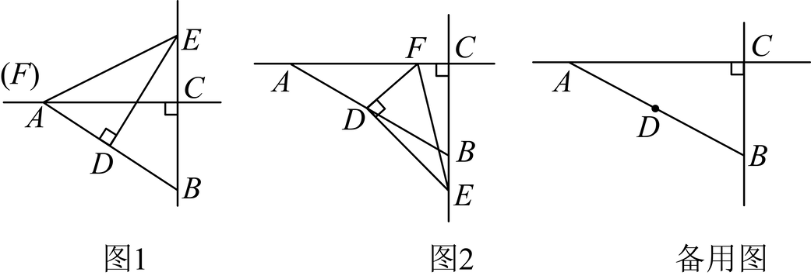

# Mathematics - 题目 1047

**ID**: a9d46425c1084ce4afba9239b7e77650
**年级**: Grade 8
**难度**: Medium-Hard
**题型**: Calculation

## 题目
如图， ${\rm{R}}{\rm{t}}\mathrm{△}ABC$ 中， $\angle ACB\mathrm{=}90{}\degree {\rm ，\mathit{D}}$ 为 $AB$ 中点，点E在直线 $BC$ 上（点E不与点B，C重合），连接 $DE$ ，过点D作 $DF\bot DE$ 交直线 $AC$ 于点F，连接 $EF$ ．（1）如图1，当点F与点A重合时，请直接写出线段 $EF$ 与 $BE$ 的数量关系：．（2）如图2，当点F不与点A重合时，请写出线段 $AF$ ， $EF$ ， $BE$ 之间的数量关系，并说明理由；​​​​​​​‌（3）若 $AC=5$ ， $BC=3$ ， $EC=1$ ，请直接写出线段AF的长．

## 解答

1. （1）解：结论： $EF=BE$ ．
2. 理由：如图1中，
3. $\because AD=DB$ ， $DE⊥AB$ ，
4. $\therefore DE$ 垂直平分 $AB$ ，
5. $\therefore EF=EB$ ．
6. （2）结论： $AF{^{2}}+BE{^{2}}=EF{^{2}}$ ．
7. 理由：如图2中，过点 $A$ 作 $AJ\bot AC$ 交 $ED$ 的延长线于 $J$ ，连接 $FJ$ ．
8. $\because AJ\bot AC$ ， $EC\bot AC$ ，
9. $\therefore AJ{\rm{/\mskip-4mu/}}BE$ ，
10. $\therefore \angle AJD=\angle DEB$ ，
11. 在 $\vartriangle AJD$ 和 $\vartriangle BED$ 中，
12. $\begin{cases}\angle AJD=\angle DEB\\\angle ADJ=\angle BDE\\AD=BD\end{cases}$ ，
13. $\therefore \vartriangle AJD≌\vartriangle BED({\rm{A}}{\rm{A}}{\rm{S}})$ ，
14. $\therefore AJ=BE$ ， $DJ=DE$ ，
15. $\because DF\bot EJ$ ，
16. $\therefore FJ=EF$ ，
17. $\because \angle FAJ=90{}\degree $ ，
18. $\therefore AF{^{2}}+AJ{^{2}}=FJ{^{2}}$ ，
19. $\therefore AF{^{2}}+BE{^{2}}=EF{^{2}}$ ．
20. （3）如图 $3-1$ 中，当点 $E$ 在线段 $BC$ 上时，设 $AF=x$ ，则 $CF=5-x$ ．
21. $\because BC=3$ ， $CE=1$ ，
22. $\therefore BE=2$ ，
23. $\because EF{^{2}}=AF{^{2}}+BE{^{2}}=CF{^{2}}+CE{^{2}}$ ，
24. $\therefore x{^{2}}+2{^{2}}=(5-x){^{2}}+1{^{2}}$ ，
25. $\therefore x=\frac {11}{5}$ ，
26. $\therefore AF=\frac {11}{5}$ ．
27. 如图 $3-2$ 中，当点 $E$ 在线段 $BC$ 的延长线上时，设 $AF=x$ ，则 $CF=5-x$ ．
28. $\because BC=3$ ， $CE=1$ ，
29. $\therefore BE=4$ ，
30. $\because EF{^{2}}=AF{^{2}}+BE{^{2}}=CF{^{2}}+CE{^{2}}$ ，
31. $\therefore x{^{2}}+4{^{2}}=(5-x){^{2}}+1{^{2}}$ ，
32. $\therefore x=1$ ，
33. $\therefore AF=1$ ，
34. 综上所述，满足条件的 $AF$ 的长为 $\frac {11}{5}$ 或1．

## 知识点

**中文**:
  - 三角形的综合
  - 勾股定理
  - 全等三角形的判定与性质
  - 线段垂直平分线的性质

**English**:
  - Comprehensive Triangle Problems
  - Pythagorean Theorem
  - Determination and Properties
  - Properties of Perpendicular Bisectors

---
