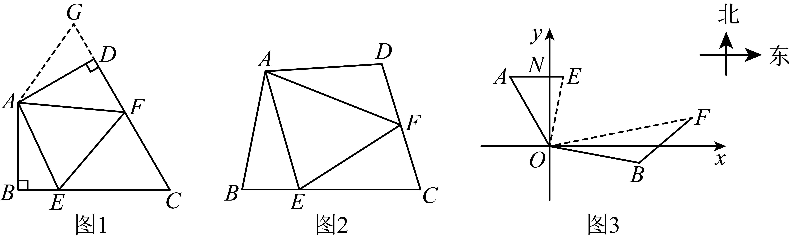

# Mathematics - 题目 2954

**ID**: abf9a0b8346549c197c2047292972831
**年级**: Grade 8
**难度**: Medium-Hard
**题型**: Calculation

## 题目
【问题背景】如图1，在四边形 $ABCD$ 中， $AB=AD$ ， $\angle B=\angle ADC=90{}\degree $ ，点 $E,F$ 分别是 $BC,CD$ 上的点，且 $EF=BE+DF$ ，试探究 $\angle EAF,\angle BAD$ 之间的数量关系．【初步探索】（1）小亮同学认为延长 $FD$ 到点 $G$ ，使 $DG=BE$ ，连接 $AG$ ，先说明 $\mathrm{△}ABE≌\mathrm{△}ADG$ ，再说明 $\vartriangle AEF≌\vartriangle AGF$ ，则可得到 $∠EAF$ ， $∠BAD$ 之间的数量关系是．【探索延伸】（2）如图2，在四边形 $ABCD$ 中， $AB=AD,\angle B+\angle D=180{}\degree $ ，点 $E,F$ 分别是 $BC,CD$ 上的点，若 $EF=BE+DF$ ，那么上述结论是否仍然成立？请说明理由．【结论运用】（3）如图3，在某次军事演习中，舰艇甲在指挥中心（ $O$ 处）北偏西 $30{}\degree $ 的 $A$ 处，舰艇乙在指挥中心南偏东 $70{}\degree $ 的 $B$ 处，并且两舰艇到指挥中心的距离相等，接到行动指令后，舰艇甲向正东方向以 $60$ 海里/时的速度前进，舰艇乙沿北偏东 $50{}\degree $ 方向以 $80$ 海里/时的速度前进， $1$ 小时后，指挥中心观测到甲、乙两舰艇分别到达 $E,F$ 处，且两舰艇之间的距离 $EF=140$ 海里，求此时 $\angle EOF$ 的度数．​​​​​​​‌

## 解答

1. 解：（1） $\angle BAD=2\angle EAF$ ，理由如下，
2. 如图所示，延长 $CD$ 到点 $G$ ，使得 $DG=BE$ ，
3. 
4. ∵ $\angle ADC=90{}\degree $ ，
5. ∴ $\angle ADG=90{}\degree =\angle B$ ，
6. 在 $\vartriangle ABE,\vartriangle ADG$ 中，
7. $\begin{cases}AB=AD\\\angle B=\angle ADG\\BE=DG\end{cases}$ ，
8. ∴ $\vartriangle ABE≌\vartriangle ADG\left ({SAS}\right )$ ，
9. ∴ $\angle BAE=\angle DAG$ ， $AE=AG$ ，
10. ∵ $EF=BE+DF$ ， $FG=DF+DF$ ，
11. ∴ $EF=GF$ ，
12. 在 $\vartriangle AEF,\vartriangle AGF$ 中，
13. $\begin{cases}AE=AG\\AF=AF\\EF=GF\end{cases}$ ，
14. ∴ $\vartriangle AEF≌\vartriangle AGF\left ({SSS}\right )$ ，
15. ∴ $\angle EAF=\angle GAF$ ，
16. ∵ $\angle GAF=\angle GAD+\angle DAF=\angle BAE+\angle DAF$ ， $\angle BAD=\angle BAE+\angle DAF+\angle EAF$ ，
17. ∴ $\angle BAD=2\angle EAF$ ；
18. （2）成立，理由如下，
19. 如图所示，延长延长 $CD$ 到点 $H$ ，使得 $DH=BE$ ，
20. 
21. ∵ $\angle ADC+\angle ADH=180{}\degree ,\angle B+\angle ADC=180{}\degree $ ，
22. ∴ $\angle B=\angle ADH$ ，
23. 在 $\vartriangle ABE,\vartriangle ADH$ 中，
24. $\begin{cases}AB=AD\\\angle B=\angle ADH\\BE=DH\end{cases}$ ，
25. ∴ $\vartriangle ABE≌\vartriangle ADH\left ({SAS}\right )$ ，
26. ∴ $AE=AH,\angle BAE=\angle DAH$ ，
27. ∴ $FH=DF+DH=BE+DF$ ，
28. ∵ $EF=BE+DF$ ，
29. ∴ $FH=FE$ ，
30. 在 $\vartriangle AEF,\vartriangle AHF$ 中，
31. $\begin{cases}AE=AH\\AF=AF\\FE=FH\end{cases}$ ，
32. ∴ $\vartriangle AEF≌\vartriangle AHF\left ({SSS}\right )$ ，
33. ∴ $\angle EAF=\angle HAF=\angle HAD+\angle DAF=\angle BAE+\angle DAF$ ，
34. ∴ $\angle BAD=2\angle EAF$ ；
35. （3）如图所示，过点 $B$ 作 $BQ\bot x$ 轴于点 $Q$ ，延长 $FB$ 到点 $M$ ，使得 $BM=AE$ ，连接 $EF$ ，
36. 
37. ∵舰艇甲在指挥中心（ $O$ 处）北偏西 $30{}\degree $ 的 $A$ 处，接到行动指令后，舰艇甲向正东方向以 $60$ 海里/时的速度前进，舰艇乙在指挥中心南偏东 $70{}\degree $ 的 $B$ 处，
38. ∴ $\angle AON=30{}\degree ,\angle POB=70{}\degree $ ， $AN\parallel x$ 轴，则 $\angle BOQ=90{}\degree -\angle POB=20{}\degree $ ，
39. ∴ $\angle ANO=90{}\degree $ ，则 $\angle A=60{}\degree $ ，
40. ∵舰艇乙沿北偏东 $50{}\degree $ 方向以 $80$ 海里/时的速度前进，
41. ∴ $\angle QBF=50{}\degree $ ， $BF=80\times 1=80$ （海里）， $AE=60\times 1=60$ （海里），
42. ∵ $BQ\bot x$ 轴，
43. ∴ $OP\parallel BQ$ ，则 $\angle POB=\angle OBQ=70{}\degree $ ，
44. ∴ $\angle OBF=\angle BOQ+\angle QBF=70{}\degree +50{}\degree =120{}\degree $ ，
45. ∴ $\angle OBM=180{}\degree -\angle OBF=60{}\degree =\angle A$ ，
46. 在 $\vartriangle AOE,\vartriangle BOM$ 中，
47. $\begin{cases}AO=BO\\\angle AOE=\angle BOM\\AE=BM\end{cases}$ ，
48. ∴ $\vartriangle AOE≌\vartriangle BOM\left ({SAS}\right )$ ，
49. ∴ $\angle AOE=\angle BOM$  $AE=BM=60$ （海里），
50. ∴ $MF=60+80=140{}\degree =EF$ ，
51. 在 $\vartriangle OEF,\vartriangle OMF$ 中，
52. $\begin{cases}OE=OM\\OF=OF\\EF=MF\end{cases}$ ，
53. ∴ $\vartriangle OEF≌\vartriangle OMF\left ({SSS}\right )$ ，
54. ∴ $\angle EOF=\angle MOF=\angle BOM+\angle BOF=\angle AOE+\angle BOF$ ，
55. ∴ $\angle AOB=\angle AOE+\angle BOF+\angle EOF=2\angle EOF$ ，
56. ∵ $\angle AOB=\angle AON+\angle NOQ+\angle BOQ=30{}\degree +90{}\degree +20{}\degree =140{}\degree $ ，
57. ∴ $\angle EOF=70{}\degree $ ．

## 知识点

**中文**:
  - 全等三角形的综合问题

**English**:
  - Comprehensive Problems

---
