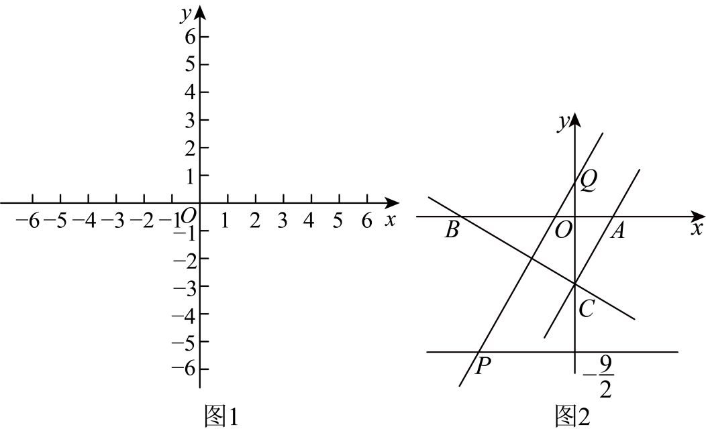

# Mathematics - 题目 778

**ID**: b4b614ca32c74bc591a1d385dd46be8f
**年级**: Grade 8
**难度**: Medium-Hard
**题型**: Calculation

## 题目
在平面直角坐标系 $xOy$ 中，直线 $y=-\frac {1}{2}x-\frac {5}{2}$ 与x轴，y轴分别交于点B，C，直线 $y=k\left ({x-1}\right )$ 过定点A．（1）直接写出点A，B，C的坐标．（2）若 $k=\frac {1}{4}$ ，先在图1中画出 $y=k\left ({x-1}\right )$  和  $y=\left |{x-2}\right |$ 的函数图象，再求 $k\left ({x-1}\right )<\left |{x-2}\right |$ 的解集．（3）如图 2 ，设点P在直线  $y=-\frac {9}{2}$  上，过点P作直线  $PQ\mathrm{/\mskip-4mu/}AC$  ，交y轴于正半轴点Q， 若  $BC$ 平分线段  $PQ$  ，求点P的坐标．​​​​​​​‌

## 解答

1. （1）解：∵直线 $y=-\frac {1}{2}x-\frac {5}{2}$ 与x轴，y轴分别交于点B，C，
2. ∴当 $x=0$ 时， $y=-\frac {5}{2}$ ，
3. 当 $y=-\frac {1}{2}x-\frac {5}{2}=0$ 时，解得： $x=-5$ ，
4. ∴ $B\left ({-5,0}\right )$ ， $C\left ({0,-\frac {5}{2}}\right )$ ；
5. ∵直线 $y=k\left ({x-1}\right )$ 过定点A．
6. ∴ $x-1=0$ ，解得： $x=1$ ，
7. ∴ $A\left ({1,0}\right )$ ；
8. （2）解： $y=\frac {1}{4}\left ({x-1}\right )$  和  $y=\left |{x-2}\right |$ 的函数图象如图所示，
9. 
10. 当 $\frac {1}{4}\left ({x-1}\right )=\left |{x-2}\right |$ 时，
11. ∴ $\frac {1}{4}\left ({x-1}\right )=x-2$ 或 $\frac {1}{4}\left ({x-1}\right )=2-x$ ，
12. 解得： $x=\frac {7}{3}$ 或 $x=\frac {9}{5}$ ，
13. ∴ $x{{}_{T}}=\frac {9}{5}$ ， $x{{}_{Q}}=\frac {7}{3}$ ；
14. 结合图象可得 $k\left ({x-1}\right )<\left |{x-2}\right |$ 的解集为： $x<\frac {9}{5}$ 或 $x>\frac {7}{3}$ ；
15. （3）解：如图，记 $PQ$ 与 $BC$ 的交点为 $T$ ，
16. 
17. ∵ $C\left ({0,-\frac {5}{2}}\right )$ ， $A\left ({1,0}\right )$ ，直线 $AC$ 为 $y=k\left ({x-1}\right )$ ，
18. ∴ $-k=-\frac {5}{2}$ ，解得： $k=\frac {5}{2}$ ，
19. ∴直线 $AC$ 为 $y=\frac {5}{2}\left ({x-1}\right )$ ，
20. ∵ $PQ\mathrm{/\mskip-4mu/}AC$ ，
21. ∴设 $PQ$ 为 $y=\frac {5}{2}x+n$ ；
22. 当 $x=0$ 时， $y=n$ ，即 $Q\left ({0,n}\right )$ ，
23. 联立： $\begin{cases}y=-\frac {9}{2}\\y=\frac {5}{2}x+n\end{cases}$ ，
24. 解得： $\begin{cases}x=-\frac {2}{5}n-\frac {9}{5}\\y=-\frac {9}{2}\end{cases}$ ，
25. ∴ $P\left ({-\frac {2}{5}n-\frac {9}{5},-\frac {9}{2}}\right )$ ，
26. ∵ $BC$ 平分线段  $PQ$  ，
27. ∴ $TP=TQ$ ，
28. ∴ $T\left ({-\frac {1}{5}n-\frac {9}{10},\frac {1}{2}n-\frac {9}{4}}\right )$ ，
29. ∴ $-\frac {1}{2}\left ({-\frac {1}{5}n-\frac {9}{10}}\right )-\frac {5}{2}=\frac {1}{2}n-\frac {9}{4}$ ，
30. 解得： $n=\frac {1}{2}$ ，
31. ∴ $P\left ({-2,-\frac {9}{2}}\right )$ .

## 知识点

**中文**:
  - 一次函数与一元一次不等式
  - 一次函数的图象和性质
  - 一次函数与二元一次方程（组）

**English**:
  - Linear Functions and Linear Inequalities
  - Graphs and Properties of Linear Functions
  - Linear Functions and Systems of Linear Equations

---
